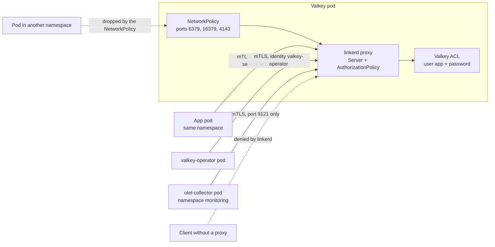
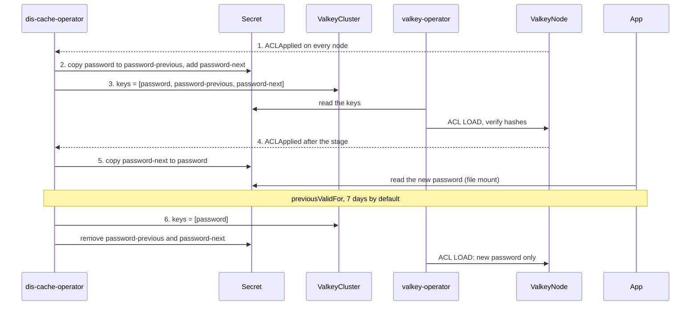
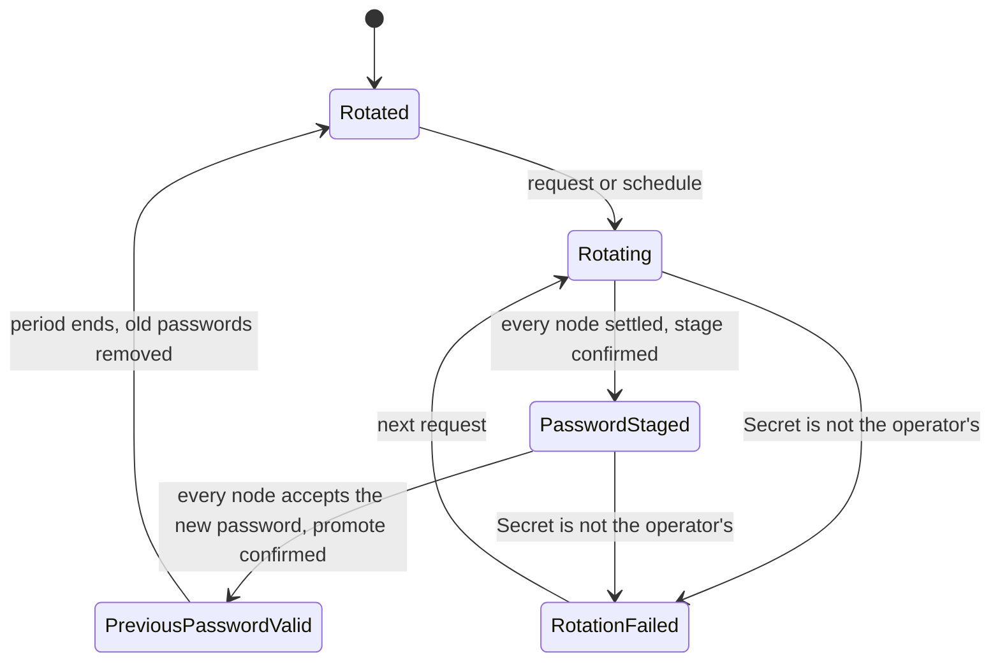
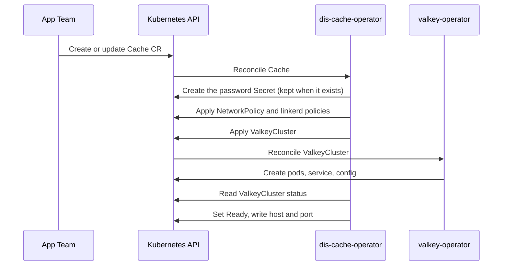

- Feature Name: self_service_cache
- Title: Self-service cache
- Start Date: 2026-08-28
- RFC PR: [altinn/altinn-platform#3952](https://github.com/Altinn/altinn-platform/pull/3952)
- Github Issue: [altinn/altinn-platform#3944](https://github.com/Altinn/altinn-platform/issues/3944)
- Product/Category: Container Runtime
- State: **REVIEW** (possible states are: **REVIEW**, **ACCEPTED** and **REJECTED**)

# Summary
[summary]: #summary

This RFC adds a new operator, `dis-cache-operator`. The operator gives app teams a self-service cache.

A team creates a `Cache` custom resource (CR) in its namespace. The operator creates a Valkey instance in the cluster. Valkey is the default engine, and the only engine for now.

The operator does not run Valkey itself. It creates resources for the official [valkey-operator](https://github.com/valkey-io/valkey-operator), which runs Valkey. `dis-pgsql-operator` and `dis-vault-operator` use the same pattern with Azure Service Operator (ASO).

This RFC replaces an earlier draft that used Azure Managed Redis (see [#3472](https://github.com/Altinn/altinn-platform/pull/3472)). That option is now under Future possibilities.

# Motivation
[motivation]: #motivation

Caching is a common need for DIS applications. The platform has no self-service option for it. Teams build their own setups. The results differ in quality and safety, and the platform team becomes a bottleneck.

We want the same model as for databases and key vaults:

- The team declares what it needs in a CR.
- The operator applies safe platform defaults.
- The team reads readiness and connection values from the resource status.

We start with Valkey in the cluster, not with a managed cloud cache:

- It is much simpler. There are no private endpoints and no private DNS zones to manage.
- It costs less. A cache uses cluster capacity that we already pay for.
- Valkey is open source and protocol-compatible with Redis.

# Guide-level explanation
[guide-level-explanation]: #guide-level-explanation

A team that needs a cache creates a `Cache` resource in its namespace:

```yaml
apiVersion: cache.dis.altinn.cloud/v1alpha1
kind: Cache
metadata:
  name: my-app-cache
spec:
  size: small
  persistence: false
  evictionPolicy: noeviction
```

The operator then:

1. Creates a `ValkeyCluster` in the team namespace, plus a NetworkPolicy, the linkerd access policies, and a password Secret.
2. The valkey-operator creates the Valkey pods, the service, and the related objects.
3. Waits until the Valkey instance is ready.
4. Writes `host`, `port`, and the `Ready` condition to `status`.

The application connects to `host:port` inside the cluster and sends a password. The service mesh encrypts the traffic. The password is in a Secret in the team namespace. Only pods in the same namespace can reach the cache (see Access control).

**Read the password from the Secret mount, not from an environment variable.** A rotation adds a new password. The old one stays valid for a grace period, 7 days by default. An application that reads the Secret as a file picks up the new value and reconnects with it. An application that copied the password into an environment variable at start keeps its open connection. It reconnects with the old value and fails when the grace period ends, days after the rotation. It needs a restart before then.

**Rotation is automatic.** The operator rotates the password every 90 days. The team makes no change for it. `spec.passwordRotation.intervalDays` sets another interval, and 0 turns the schedule off. The schedule is safe only for an application that reads the password as described above. Two fields are for the exception, a password that may have leaked. `requestedAt` asks for one rotation now. `previousValidFor: 0s` drops the old password at once.

```yaml
spec:
  size: small
  passwordRotation:
    intervalDays: 90
```

# Reference-level explanation
[reference-level-explanation]: #reference-level-explanation

## CRD contract

### Spec (v1alpha1)

- `size` (optional): `small | medium | large`. Default `small`. The platform maps each size to CPU, memory, and replica values.
- `persistence` (optional `bool`): default `false`. A cache does not keep data by default.
- `evictionPolicy` (optional): a Valkey `maxmemory-policy` value: `noeviction | allkeys-lru | allkeys-lfu | allkeys-random | volatile-lru | volatile-lfu | volatile-random | volatile-ttl`. Default `noeviction`.
- `passwordRotation` (optional), see Password rotation and Rotation triggers:
  - `intervalDays`: rotates on a schedule. 0 to 365. Default 90. 0 turns the schedule off.
  - `requestedAt`: asks for one rotation now.
  - `previousValidFor`: how long the old password stays valid after a rotation. 0 to 168h. Default 7 days, from an operator flag. At most half of the interval.

The spec starts small on purpose. We can add fields later. We cannot remove fields later without breaking teams.

The spec has no identity references. Valkey does not use Entra ID for data access (see Access control).

### Status (v1alpha1)

- `conditions[]`: `Ready`, plus more condition types when the implementation adds them. The reasons of `Ready` are `Provisioning`, `ValkeyReady`, `ValkeyDegraded`, `ValkeyFailed`, `UpstreamSpecMismatch`, `SecretCreateFailed`, and `ApplyFailed`.
- `host`: the in-cluster DNS name of the Valkey service, `valkey-<name>.<namespace>.svc.cluster.local`. Set only while `Ready` is true. It stays when an operator step fails, because the Valkey instance is untouched then.
- `port`: the Valkey port, 6379. Same rule as `host`.
- `observedGeneration`: the last generation the operator reconciled.

## The official valkey-operator

Facts at the time of writing (2026-08-28):

- Repository `github.com/valkey-io/valkey-operator`, part of the Valkey project. Latest release v0.5.0, API `valkey.io/v1alpha1`, resource types `ValkeyCluster` and `ValkeyNode`. The project says it is not ready for production.
- `users[]` defines access control list (ACL) users with password Secrets. The operator hashes the password and reloads the ACL on the running nodes without a pod restart. A user can have more than one valid password. It re-reads the Secret on every reconcile, every 30 seconds.
- The API has no field for pod annotations. Mesh injection must come from the namespace.

We choose it although it is alpha:

- It is the official operator, and it improves quickly.
- Our own `Cache` CRD protects the teams. When the upstream API changes, we update `dis-cache-operator`, and the `Cache` resources do not change.
- The platform pins the upstream version and updates it on its own schedule.

The upstream operator runs in the platform-system layer on each cluster. Teams never create `ValkeyCluster` resources directly. Only the `Cache` CRD is part of the tenant contract.

**Installation.** The platform installs the Helm chart (`oci://ghcr.io/valkey-io/valkey-helm`, version 0.5.0) through the `valkey-operator` package in gitops-manifests, promoted ring by ring. A flag per cluster in the cluster configuration, `enable_valkey_operator`, creates the Flux configuration.

## Access control

Valkey does not use Entra ID. Workload identity does not help either: Valkey cannot check an Azure token. The operator uses three layers from the cluster instead: the network, the mesh identity, and a password.



### Network policy

The operator creates a Kubernetes NetworkPolicy on the Valkey pods. It works on IP and port, and it applies to every pod. In DIS, the namespace is the team boundary. The policy allows only:

- Pods in the same namespace, port 6379.
- The Valkey pods themselves, 6379 and 16379, for replication.
- The valkey-operator pods, 6379.
- The `monitoring` namespace, the proxy port only, for the metrics scrape.

Each rule also allows port 4143, the linkerd proxy inbound port. Traffic between two meshed pods arrives on that port, not on the application port. Without it, every mesh connection is dropped before linkerd can check the identity.

### Linkerd policies

The DIS clusters run linkerd with the default inbound policy `deny`. A meshed pod rejects all traffic until a `Server` and an `AuthorizationPolicy` allow it. This layer works on identity, not on IP. The operator creates:

- Two `Server`s on the Valkey pods, for 6379 and 16379, both `opaque` so the proxy does not detect a protocol.
- One `MeshTLSAuthentication`: every service account in the namespace, plus the valkey-operator identity `valkey-operator.valkey-operator-system`.
- One `AuthorizationPolicy` per `Server`.
- A third `Server` for the metrics exporter port 9121, as `HTTP/1`, with its own `MeshTLSAuthentication` and `AuthorizationPolicy`. The only identity is the OpenTelemetry collector of the cluster (see Metrics).

The Valkey health probes are `exec` probes: they never cross the proxy and need no rule. The exporter probes are HTTP requests from the kubelet. Linkerd authorizes them on its own for an `HTTP/1` Server without an `HTTPRoute`.

Do not add an IP-range (CIDR) `NetworkAuthentication` to the cache Servers: it lets plaintext clients back in (see Rationale and alternatives).

### Mesh identity and encryption

The Valkey pods and the app pods run in the mesh. Linkerd encrypts the traffic between them and checks the identity of both sides. The operator creates no TLS certificates for Valkey (see Rationale and alternatives for the cert-manager option). Three facts drive this design:

- Injection comes from the namespace annotation `linkerd.io/inject: enabled`, because the upstream API has no pod-annotation field. The whole team namespace is meshed. Team namespaces get this annotation from their syncroots.

- The valkey-operator pod runs in the mesh too, because it connects to the Valkey pods to load the ACL. The gitops-manifests package injects the proxy and adds a `Server` and an `AuthorizationPolicy` for the pod, in the shape the platform uses. The metrics port is allowed for the pod network where the Azure Monitor scraper runs. The health port and the proxy admin port are allowed for the kubelet, through the virtual network (VNET) ranges. Only the API server port 443 stays outside the proxy, because the API server is outside the cluster. The platform rule: skip a port only when the other side is outside the cluster; otherwise write a scoped policy.

- The post-upgrade job of linkerd restarts every meshed workload, so that every pod gets the new proxy at once. We do not exclude the Valkey pods: a skipped pod keeps an old proxy until something else restarts it. A cache must tolerate this restart like a node upgrade. A cache without persistence starts empty; a cache with persistence keeps its data on the volume.

### Password and ACL

The operator generates a random password with `crypto/rand` and stores it in a Secret in the team namespace, with the keys `username` and `password`. It configures a Valkey ACL user `app` with this password through the upstream `users[].passwordSecret` field. The `app` user gets `+@all -@admin -@dangerous` on all keys and channels: no `FLUSHALL`, `CONFIG`, `SHUTDOWN`, or `ACL` commands. The app reads the Secret.

**The built-in `default` user is locked.** Valkey always has a `default` user. The valkey-operator sets `protected-mode no` and never disables it. Without action, any pod in the namespace can connect with no password and full access, and the `app` user changes nothing. The operator therefore adds `default` to `users[]` with `resetpass` (no password can ever match) and `-@all` (no permissions). It does not use `enabled: false`. That field is an `omitempty` bool with a CRD default of `true`, so a `false` sent from Go is dropped and becomes `true`.

### Password rotation

A rotation has no downtime, because a Valkey user can have several valid passwords, and an application reads the key `password` only. At every moment that key holds a password Valkey accepts, and the set of passwords Valkey accepts changes only at the first and the last step. This order keeps it so:

1. The operator waits until every `ValkeyNode` reports the condition `ACLApplied`. A node that still loads an earlier change must settle first, so a later transition belongs to this rotation.

2. The operator copies `password` to `password-previous` and writes the new password under `password-next`. The API server copies the value; the operator never reads it. The key `password` does not change.

3. The operator lists the three keys on the `ValkeyCluster`. The valkey-operator loads the old and the new password into the ACL of every node.

4. The operator waits until the `ValkeyCluster` shows that the valkey-operator processed the new key list, and until every `ValkeyNode` reports `ACLApplied` with a transition at or after the stage. The valkey-operator sets that condition only after it reloaded the ACL file on the node and verified the password hashes. A node that reports the condition without a transition gives no proof. After 5 minutes the operator writes a fresh password under `password-next` and moves the stage time, so a working node reports a new transition. While it waits, the key `password` does not change.

5. The operator copies `password-next` to `password`. Both passwords are valid already, so a pod that starts now reads a password Valkey accepts. The apps read the new value (see the guide-level explanation for file mounts and environment variables).

6. After the period, the operator lists `password` only, and removes the two extra keys from the Secret after. In the other order the valkey-operator fails with "missing password key" and does not update the ACL.



**Safety.** Each Secret patch first tests the Cache label and a rotation step annotation, on a metadata-only object, so no Secret data comes back. The steps on the Secret are `idle`, `staged` and `replaced`. The status follows each patch, so the `ValkeyCluster` lists a key only after the key exists. The condition reason records the confirmed step. A failed step resumes at the same step on the next reconcile, also after a restart. When every guarded patch is rejected, the Secret is not the operator's: the condition reports `RotationFailed`, and a later request starts over. Annotations with the stage time and the rotation time give the valkey-operator an event at each step, so it loads the keys at once. A Secret deleted during a rotation comes back with one password; the operator then ends the rotation. While the operator waits for a node, the condition message names the node.



### Rotation triggers

The schedule is the normal mode. A request is for a password that may have leaked, and for tests. The condition `PasswordRotated` reports the state and every step, with reasons only and never values.

- `spec.passwordRotation.requestedAt` asks for one rotation. A value later than `status.passwordRotation.requestedAt` starts it; the value itself is only a marker. A request made during a period runs when the period ends.

- `spec.passwordRotation.intervalDays` rotates on a schedule, counted from `status.passwordRotation.lastRotatedAt`. The default is 90 days. 0 turns the schedule off. A Cache from before the default keeps its stored 0 until its manifest sets the field. An application must read the password from the mounted Secret file. An application that reads it one time at start needs a restart before the grace period ends.

- `spec.passwordRotation.previousValidFor` sets how long the previous password stays valid, from 0 (a password that may have leaked) to 7 days. An operator flag sets the default of 7 days.

A removed password does not end an open connection, so an environment-variable application fails only at its next reconnect, long after the rotation. A true revoke removes and re-creates the Valkey user, with a short outage. It is not part of v1.

### Permissions

Rotation is the only reason the operator needs `patch` on Secrets. `patch` on all Secrets in team namespaces is a wider right than `create`. It could overwrite the system password Secret of the valkey-operator or a TLS Secret. A `ValidatingAdmissionPolicy` will limit the patches: in-tree Common Expression Language (CEL), no webhook, bound to the service account of the operator. It allows patches only on Secrets with a name that ends in `-cache-auth` and the label of the operator. It forbids a change of type or labels. It is the first change after the alpha.

## Secrets in the team namespace

Three Secrets with credentials sit in the team namespace next to a cache:

- `<cache>-cache-auth`: the `app` password, written by dis-cache-operator.
- `internal-<name>-system-passwords`: the own users of the valkey-operator. `_replication` can dump all data (`PSYNC`) and write everything, and it is also on the `valkey-server` command line. `_operator` and `_exporter` are the other two.
- `internal-<name>-acl`: the ACL file with SHA-256 hashes of all passwords.

Every workload of the team can read all three. Kubernetes RBAC limits who reads a Secret through the API. A pod can still mount every Secret of its namespace. No admission policy on the clusters blocks that, because Kyverno runs in audit mode. At rest, etcd encrypts the Secrets with keys that Azure manages, not with a key of the team.

We accept this for v1. Every password is per cache, so the damage stays inside the cache of the team. The `_replication` command-line exposure is an upstream issue to file.

## Operator permissions and safety

**Secrets.** The operator has no `get`, `list`, or `watch` on Secrets, and its client cache excludes them. It never reads a password back. On every reconcile it generates a password and tries to create the Secret; when the Secret exists, the create fails and the stored password stays. A compromised operator can overwrite Secrets but not read them. When a Secret is deleted, the valkey-operator sets the `ValkeyCluster` to `Failed`, the operator reconciles, and creates the Secret with a new password.

**Drift guard.** The upstream CRD upgrades with `CreateReplace`. If a chart bump renames `spec.users`, the API server prunes the field and the `default` user is open again. The operator compares `spec.users` in the apply response and sets `Ready=False` with reason `UpstreamSpecMismatch` on a mismatch. The Helm chart and the Go module bump together in one PR.

**Permissions.** On `Cache`: `get`, `list`, `watch`. On its status: `patch`. On its finalizers: `update`, for clusters that run the owner-reference admission plugin. On the owned objects: `list` and `watch` for the informers, `create` and `patch` for server-side apply. On `ValkeyNode`: `list` and `watch`, for the `ACLApplied` condition. On Secrets: `create` and `patch`. No `update` or `delete` anywhere; owner references delete.

## Pod and data hardening

- The valkey-operator starts `valkey-server` directly and skips the image entrypoint, so the pods would run as root. The operator sets a pod security context: non-root, user and group ID and `fsGroup` 999, seccomp `RuntimeDefault`. The `server` and `metrics-exporter` containers get no privilege escalation, a read-only root filesystem, and all capabilities dropped.

- The upstream default images pull from Docker Hub. The operator sets both images to the Azure Container Registry (ACR) pull-through path, from the environment variables `DISCACHE_VALKEY_IMAGE` and `DISCACHE_EXPORTER_IMAGE`. An empty value keeps the upstream image. The gitops-manifests package sets the values with Flux substitution, each with a Renovate comment, and a new version goes through the ring promotion.

- With `persistence: false`, Valkey would still write snapshots to the node disk, because upstream sets no `save`. The operator sets `save ""` and `appendonly no`.

- The metrics exporter sidecar is the upstream default, `oliver006/redis_exporter`. The typed struct cannot turn it off, the same `omitempty` problem; the unstructured apply could set `enabled: false`. We keep it on for now, pulled through the ACR, with the same hardening.

- Persistent volumes use platform-managed keys, like every disk on the clusters.

## Metrics

Every Valkey pod carries the metrics exporter on port 9121. The OpenTelemetry collector of the cluster scrapes it, not the Azure Monitor managed Prometheus addon. Both write to the same Azure Monitor workspace of the cluster; the choice is about identity. The collector is meshed, so it scrapes with the identity of its service account, `otel-collector.monitoring`. The exporter port accepts that identity and nothing else. The addon has no proxy, and to trust it means to trust a pod CIDR.

The collector has two scrape jobs in the gitops-manifests package `otel-collector`:

- `pods` is the opt-in of the platform for every workload: a pod with the label `dis.otel/scrape: "true"` and a container port named `metrics`.

- `caches` selects the Valkey pods by the label `valkey.io/cluster`. The valkey-operator sets the pod labels itself and passes none through from the `ValkeyCluster`, so a Cache cannot opt in.

Both jobs add the labels `namespace` and `pod`; `caches` adds `cache`.

The operator learns the collector from the flags `--scraper-namespace` and `--scraper-service-account`, defaults `monitoring` and `otel-collector`. The gitops package sets them like the images when a cluster differs. The operator validates both as Kubernetes names at start, because a value such as `*` would be a linkerd identity wildcard.

Teams see the metrics in the Grafana dashboard "Caches" in the DIS Core folder. It has one data source per cluster and filters for namespace and cache. The hit ratio is summed per cache before the division: reads go to the primary, so a replica without reads would otherwise show no value.

## One cache per application

Each `Cache` becomes its own small `ValkeyCluster`: one shard, and replicas for failover. We do not share one big Valkey cluster between teams:

- Valkey sets memory limits and the eviction policy per instance, not per user. Teams with different needs cannot share one instance.
- A cache per namespace keeps the team boundary. The NetworkPolicy closes it, and a leaked password only exposes one cache.
- Teams create, resize, and delete their caches without risk to other teams.
- A small Valkey instance is cheap. The isolation is worth the extra pods.

Valkey cluster mode with many shards stays a scale-up option for the large workload of one team (see Future possibilities). It is not a way to share hardware between teams.

## Reconciliation flow



The Secret and the policies come first, so the Valkey pods find the password and the access rules on their first start. The operator writes `host` and `port` only when `Ready` is true.

## Deletion

Every object the operator creates has an owner reference to the `Cache`: the Secret, the NetworkPolicy, the linkerd policies, and the `ValkeyCluster`. When the team deletes the `Cache`, Kubernetes deletes all of them. The valkey-operator then removes the pods and the service. The operator uses no finalizer.

## Naming

Kubernetes names are unique per namespace. The operator derives the `ValkeyCluster` name from the `Cache` name. We do not need the hash-based global naming that the Azure-backed operators use.

The valkey-operator names the Service `valkey-<name>`. A Service name is one DNS label of at most 63 characters. The CRD therefore limits a `Cache` name to 56 characters and rejects names with a dot.

# Drawbacks
[drawbacks]: #drawbacks

- The upstream operator is alpha, and its API can change. We accept this because our CRD protects the teams.
- Caches use cluster CPU and memory. The platform needs capacity limits per team.
- The platform gets one more operator to run, watch, and update.
- A cache puts a stateful workload in the mesh. The DIS clusters have one such case today, activemq. Linkerd upgrades restart the Valkey pods a few times a year; node upgrades do so more often. Apps must handle a cold cache.
- The first password on the platform. Every other DIS data path uses Entra ID. The password is the second layer behind the mesh identity, not the only one.

# Rationale and alternatives
[rationale-and-alternatives]: #rationale-and-alternatives

## Alternatives considered

1. **Manage the Valkey pods ourselves.** `dis-cache-operator` would create StatefulSets directly. Rejected: we would rebuild failover, upgrades, and scaling that the valkey-operator already has.

2. **Give teams the `ValkeyCluster` CRD directly.** Rejected: the alpha upstream API becomes the tenant contract, and we lose the platform defaults.

3. **OT-CONTAINER-KIT/redis-operator.** More mature: 1.4k stars and regular releases. It is Redis-first and supports Valkey images. It is our fallback if the official operator blocks us.

4. **The official Valkey Helm chart, without an operator.** Rejected: no reconcile loop, no failover management, and no status for teams.

5. **Azure Managed Redis**, the earlier draft of this RFC. Not the starting point: it needs private endpoints and a shared private DNS zone, it costs more, and it adds ASO version requirements. It stays possible later (see Future possibilities).

6. **cert-manager server TLS with an internal certificate authority (CA).** Dropped for the mesh. The DIS clusters have no internal CA issuer. A CA key is one more secret to protect. The mesh gives encryption and client identity at once. It stays the fallback if the mesh cannot carry the cache.

7. **Password in the Key Vault of the app, synced by External Secrets Operator (ESO).** Not chosen for v1. Every `Cache` would depend on a `Vault`. The operator would need write access to team vaults. The password lands in a Kubernetes Secret either way.

8. **Metrics scraped by the Azure Monitor managed Prometheus addon.** Rejected: the addon has no proxy, so the exporter port would have to trust its pod network with an IP-range `NetworkAuthentication`. Such a rule lets plaintext clients back in. The meshed collector is trusted by its identity instead (see Metrics).

## Impact of not doing this

Teams keep building their own cache setups, and the platform keeps missing the self-service goal for caches.

# Prior art
[prior-art]: #prior-art

- [RFC 0006 - self_service_postgresql_database](https://github.com/Altinn/altinn-platform/blob/main/rfcs/0006-serlf-service-psql.md): a DIS CRD in front of another operator.
- [RFC 0009 - self_service_key_vault](https://github.com/Altinn/altinn-platform/blob/main/rfcs/0009-self-service-key-vault.md): one resource per CR, safe defaults, status conditions.
- `dis-vault-operator` and `dis-pgsql-operator`: readiness gating and condition aggregation patterns.

# Unresolved questions
[unresolved-questions]: #unresolved-questions

- Does an ACL reload end the open connections of the `app` user?
- Must a rotation request during a grace period end the period at once, for a password that may have leaked? Today the request waits for the period to end.
- How do we limit caches per team: a `ResourceQuota` per namespace, a cap on the number of `Cache` objects reported as a condition, or both?
- Which CPU, memory and replica values does each `size` get?

# Future possibilities
[future-possibilities]: #future-possibilities

- **A managed cloud cache in the same CRD.** A field such as `type: managed` creates Azure Managed Redis through ASO instead of in-cluster Valkey. The building blocks exist: ASO v2.19.0 has `RedisEnterpriseDatabaseAccessPolicyAssignment` under `cache.azure.com/v20250401`, so Entra-only access is possible. The earlier draft of this RFC describes that design.

- Valkey cluster mode for large workloads.

- Connection values in a ConfigMap, in the same way `dis-pgsql-operator` publishes one.

- Per-application ACL users with command and key limits (the upstream API supports them).

- Alerts on cache metrics: memory near the configured maximum, a node down, evictions.

- The `caches` scrape job in the collector goes away once valkey-operator passes pod labels through. The Valkey pods then opt in like every other pod.

- Backup and restore of a cache with persistence.

- Upstream changes to ask for in valkey-operator: pod annotations on `ValkeyCluster`, a `serviceAccountName` for the Valkey pods (today they share the namespace `default` account, so they share one mesh identity), `--primaryauth` off the command line, a `*bool` for `enabled`, and pod labels passed through from the `ValkeyCluster`.
