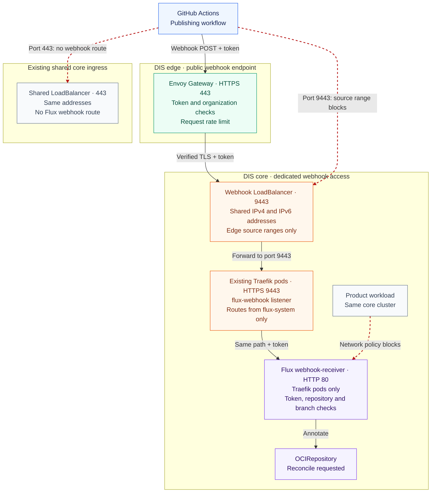
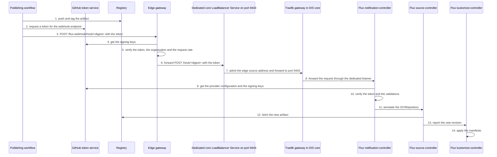

- Feature Name: on_demand_flux_reconcile
- Title: On-demand Flux reconcile for product artifacts
- Start Date: 2026-10-12
- RFC PR: [altinn/altinn-platform#4180](https://github.com/altinn/altinn-platform/pull/4180)
- Github Issue: N/A; implementation issues follow RFC acceptance
- Product/Category: CI/CD
- State: **REVIEW**

# Summary
[summary]: #summary

A publishing workflow can ask Flux to fetch a new product artifact immediately. The workflow sends an authenticated reconcile request to the DIS edge gateway of the environment. The edge gateway verifies the token, limits the request rate and forwards the request to the DIS core cluster. A dedicated load balancer Service on a separate port of the existing core addresses admits only the edge cluster's outbound addresses. A Flux `Receiver` in the product namespace verifies the token again and starts the reconcile. The reconcile request contains no deployment data, and Flux continues to pull the artifact from the registry. Polling stays as the fallback.

# Motivation
[motivation]: #motivation

Flux finds a new artifact only when the `OCIRepository` polls the registry. Each product sets its poll interval. Dialogporten uses 10 minutes.

After a publishing workflow completes, the cluster waits for the next poll. The table shows the wait for Dialogporten.

| Value | Wait |
|---|---|
| Minimum | 0 minutes |
| Average | 5 minutes |
| Maximum | 10 minutes |

This wait has two effects:

- Each deployment takes longer than necessary.
- A test that runs after a deployment must wait for the maximum time, or it tests the previous release.

A shorter poll interval decreases the wait, but it does not remove the wait. It also adds registry requests for each product in each cluster.

The expected outcome is that Flux starts to fetch the artifact some seconds after the publishing workflow pushes it. No continuous integration (CI) system gets access to the Kubernetes API, and no CI system connects directly to a DIS core cluster.

# Guide-level explanation
[guide-level-explanation]: #guide-level-explanation

## Concepts

| Concept | Meaning |
|---|---|
| Publishing workflow | The GitHub Actions workflow that pushes the Flux Open Container Initiative (OCI) artifact of a product to the registry. |
| Reconcile request | An HTTPS `POST` request that asks Flux to reconcile specified resources immediately. |
| `Receiver` | The Flux resource that accepts a reconcile request. It names the resources that Flux reconciles. |
| Edge gateway | The Envoy Gateway in the DIS edge cluster of an environment. It is the public entry point for the Altinn APIs. [RFC 0015](0015-envoy-gateway-api-edge.md) describes it. |
| Webhook endpoint | The address on the edge gateway where a workflow sends a reconcile request. |
| Cluster route | The route on the gateway of a DIS core cluster to the Flux notification-controller. The edge gateway forwards each reconcile request to it. |
| Dedicated listener | The Traefik listener for reconcile requests. A separate Kubernetes `LoadBalancer` Service exposes it on port 9443 of the shared public addresses, only to the edge cluster's outbound addresses. |
| Shared public addresses | The existing public IPv4 and IPv6 addresses of the shared Traefik Service in a DIS core cluster. |

The webhook endpoint of an environment is `https://<platform host name>/flux-webhook`.

| Environment | Platform host name |
|---|---|
| `at22` | `platform.at22.altinn.cloud` |
| `at23` | `platform.at23.altinn.cloud` |
| `at24` | `platform.at24.altinn.cloud` |
| `yt01` | `platform.yt01.altinn.cloud` |
| `tt02` | `platform.tt02.altinn.no` |
| `prod` | `platform.altinn.no` |

## Use the feature

A product team does two steps.

1. Add a `Receiver` to the product syncroot, next to the `OCIRepository` of the product.
2. Call the `trigger-reconcile` action after the step that pushes the artifact.

This is the `Receiver` for a product with the name `example`:

```yaml
apiVersion: notification.toolkit.fluxcd.io/v1
kind: Receiver
metadata:
  name: example-manifests
  namespace: product-example
spec:
  type: generic-oidc
  oidcProviders:
    - issuerURL: https://token.actions.githubusercontent.com
      audience: https://platform.at23.altinn.cloud/flux-webhook
      validations:
        - expression: claims.repository_owner_id == '5949420' && claims.repository_id == '<repository id>'
          message: token is not issued to the publishing repository
        - expression: claims.ref == 'refs/heads/main'
          message: token is not issued for the main branch
  resources:
    - apiVersion: source.toolkit.fluxcd.io/v1
      kind: OCIRepository
      name: example-manifests
```

This is the step in the publishing workflow:

```yaml
- name: Trigger Flux reconcile
  continue-on-error: true
  uses: Altinn/altinn-platform/actions/flux/trigger-reconcile@<commit>
  with:
    url: https://platform.at23.altinn.cloud/flux-webhook
    receiver_name: example-manifests
    receiver_namespace: product-example
```

The job must have the permission `id-token: write`.

## Rules for product teams

- The reconcile request is an optimization. Polling continues, and the next poll fetches the artifact if the reconcile request fails.
- Set `continue-on-error: true` on the step. A failed reconcile request must not stop a deployment.
- Send the reconcile request only to the webhook endpoint of the environment that the workflow publishes.
- Use the webhook endpoint as the audience in the `Receiver`. The action uses the same value as the audience of the token.
- Name only the `OCIRepository` in the `Receiver`. Flux reconciles the `Kustomization` when the `OCIRepository` reports a new revision.
- Use the numeric repository id and organization id in the validations. A different repository can get a name again after a rename or a transfer.
- Publish from a repository in the `Altinn` GitHub organization. The edge gateway admits only this organization, with the numeric id `5949420`.
- The reconcile request does not report the deployment result.

## Error messages

The action reports the response of the webhook endpoint.

| Response | Source | Meaning | Correction |
|---|---|---|---|
| `200` | Flux | Flux accepted the reconcile request. | None. |
| `400` | Flux | Flux rejected the token, or Flux could not get the provider configuration or the signing keys from GitHub. | Compare the audience and the validations of the `Receiver` with the workflow. If they match, examine the connection from the notification-controller to GitHub. |
| `401` | Edge gateway | The token is missing, not valid or expired, or it has a different audience. | Compare the address and the audience with the webhook endpoint of the environment. |
| `403` | Edge gateway | The token does not identify the `Altinn` GitHub organization. | Run the publishing workflow from a repository in `Altinn`. |
| `404` | Flux | No `Receiver` has this name and namespace. | Examine the name, the namespace and the address. |
| `429` | Edge gateway | The request rate of the repository or of the environment is more than its limit. | None. The action tries again, and the next poll fetches the artifact. |
| `503` | Flux | The `Receiver` is suspended or not ready. | Examine the status of the `Receiver`. |

# Reference-level explanation
[reference-level-explanation]: #reference-level-explanation

## Components

| Component | Owner | Location | Function |
|---|---|---|---|
| Edge route | Platform team | `dis-way/gitops-manifests`, package `flux-webhook-receiver`, layer `edge` | Exposes the webhook endpoint on the edge gateway. Verifies the token, limits the request rate and forwards the request to the cluster route. |
| Dedicated listener | Platform team | `dis-way/gitops-manifests`, package `traefik`, an optional layer | Adds the load balancer Service on the shared public addresses, the entrypoint and the Gateway listener to the existing Traefik release. |
| Cluster route | Platform team | `dis-way/gitops-manifests`, package `flux-webhook-receiver`, layer `multitenancy` | Exposes the notification-controller through the dedicated listener. Admits traffic to the webhook port only from the Traefik pods. |
| Edge configuration | Platform team | `dis-way/core`, `flux/clusters/dis-edge-<environment>-aks` | Deploys the edge layer to an edge cluster. |
| Cluster configuration | Platform team | `dis-way/core`, the Terraform configuration of each DIS core cluster | Enables the listener and the cluster route. Adds no public address and no Domain Name System (DNS) record. |
| Module inputs | Platform team | `dis-way/terraform-azurerm-dis-modules`, the cluster and `dis_aks_resources_multitenancy` modules | Passes the enable flag to the Traefik configuration. The edge source ranges and the shared public addresses already reach it. |
| `trigger-reconcile` action | Platform team | `Altinn/altinn-platform`, `actions/flux/trigger-reconcile` | Gets the token and sends the reconcile request. |
| `Receiver` | Product team | Product syncroot | Verifies the caller and names the resources. |
| Workflow step | Product team | Publishing workflow | Calls the action after the push. |

## Network boundaries

The diagram shows the reconcile request path. The sequence below also shows the artifact publication and the Flux reconcile.



The dedicated Service selects the existing Traefik pods. The design adds no application or ingress controller.
The dedicated Service uses port 9443 of the shared public addresses. The design adds no public address.
The source ranges restrict public access. They do not authenticate individual workloads within the edge cluster.
A network policy admits traffic to the webhook port of the notification-controller only from the Traefik pods.

## Sequence



## Authentication

Two components verify each token: the edge gateway and the notification-controller.

### Edge gateway

A `SecurityPolicy` on the edge route does these checks for each reconcile request:

1. It reads the token only from the `Authorization: Bearer` header.
2. It verifies the signature with the keys from `https://token.actions.githubusercontent.com/.well-known/jwks`.
3. It verifies the issuer, the expiry time and the audience of the token.
4. It admits the request only if the `repository_owner_id` claim equals `5949420`, the numeric id of the `Altinn` GitHub organization.
5. It copies the `repository_id` claim to the header `x-flux-webhook-repository-id` for the rate limit.

The edge gateway forwards the token to the cluster route without a change.

The policy sets `extractFrom` to the `Authorization` header.
Without `extractFrom`, Envoy also accepts the token in the `access_token` query parameter.
The notification-controller reads the token only from the header.
A token in a query parameter can also show in access logs.
The access logs of the edge gateway and Traefik must not record the `Authorization` header.

```yaml
apiVersion: gateway.envoyproxy.io/v1alpha1
kind: SecurityPolicy
metadata:
  name: flux-webhook-github-oidc
  namespace: flux-webhook
spec:
  targetRefs:
    - group: gateway.networking.k8s.io
      kind: HTTPRoute
      name: flux-webhook
  jwt:
    providers:
      - name: github-actions
        issuer: https://token.actions.githubusercontent.com
        audiences:
          - https://platform.at23.altinn.cloud/flux-webhook
        remoteJWKS:
          uri: https://token.actions.githubusercontent.com/.well-known/jwks
        extractFrom:
          headers:
            - name: Authorization
              valuePrefix: "Bearer "
        claimToHeaders:
          - claim: repository_id
            header: x-flux-webhook-repository-id
  authorization:
    defaultAction: Deny
    rules:
      - name: altinn-only
        action: Allow
        principal:
          jwt:
            provider: github-actions
            claims:
              - name: repository_owner_id
                values: ["5949420"]
```

### Notification-controller

The `Receiver` has the type `generic-oidc`. This type is available from Flux 2.9. The notification-controller does these checks for each reconcile request:

1. It reads the token from the `Authorization: Bearer` header.
2. It finds the provider whose `issuerURL` is the same as the `iss` claim of the token.
3. It verifies the signature, the expiry time and the audience of the token.
4. It evaluates each Common Expression Language (CEL) expression in `validations` against the claims of the token.

The notification-controller does not cache the provider configuration or the signing keys.
It gets both from GitHub again for each request to a `Receiver` path with a token that claims the GitHub issuer.
Thus each such request causes two requests from the DIS core cluster to GitHub.
The [notification-controller v1.9.4 source](https://github.com/fluxcd/notification-controller/blob/v1.9.4/internal/server/receiver_oidc.go) shows this behaviour.

### Why the edge gateway is the only public path

The edge gateway rejects a request without a valid token before the request reaches a DIS core cluster.
Thus a request without a valid token does not cause requests from the core cluster to GitHub.
The rate limits of the edge gateway also limit the requests from the notification-controller to GitHub.

A public path to the notification-controller without the edge gateway removes these two protections.
Any public caller can then make a core cluster send two requests to GitHub for each request.
If GitHub limits these requests, valid reconcile requests to all `Receiver` resources in the cluster fail.
This is the primary reason for the dedicated listener and its source ranges.

### Why both components verify the token

The edge gateway admits the `Altinn` organization. It does not authorize a repository or branch for a specific `Receiver`.
A workflow in another Altinn repository can request the same audience and send a request to that `Receiver`.
The repository and branch validations of the `Receiver` reject this request.

The `generic-oidc` `Receiver` verifies the signed token before it uses the claims for authorization.
It does not trust a request only because the request passes through the edge gateway.
This also protects the `Receiver` from unauthorized requests through an admitted edge address or from inside the core cluster.

Moving authorization to the edge gateway requires a repository and branch policy for each receiver path.
This design keeps that policy in the product's `Receiver` resource.

### Token

GitHub issues an OpenID Connect (OIDC) token to each workflow in each repository. A correct signature does not identify the product. The edge gateway examines only the organization. The validations of the `Receiver` must identify the publishing repository and the branch.

The audience is the webhook endpoint of the environment. A token for one environment is not valid in a different environment.

Flux calculates the path of the `Receiver` as `/hook/<sha256(name + namespace)>`. The path is not a secret. The token gives the authentication.

The product does not store a secret in the cluster, and the workflow does not store a secret in GitHub.

## Authorization

A caller can send a valid reconcile request only from the publishing repository and the `main` branch. The same repository and branch can push the artifact to the registry. The feature does not add a new group of trusted callers.

A reconcile request sets the annotation `reconcile.fluxcd.io/requestedAt` on the resources that the `Receiver` names. It cannot select an artifact, a tag or a digest. It cannot change a manifest. The worst result of an incorrect reconcile request is one more poll of the registry.

The multi-tenancy setting of the Flux extension prevents references to a different namespace. A `Receiver` can name only resources in its namespace. A product cannot reconcile the resources of a different product.

The workflow connects only to the edge gateway. All Altinn API clients use the same entry point. The workflow does not connect to the Kubernetes API, and it does not connect directly to a DIS core cluster.

## Edge route

The layer `edge` of the package `flux-webhook-receiver` contains the edge route and its policies.

| Property | Value |
|---|---|
| Gateway | `eg` in the namespace `envoy-gateway-system` |
| Listener | `https` |
| Host name | The platform host name of the environment |
| Method | `POST` |
| Path | Prefix `/flux-webhook/hook` |
| Rewrite | Host name `flux-webhook.<DEFAULT_GATEWAY_HOSTNAME>` of the DIS core cluster, and path prefix `/hook` |
| Target | A `Backend` with the host name of the cluster route and port 9443 |
| Transport Layer Security (TLS) to the target | A `BackendTLSPolicy` verifies the certificate with the system certificate authorities. |
| Namespace | `flux-webhook`, with the annotation `<platform host name>/edge-allowed-paths: "/flux-webhook"` |

The Dialogporten route on `dis-edge-at23` uses the same `Backend`, `BackendTLSPolicy` and `HTTPRoute` resources to reach a DIS core cluster.

The edge route guard admits the route only if the annotation of the namespace allows the path.

The wildcard DNS record resolves the target host name to the shared public addresses of the DIS core cluster.
The edge gateway uses that host name for the TLS connection and certificate verification.

A `BackendTrafficPolicy` on the edge route sets two global rate limits:

| Limit | Counter | Function |
|---|---|---|
| Repository limit | One counter for each value of the header `x-flux-webhook-repository-id` | Limits the requests from each publishing repository. One repository cannot use the limit of a different repository. |
| Environment limit | One counter for all requests to the edge route | Limits the total requests to the notification-controller, and from the notification-controller to GitHub. |

- The `SecurityPolicy` copies the `repository_id` claim to the header `x-flux-webhook-repository-id` after it verifies the token.
- Envoy removes this header from the client request before it verifies the token. A caller cannot select a different counter.
- The repository rule uses a header selector of the type `Distinct`. Each repository id gets a separate counter.
- The rate limit service of the edge cluster keeps the counters in Valkey.
- The policy must set `mergeType`. Without `mergeType`, the route policy replaces the gateway policy, and the route loses the limits and timeouts of the gateway.
- Envoy verifies the token and the organization before it applies the rate limits. A request without a valid token does not use a limit.
- The rate limiter fails open. If Valkey is not available, the edge gateway forwards each request that has a valid token.
- Valkey has one replica and no persistent storage. A restart of Valkey sets all counters to zero. The limits are not a hard bound.

```yaml
apiVersion: gateway.envoyproxy.io/v1alpha1
kind: BackendTrafficPolicy
metadata:
  name: flux-webhook-rate-limit
  namespace: flux-webhook
spec:
  targetRefs:
    - group: gateway.networking.k8s.io
      kind: HTTPRoute
      name: flux-webhook
  mergeType: StrategicMerge
  rateLimit:
    global:
      rules:
        - clientSelectors:
            - headers:
                - name: x-flux-webhook-repository-id
                  type: Distinct
          limit:
            requests: <repository limit>
            unit: Minute
        - limit:
            requests: <environment limit>
            unit: Minute
```

## Dedicated core listener

Each participating DIS core cluster has a separate Kubernetes Service of type `LoadBalancer` for reconcile requests.
The existing Traefik Helm release creates this Service through `service.additionalServices`.
The Service selects the existing Traefik pods. It needs no custom application, additional deployment or separate ingress controller.
The Service uses the shared public addresses on port 9443. The shared Traefik Service keeps ports 80 and 443 on the same addresses.

The dedicated Service gives two protections:

- Only the edge cluster's outbound addresses can connect to port 9443.
- The `flux-webhook` entrypoint has only the routes of the `flux-webhook` listener. A product route on a shared listener does not exist on this entrypoint.

The Traefik `kubernetesCRD` provider remains disabled in the multi-tenant configuration.
The design uses the existing Kubernetes Gateway API provider and no Traefik `Middleware` resources.

| Property | Value |
|---|---|
| Service | `altinn-traefik-flux-webhook` in the namespace `traefik` |
| Public addresses | The shared public addresses, from the existing `PUBLIC_IP_V4` and `PUBLIC_IP_V6` values |
| Service port | TCP 9443, with the target port `flux-webhook` |
| Traefik entrypoint | `flux-webhook`, container port 9443 |
| Source ranges | Only the corresponding edge cluster's IPv4 and IPv6 outbound ranges |
| External traffic policy | `Local`, to preserve the source address |
| Gateway listener | `flux-webhook`, HTTPS on port 9443 |
| Listener host name | `flux-webhook.<DEFAULT_GATEWAY_HOSTNAME>` |
| Admitted route namespace | Only `flux-system`, selected by the label `kubernetes.io/metadata.name` |
| TLS certificate | The existing wildcard certificate in the Secret `ssl-cert` |

The shared Traefik Service must not expose port 9443.
The dedicated Service must expose only the `flux-webhook` entrypoint.
The existing product listeners and their source ranges do not change.

### Helm values

These values extend the existing Traefik configuration. They do not replace its other ports, listeners or annotations.
The example uses the structure of the pinned Traefik chart, version 41.6.1.

```yaml
ports:
  flux-webhook:
    port: 9443
    exposedPort: 9443
    protocol: TCP
    expose:
      default: false
      flux-webhook: true
    http:
      tls:
        enabled: true
    transport:
      lifeCycle:
        requestAcceptGraceTimeout: 15s

service:
  additionalServices:
    flux-webhook:
      enabled: true
      single: true
      annotations:
        service.beta.kubernetes.io/azure-load-balancer-resource-group: "${AKS_NODE_RG}"
        service.beta.kubernetes.io/azure-load-balancer-ipv4: "${PUBLIC_IP_V4}"
        service.beta.kubernetes.io/azure-load-balancer-ipv6: "${PUBLIC_IP_V6}"
      spec:
        type: LoadBalancer
        externalTrafficPolicy: Local
        ipFamilyPolicy: RequireDualStack
        ipFamilies:
          - IPv4
          - IPv6
        loadBalancerSourceRanges:
          - "${LB_SOURCE_RANGE_DIS_EDGE}"
          - "${LB_SOURCE_RANGE_DIS_EDGE_IPV6}"

gateway:
  listeners:
    flux-webhook:
      port: 9443
      protocol: HTTPS
      hostname: "flux-webhook.${DEFAULT_GATEWAY_HOSTNAME}"
      namespacePolicy:
        from: Selector
        selector:
          matchLabels:
            kubernetes.io/metadata.name: flux-system
      certificateRefs:
        - name: ssl-cert
```

Add port 9443 to the existing `config.linkerd.io/skip-inbound-ports` pod annotation.
Keep ports 8000, 8443 and 9100 in that annotation.
This preserves the existing TLS handling in Traefik.

### Shared addresses and source ranges

Azure Kubernetes Service (AKS) lets two Services use the same public address when their ports are different.
The cloud provider writes the network security group allow rules for each Service, address and port.
The source ranges of the dedicated Service apply only to port 9443.
The source ranges of the shared Service continue to apply to ports 80 and 443.

The design needs no new public address, Terraform resource or DNS record.
The wildcard DNS record already resolves `flux-webhook.<DEFAULT_GATEWAY_HOSTNAME>` to the shared public addresses.
The existing wildcard certificate covers the webhook host name.

AKS writes a deny-all rule for an address when a Service on that address has a source range that is not valid.
AKS also writes it when a Service has the annotation `service.beta.kubernetes.io/azure-deny-all-except-load-balancer-source-ranges`.
The rule applies to the whole address. With a shared address, it also changes the network rules of the shared Service.

- Do not set the deny-all annotation on the dedicated Service or on the shared Service.
- Reject a source range that is not a valid address range before deployment.

The Service uses `loadBalancerSourceRanges` to restrict inbound traffic.
AKS applies these restrictions through network security group and host rules.
Use only the environment's `LB_SOURCE_RANGE_DIS_EDGE` and `LB_SOURCE_RANGE_DIS_EDGE_IPV6` values.
Do not inherit the shared Service's Cloudflare, monitoring, API Management or unrestricted source ranges.
The implementation must reject missing source ranges and the unrestricted ranges `0.0.0.0/0` and `::/0`.

Verify the actual outbound addresses of the edge gateway before enabling the edge route.
Keep the AKS load balancer health probes working with `externalTrafficPolicy: Local`.
Do not admit public webhook traffic to make a health probe pass.
Verify in `at23` that the rules of the shared Service do not change when the dedicated Service changes.

## Cluster route

The layer `multitenancy` of the package `flux-webhook-receiver` contains one `HTTPRoute` in the namespace `flux-system`.

| Property | Value |
|---|---|
| Gateway | `traefik-gateway` in the namespace `traefik` |
| Listener | `flux-webhook` only, selected by `parentRefs[].sectionName` |
| Host name | `flux-webhook.<DEFAULT_GATEWAY_HOSTNAME>` |
| Method | `POST` |
| Path | Prefix `/hook` |
| Target | Service `webhook-receiver`, port 80 |

The route must not change the path. The notification-controller finds the `Receiver` from the exact path of the request.

Do not attach the route to `https`, `https-wildcard` or another shared listener.
Remove an existing shared-listener attachment before enabling the edge route.
A request to port 443 of the shared public addresses must not reach Flux, even with the webhook host name and a valid token.

The source restriction applies in every environment, including test and staging.
It restricts public access through the dedicated Service. It does not isolate pods inside either cluster.
Workloads that share the admitted edge outbound addresses can reach the listener.
The notification-controller must continue to verify every reconcile request.

### Network policy

The layer `multitenancy` also contains one `NetworkPolicy` in the namespace `flux-system`.
It admits traffic to the webhook port of the notification-controller only from the Traefik pods.
Without it, a workload in the DIS core cluster can connect to the `webhook-receiver` Service directly.
That path has no edge gateway and no rate limit. Each request on that path can cause two requests to GitHub.

| Property | Value |
|---|---|
| Pods | The notification-controller in the namespace `flux-system` |
| Port with the restriction | The webhook port, 9292 |
| Admitted source | Pods with the label `app.kubernetes.io/name: traefik` in the namespace `traefik` |
| Other ports | Events 9090, metrics 8080 and health probes 9440. The policy does not change access to these ports. |

```yaml
apiVersion: networking.k8s.io/v1
kind: NetworkPolicy
metadata:
  name: flux-webhook-from-traefik
  namespace: flux-system
spec:
  podSelector:
    matchLabels:
      app: notification-controller
  policyTypes:
    - Ingress
  ingress:
    # Only the Traefik pods can connect to the webhook port.
    - from:
        - namespaceSelector:
            matchLabels:
              kubernetes.io/metadata.name: traefik
          podSelector:
            matchLabels:
              app.kubernetes.io/name: traefik
      ports:
        - port: 9292
          protocol: TCP
    # The policy does not change access to the other ports.
    - ports:
        - port: 9090 # Events from the Flux controllers
          protocol: TCP
        - port: 8080 # Metrics
          protocol: TCP
        - port: 9440 # Health probes
          protocol: TCP
```

When a `NetworkPolicy` selects a pod, Kubernetes blocks all incoming traffic to the pod that no policy admits.
Thus the policy must also admit the other ports of the notification-controller.
The labels and ports in the example come from the upstream Flux manifests. The pilot must confirm them in the `microsoft.flux` extension.
The DIS core clusters use Cilium as the network policy engine.
Kubernetes adds together all policies that select a pod. A different policy that admits all pods to the webhook port removes this restriction.

The policy does not block a workload that connects to port 9443 of the Traefik pods.
The workload can use the cluster IP address of the dedicated Service. The source ranges do not apply to that address.
Traefik then forwards the request to the notification-controller. That path also has no edge gateway and no rate limit.

## Prerequisites

- The DIS core cluster runs the `microsoft.flux` extension 1.26.1 or later. This version contains Flux 2.9.
- The notification-controller can connect to `https://token.actions.githubusercontent.com`. It gets the provider configuration and the signing keys from that address.
- The edge gateway can connect to `https://token.actions.githubusercontent.com`. It gets the signing keys from that address.
- The edge gateway serves the platform host name of the environment.
- The dedicated Service admits the actual outbound addresses of the edge gateway for both IP families.
- The wildcard DNS record resolves the webhook host name, and the Gateway listener has a valid TLS certificate.
- The shared public addresses have no other Service on port 9443.
- The cluster route attaches only to the dedicated listener.
- The DIS core cluster enforces network policies.

## Environment selection

A product publishes its artifact with one tag for each environment. The publishing workflow sends the reconcile request to the webhook endpoint of that environment.

Dialogporten publishes one tag for all environments at this time. [Dialogporten manifests PR #86](https://github.com/Altinn/dialogporten-manifests/pull/86) changes this to one tag for each environment. Until then, the Dialogporten workflow sends the reconcile request only to the environment whose image tags changed. The other clusters fetch the artifact at their next poll and find no change for their environment.

## Corner cases

| Case | Result |
|---|---|
| The `Receiver` does not exist yet. | Flux returns `404`. The next poll fetches the artifact. |
| The cluster runs a Flux version before 2.9. | The API server rejects the `Receiver`. The syncroot `Kustomization` fails until the product removes the `Receiver`. |
| The token is missing, expired or not valid. | The edge gateway returns `401`. The request does not reach the DIS core cluster. |
| The repository is outside the `Altinn` GitHub organization. | The edge gateway returns `403`. The request does not reach the DIS core cluster. |
| A repository sends more requests than the repository limit. | The edge gateway returns `429` to that repository. Requests from other repositories continue. |
| All repositories together send more requests than the environment limit. | The edge gateway returns `429`. The next poll fetches the artifact. |
| A caller sends a false `x-flux-webhook-repository-id` header. | Envoy removes the header. The repository limit uses the `repository_id` claim of the token. |
| A caller sends the token in the `access_token` query parameter. | The edge gateway returns `401`. It reads the token only from the `Authorization` header. |
| Valkey is not available. | The rate limiter fails open. The edge gateway and the notification-controller continue to verify each token. |
| Valkey restarts. | All counters start again from zero. |
| The edge gateway cannot get the signing keys from GitHub. | The edge gateway rejects the request. The next poll fetches the artifact. |
| The notification-controller cannot get the provider configuration or the signing keys from GitHub. | Flux returns `400`. The next poll fetches the artifact. |
| The edge gateway is not available. | The action reports an error. The next poll fetches the artifact. |
| A public caller connects directly to port 9443 of a shared public address. | The source ranges block the connection unless the caller uses an admitted edge outbound address. |
| A caller sends the webhook host name to port 443 of a shared public address. | No route on the product listeners forwards the request to Flux. |
| A workload in the DIS core cluster connects to the `webhook-receiver` Service. | The network policy blocks the connection. |
| A workload in the DIS core cluster connects to port 9443 of the Traefik pods. | Traefik forwards the request to Flux. The notification-controller verifies the token. The edge gateway and its rate limits do not apply. |
| The edge outbound addresses change before the source ranges change. | The dedicated Service blocks the edge gateway. The next poll fetches the artifact. |
| The dedicated Service is not ready. | The edge gateway cannot reach Flux. The next poll fetches the artifact. Product traffic on ports 80 and 443 continues. |
| A source range of the dedicated Service is not valid. | The configuration validation rejects it before deployment. Otherwise AKS writes a deny-all rule for the shared public address. |
| Two publishing workflows send a reconcile request at the same time. | Flux reconciles the `OCIRepository` one time or two times. The result is the same. |
| The reconcile request arrives before the registry has the new tag. | Flux finds no new revision. The next poll fetches the artifact. The step order in the workflow prevents this case. |
| A person captures a token and sends it again. | The token expires after some minutes. A second reconcile request causes one more poll. |
| The `OCIRepository` is suspended. | Flux does not reconcile it. |
| The notification-controller is not available. | The edge gateway returns an error. The source-controller and the kustomize-controller continue to operate. |

## Pilot

Dialogporten in `at23` is the pilot. The pilot needs these changes:

- The action `actions/flux/trigger-reconcile` in this repository: [altinn-platform#4181](https://github.com/Altinn/altinn-platform/pull/4181). The action must also explain the responses `401`, `403` and `429`.
- The layer `multitenancy` of the package `flux-webhook-receiver`: [gitops-manifests#2005](https://github.com/dis-way/gitops-manifests/pull/2005). Its route must use the dedicated listener. It must also contain the network policy. The layer `edge` does not exist yet.
- An optional layer in the `traefik` package for the dedicated Service, entrypoint, listener and Linkerd annotation.
- The cluster and `dis_aks_resources_multitenancy` modules need an explicit enable flag. The feature defaults to disabled.
- The configuration for `dis-core-at23` in `dis-way/core`: [core#396](https://github.com/dis-way/core/pull/396). Enable the Traefik layer. Do not add public addresses or DNS records.
- The Flux configuration for `dis-edge-at23` in `dis-way/core`. This change does not exist yet. [core#387](https://github.com/dis-way/core/pull/387) deploys the edge route guard to `dis-edge-at23`.
- The `Receiver` and the workflow step in `Altinn/dialogporten-manifests`: [dialogporten-manifests#89](https://github.com/Altinn/dialogporten-manifests/pull/89). The audience and the address must change to the webhook endpoint on the edge gateway.

Enable the feature for each cluster explicitly. Start with `at23`.
Create the restricted Service and listener before enabling the edge route.
Enable the workflow step after the following checks pass.

### Pilot acceptance checks

| Check | Required result |
|---|---|
| Render the Helm and Kustomize configuration. | The dedicated Service exposes only port 9443 to target port 9443 on the shared public addresses. The shared Service has no webhook port. |
| Examine the rendered listener and route. | Only `flux-system` can attach routes. The webhook route selects only the `flux-webhook` listener. |
| Omit an edge source range or supply an unrestricted range. | Configuration validation fails before deployment. |
| Send a valid request through the edge gateway. | Flux accepts the request and reconciles the intended `OCIRepository`. |
| Send a request without a token or with an incorrect audience through the edge gateway. | The edge gateway rejects it before it reaches Flux. |
| Send a valid token from a repository outside `Altinn` through the edge gateway. | The edge gateway returns `403` before the request reaches Flux. |
| Send a valid token from a different Altinn repository to the same `Receiver`. | The notification-controller rejects it. |
| Send a valid token in the `access_token` query parameter without an `Authorization` header. | The edge gateway returns `401`. |
| Send more requests from one repository than the repository limit. | The edge gateway returns `429` to that repository. A request from a different repository succeeds. |
| Send requests with a false `x-flux-webhook-repository-id` header. | The repository limit counts each request for the repository in the token. |
| Examine the access logs of the edge gateway and Traefik after a reconcile request. | No log entry contains the `Authorization` header or the token. |
| Connect from outside the admitted ranges to port 9443 of each shared public address with a valid token. | Both IPv4 and IPv6 connections fail before they reach Traefik. |
| Connect through the edge gateway to port 9443 of each shared public address. | Both IPv4 and IPv6 connections succeed. The edge gateway verifies the core TLS certificate. |
| Send the webhook host name and a valid token to port 443 of each shared public address. | No request reaches the notification-controller. |
| Connect from a pod in a product namespace to the `webhook-receiver` Service. | The connection fails. |
| Examine Flux alerts, metrics and health probes of the notification-controller after the network policy is applied. | They continue to work. |
| Check existing product routes and load balancer health probes. | They continue to work. |
| Create, change and delete the dedicated Service. | The network security group rules of the shared Service do not change. Product traffic continues. |
| Disable the workflow step or make the webhook unavailable. | Polling continues to fetch artifacts. |

# Drawbacks
[drawbacks]: #drawbacks

- The webhook endpoint is on the public platform host name. Through the edge gateway, it connects to a Flux controller in each DIS core cluster.
- Each reconcile request crosses two gateways. More components can fail, and each component can return an error.
- Each participating core cluster needs an additional load balancer Service and port 9443 on its shared public addresses.
- The dedicated Service and the shared Service use the same addresses. An error in the network rules of one Service can affect the other Service.
- The platform team must keep the admitted source ranges aligned with the actual edge outbound addresses.
- The dedicated listener shares Traefik pods and capacity with product ingress. It does not give separate capacity or isolate failures.
- The source ranges identify edge outbound addresses. They do not identify the Envoy process or block access from inside the core cluster.
- A workload in the core cluster can connect to port 9443 of the Traefik pods. That path has no edge gateway and no rate limit.
- The edge gateway and each `Receiver` must use the same audience.
- The feature needs a minimum version of the `microsoft.flux` extension. Azure controls when a cluster gets a new version.
- The edge gateway and the notification-controller need a connection to GitHub to verify a token.
- The notification-controller does not cache the provider configuration or the signing keys. Each reconcile request causes two requests to GitHub.
- Each product must add a `Receiver` and a workflow step.
- A failed reconcile request is easy to miss, because the deployment continues.

# Rationale and alternatives
[rationale-and-alternatives]: #rationale-and-alternatives

## Why this design

- The cluster continues to pull. The workflow gets no access to the Kubernetes API and no credentials for the cluster.
- The workflow connects only to the edge gateway, which is the public entry point for the Altinn APIs.
- The edge gateway rejects a request without a valid token before the request reaches a DIS core cluster.
- The edge gateway limits the request rate for each repository and for the environment. The multi-tenant Traefik configuration keeps its `kubernetesCRD` provider disabled.
- The dedicated Service applies the same source restriction in every environment without changing the source ranges of existing product ingress.
- The dedicated Service uses the existing public addresses and the wildcard DNS record. Its separate entrypoint keeps product routes away from the webhook route.
- The design uses standard Flux, Envoy Gateway and Traefik functions. The extra Kubernetes Service needs no custom application.
- The design uses no shared secret. Thus there is no secret to store, to rotate or to leak.
- A product team adds and controls its `Receiver`. The platform team does one change for each DIS core cluster and one change for each edge cluster.

## Alternatives

| Alternative | Why not |
|---|---|
| The existing shared core listener with only Flux authentication | Public callers in test environments can bypass edge authentication and rate limits. Each of their requests can cause two requests from the core cluster to GitHub. |
| A Traefik `IPAllowList` Middleware on the shared listener | It requires enabling the `kubernetesCRD` provider. That changes the multi-tenant ingress configuration and needs additional resource controls. The webhook route also shares the entrypoint with product routes. Traefik ranks routes only by their match, so a product route with a more specific match receives the reconcile requests. |
| A dedicated Service with its own public addresses | It needs two public addresses and two DNS records for each cluster. Port 9443 on the shared public addresses gives the same source restriction and the same separate entrypoint. |
| A private core listener | It needs private connectivity and DNS between each edge and core cluster. The selected design uses existing public connectivity. |
| A separate authentication proxy or ingress controller | It adds an application or controller to operate. The existing gateways and the dedicated Service provide the required controls. |
| A route directly to the DIS core gateway, without the edge gateway | The production load balancer does not admit the runners. The Traefik gateway cannot limit the request rate. The notification-controller gets all requests from the internet. |
| A shorter poll interval | It decreases the wait and does not remove it. It needs no new component, and a product can use it together with this feature. |
| A `Receiver` of the type `generic-hmac` | It needs a shared secret in the cluster and in GitHub. It works with Flux versions before 2.9. |
| A registry webhook to a `Receiver` of the type `acr` | The `Receiver` does not verify a signature. Each product and each cluster needs one webhook in the shared registry, and the registry has a webhook quota. |
| `az aks command invoke` from the workflow | The workflow gets a path to the Kubernetes API. Microsoft states that the command is not for automated access. Each call starts a pod in the cluster. |
| A network connection from the runners to the API server | The runners get direct access to the Kubernetes API. This is opposite to the pull model in RFC 0001. |
| A reconcile function in DIS Console | The platform team must build and operate a function that Flux already has. |
| A `Receiver` of the type `github` with a repository webhook | GitHub sends the push event before the workflow publishes the artifact. |

## If we do not do this

Each deployment continues to wait for the poll interval.

# Prior art
[prior-art]: #prior-art

- [Flux Receivers](https://fluxcd.io/flux/components/notification/receivers/) describes the `Receiver` types and the `generic-oidc` type.
- [Traefik chart 41.6.1](https://github.com/traefik/traefik-helm-chart/blob/v41.6.1/traefik/templates/service.yaml) creates additional Services and selects ports for each Service.
- [AKS load balancer source restrictions](https://learn.microsoft.com/en-us/azure/aks/configure-load-balancer-standard#restrict-inbound-traffic-to-specific-ip-ranges) describes `loadBalancerSourceRanges` and the network rules.
- [`flux trigger receiver`](https://fluxcd.io/flux/cmd/flux_trigger_receiver/) is the Flux command that sends the same request. The action does not use it, because the shared publishing actions install an earlier Flux version.
- [RFC 0001](0001-pull-based-cd.md) sets the pull model. This RFC keeps that model.
- [RFC 0015](0015-envoy-gateway-api-edge.md) makes Envoy Gateway in the DIS edge cluster the public API edge for Altinn. This RFC adds one route to that edge.
- The Dialogporten route on `dis-edge-at23` forwards requests from the edge gateway to a DIS core cluster. The edge route uses the same resources.
- [RFC 0010](https://github.com/Altinn/altinn-platform/pull/3220) proposes to send Flux events to GitHub. That direction is from the cluster to GitHub. This RFC is the opposite direction.
- The syncroot publishing identity uses GitHub OIDC tokens to push to the registry. This RFC uses the same token source and the same repository and branch conditions.

# Unresolved questions
[unresolved-questions]: #unresolved-questions

Before the team accepts this RFC:

- Which address must the webhook endpoint use: the path `/flux-webhook` on the platform host name, or a separate host name? A separate host name needs a `ListenerSet`, a DNS record and a certificate.
- Which values must the repository limit and the environment limit use?
- Must a policy admit only authenticated `Receiver` types? Types such as `generic` and `acr` do no authentication. The cluster route exposes all `Receiver` resources in the cluster.

Before the feature is stable:

- Do all DIS core clusters run the `microsoft.flux` extension 1.26.1 or later? The implementation must examine each cluster before a product adds a `Receiver`.
- Can the notification-controller and the edge gateway connect to the GitHub token service in all environments?
- Can the applier service account of a product namespace create a `Receiver`?
- Do the observed edge outbound addresses match the configured source ranges for both IP families in every participating environment?
- Do the source restrictions and health probes pass the pilot checks with the deployed AKS networking configuration?
- Where must the action be after [the action migration](https://github.com/Altinn/altinn-platform/pull/3926): in this repository or in `dis-way/actions`?

Out of scope:

- The deployment result.
- Reconcile requests for platform artifacts.

# Future possibilities
[future-possibilities]: #future-possibilities

- **Report the deployment result to the workflow.** This is the next step. A wait step after the reconcile request can report the result of the deployment. The reconcile request removes the poll interval from the time to that result.
- Send Flux events to GitHub, as RFC 0010 proposes.
- Add the `Receiver` to the default syncroot, so each new product gets it.
- Use reconcile requests for the platform packages in `dis-way/gitops-manifests`.
- Increase the poll interval of a product after its reconcile requests are reliable. This decreases the number of registry requests.
- **Protect the notification-controller from workloads in the DIS core cluster.** The design protects the webhook endpoint against callers outside the clusters. Its network policy blocks direct connections from workloads to the notification-controller. These changes can also protect it against workloads in the same cluster:
  - Admit only the `issuerURL` `https://token.actions.githubusercontent.com` in a `Receiver`, with an admission policy. The `issuerURL` field admits any `http` or `https` address. The notification-controller gets the provider configuration from the issuer of each token. A product can set an internal address as the `issuerURL` of its `Receiver`. A workload of that product can then send a token with that issuer to the `Receiver`. The notification-controller then sends a request from `flux-system` to the internal address. The product does not get the response.
  - Admit traffic to port 9443 of the Traefik pods only from outside the cluster. At this time, a workload can connect to that port through the cluster IP address of the dedicated Service. Traefik then forwards the request to the notification-controller. That policy must not change access to the product ports of Traefik.
