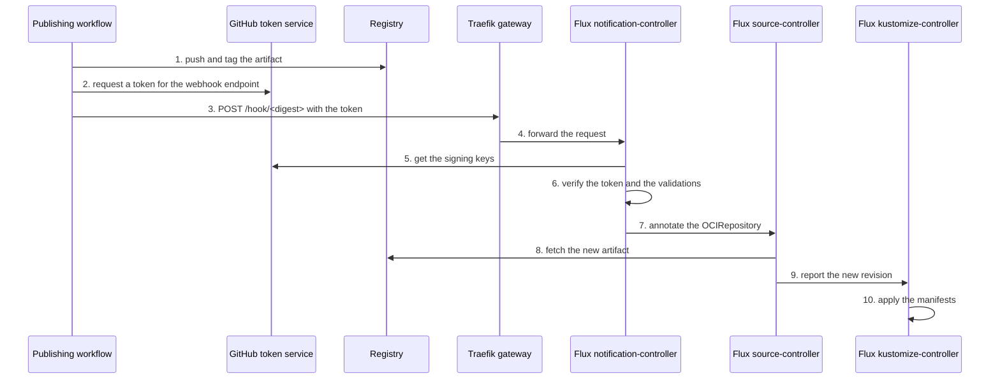

- Feature Name: on_demand_flux_reconcile
- Title: On-demand Flux reconcile for product artifacts
- Start Date: 2026-10-12
- RFC PR: [altinn/altinn-platform#4180](https://github.com/altinn/altinn-platform/pull/4180)
- Github Issue: N/A; implementation issues follow RFC acceptance
- Product/Category: CI/CD
- State: **REVIEW**

# Summary
[summary]: #summary

A publishing workflow can ask Flux to fetch a new product artifact immediately. The workflow sends an authenticated reconcile request to a Flux `Receiver` in the product namespace. The platform exposes one webhook endpoint in each cluster. The reconcile request contains no deployment data, and Flux continues to pull the artifact from the registry. Polling stays as the fallback.

# Motivation
[motivation]: #motivation

Flux finds a new artifact only when the `OCIRepository` polls the registry. Each product sets its poll interval. Dialogporten uses 10 minutes.

After a publishing workflow completes, the cluster waits for the next poll. The table shows the wait for Dialogporten.

| Value | Wait |
|---|---|
| Minimum | 0 minutes |
| Average | 5 minutes |
| Maximum | 10 minutes |

This wait has two effects:

- Each deployment takes longer than necessary.
- A test that runs after a deployment must wait for the maximum time, or it tests the previous release.

A shorter poll interval decreases the wait, but it does not remove the wait. It also adds registry requests for each product in each cluster.

The expected outcome is that Flux starts to fetch the artifact some seconds after the publishing workflow pushes it. No continuous integration (CI) system gets access to the Kubernetes API.

# Guide-level explanation
[guide-level-explanation]: #guide-level-explanation

## Concepts

| Concept | Meaning |
|---|---|
| Publishing workflow | The GitHub Actions workflow that pushes the Flux Open Container Initiative (OCI) artifact of a product to the registry. |
| Reconcile request | An HTTPS `POST` request that asks Flux to reconcile specified resources immediately. |
| `Receiver` | The Flux resource that accepts a reconcile request. It names the resources that Flux reconciles. |
| Webhook endpoint | The address in each cluster where the platform exposes the Flux notification-controller. |

The webhook endpoint of a DIS core cluster is `https://flux-webhook.<environment>.dis-core.altinn.cloud`.

## Use the feature

A product team does two steps.

1. Add a `Receiver` to the product syncroot, next to the `OCIRepository` of the product.
2. Call the `trigger-reconcile` action after the step that pushes the artifact.

This is the `Receiver` for a product with the name `example`:

```yaml
apiVersion: notification.toolkit.fluxcd.io/v1
kind: Receiver
metadata:
  name: example-manifests
  namespace: product-example
spec:
  type: generic-oidc
  oidcProviders:
    - issuerURL: https://token.actions.githubusercontent.com
      audience: https://flux-webhook.at23.dis-core.altinn.cloud
      validations:
        - expression: claims.repository_owner_id == '<organization id>' && claims.repository_id == '<repository id>'
          message: token is not issued to the publishing repository
        - expression: claims.ref == 'refs/heads/main'
          message: token is not issued for the main branch
  resources:
    - apiVersion: source.toolkit.fluxcd.io/v1
      kind: OCIRepository
      name: example-manifests
```

This is the step in the publishing workflow:

```yaml
- name: Trigger Flux reconcile
  continue-on-error: true
  uses: Altinn/altinn-platform/actions/flux/trigger-reconcile@<commit>
  with:
    url: https://flux-webhook.at23.dis-core.altinn.cloud
    receiver_name: example-manifests
    receiver_namespace: product-example
```

The job must have the permission `id-token: write`.

## Rules for product teams

- The reconcile request is an optimization. Polling continues, and the next poll fetches the artifact if the reconcile request fails.
- Set `continue-on-error: true` on the step. A failed reconcile request must not stop a deployment.
- Send the reconcile request only to the cluster of the environment that the workflow publishes.
- Name only the `OCIRepository` in the `Receiver`. Flux reconciles the `Kustomization` when the `OCIRepository` reports a new revision.
- Use the numeric repository id and organization id in the validations. A different repository can get a name again after a rename or a transfer.
- The reconcile request does not report the deployment result. [RFC 0016](https://github.com/Altinn/altinn-platform/pull/4144) describes that function.

## Error messages

The action reports the response of the webhook endpoint.

| Response | Meaning | Correction |
|---|---|---|
| `200` | Flux accepted the reconcile request. | None. |
| `400` | Flux rejected the token. | Compare the audience and the validations with the workflow. |
| `404` | No `Receiver` has this name and namespace. | Examine the name, the namespace and the address. |
| `503` | The `Receiver` is suspended or not ready. | Examine the status of the `Receiver`. |

# Reference-level explanation
[reference-level-explanation]: #reference-level-explanation

## Components

| Component | Owner | Location | Function |
|---|---|---|---|
| Route to the notification-controller | Platform team | `dis-way/gitops-manifests`, package `flux-webhook-receiver` | Exposes the webhook endpoint through the Traefik gateway. |
| Cluster configuration | Platform team | `dis-way/core` | Deploys the package to a cluster. |
| `trigger-reconcile` action | Platform team | `Altinn/altinn-platform`, `actions/flux/trigger-reconcile` | Gets the token and sends the reconcile request. |
| `Receiver` | Product team | Product syncroot | Verifies the caller and names the resources. |
| Workflow step | Product team | Publishing workflow | Calls the action after the push. |

## Sequence



## Authentication

The `Receiver` has the type `generic-oidc`. This type is available from Flux 2.9. The notification-controller does these checks for each reconcile request:

1. It reads the token from the `Authorization: Bearer` header.
2. It finds the provider whose `issuerURL` is the same as the `iss` claim of the token.
3. It verifies the signature, the expiry time and the audience of the token.
4. It evaluates each Common Expression Language (CEL) expression in `validations` against the claims of the token.

GitHub issues an OpenID Connect (OIDC) token to each workflow in each repository. A correct signature does not identify the product. The validations must identify the publishing repository and the branch.

The audience is the address of the webhook endpoint. A token for one cluster is not valid in a different cluster.

Flux calculates the path of the `Receiver` as `/hook/<sha256(name + namespace)>`. The path is not a secret. The token gives the authentication.

The product does not store a secret in the cluster, and the workflow does not store a secret in GitHub.

## Authorization

A caller can send a valid reconcile request only from the publishing repository and the `main` branch. The same repository and branch can push the artifact to the registry. The feature does not add a new group of trusted callers.

A reconcile request sets the annotation `reconcile.fluxcd.io/requestedAt` on the resources that the `Receiver` names. It cannot select an artifact, a tag or a digest. It cannot change a manifest. The worst result of an incorrect reconcile request is one more poll of the registry.

The multi-tenancy setting of the Flux extension prevents references to a different namespace. A `Receiver` can name only resources in its namespace. A product cannot reconcile the resources of a different product.

## Webhook endpoint

The package `flux-webhook-receiver` contains one `HTTPRoute` in the namespace `flux-system`.

| Property | Value |
|---|---|
| Gateway | `traefik-gateway` in the namespace `traefik` |
| Listener | `https-wildcard` only |
| Host name | `flux-webhook.<DEFAULT_GATEWAY_HOSTNAME>` |
| Path | Prefix `/hook` |
| Target | Service `webhook-receiver`, port 80 |

The route must not change the path. The notification-controller finds the `Receiver` from the exact path of the request.

The wildcard record in the cluster zone gives the host name. The wildcard certificate of the gateway gives the Transport Layer Security (TLS) certificate. The route needs no new record and no new certificate.

The source ranges of the Traefik load balancer apply to the route.

| Cluster | Load balancer admits | Runner can reach the webhook endpoint |
|---|---|---|
| `at22`, `at23`, `at24`, `yt01`, `tt02` | All sources | Yes |
| `prod` | Cloudflare, altinn-uptime and the DIS edge cluster | No |

## Prerequisites

- The cluster runs the `microsoft.flux` extension 1.26.1 or later. This version contains Flux 2.9.
- The notification-controller can connect to `https://token.actions.githubusercontent.com`. It gets the provider configuration and the signing keys from that address.
- The publishing workflow runs on a runner that can connect to the webhook endpoint.

## Environment selection

A product publishes its artifact with one tag for each environment. The publishing workflow sends the reconcile request to the cluster of that environment.

Dialogporten publishes one tag for all environments at this time. [Dialogporten manifests PR #86](https://github.com/Altinn/dialogporten-manifests/pull/86) changes this to one tag for each environment. Until then, the Dialogporten workflow sends the reconcile request only to the environment whose image tags changed. The other clusters fetch the artifact at their next poll and find no change for their environment.

## Corner cases

| Case | Result |
|---|---|
| The `Receiver` does not exist yet. | The webhook endpoint returns `404`. The next poll fetches the artifact. |
| The cluster runs a Flux version before 2.9. | The API server rejects the `Receiver`. The syncroot `Kustomization` fails until the product removes the `Receiver`. |
| Two publishing workflows send a reconcile request at the same time. | Flux reconciles the `OCIRepository` one time or two times. The result is the same. |
| The reconcile request arrives before the registry has the new tag. | Flux finds no new revision. The next poll fetches the artifact. The step order in the workflow prevents this case. |
| A person captures a token and sends it again. | The token expires after some minutes. A second reconcile request causes one more poll. |
| The `OCIRepository` is suspended. | Flux does not reconcile it. |
| The notification-controller is not available. | The webhook endpoint returns an error. The source-controller and the kustomize-controller continue to operate. |

## Pilot

Dialogporten in `at23` is the pilot. These changes implement it:

- The action `actions/flux/trigger-reconcile` in this repository: [altinn-platform#4181](https://github.com/Altinn/altinn-platform/pull/4181).
- The package `flux-webhook-receiver` in `dis-way/gitops-manifests`: [gitops-manifests#2005](https://github.com/dis-way/gitops-manifests/pull/2005).
- The Flux configuration for `dis-core-at23` in `dis-way/core`: [core#396](https://github.com/dis-way/core/pull/396).
- The `Receiver` and the workflow step in `Altinn/dialogporten-manifests`: [dialogporten-manifests#89](https://github.com/Altinn/dialogporten-manifests/pull/89).

# Drawbacks
[drawbacks]: #drawbacks

- Each cluster gets a public address that connects to a Flux controller. The notification-controller must verify each request, also the requests without a valid token.
- The gateway cannot limit the request rate at this time. The multi-tenant Traefik configuration disables the Traefik `Middleware` resources.
- Many requests can overload the notification-controller. This stops alerts and reconcile requests. It does not stop the source-controller or the kustomize-controller.
- The feature needs a minimum version of the `microsoft.flux` extension. Azure controls when a cluster gets a new version.
- The notification-controller needs a connection to GitHub to verify a token.
- Each product must add a `Receiver` and a workflow step.
- A failed reconcile request is easy to miss, because the deployment continues.

# Rationale and alternatives
[rationale-and-alternatives]: #rationale-and-alternatives

## Why this design

- The cluster continues to pull. The workflow gets no access to the Kubernetes API and no credentials for the cluster.
- The design uses a standard Flux function. The platform does not operate a new service.
- The design uses no shared secret. Thus there is no secret to store, to rotate or to leak.
- A product team adds and controls its `Receiver`. The platform team does one change for each cluster.

## Alternatives

| Alternative | Why not |
|---|---|
| A shorter poll interval | It decreases the wait and does not remove it. It needs no new component, and a product can use it together with this feature. |
| A `Receiver` of the type `generic-hmac` | It needs a shared secret in the cluster and in GitHub. It works with Flux versions before 2.9. |
| A registry webhook to a `Receiver` of the type `acr` | The `Receiver` does not verify a signature. Each product and each cluster needs one webhook in the shared registry, and the registry has a webhook quota. |
| `az aks command invoke` from the workflow | The workflow gets a path to the Kubernetes API. Microsoft states that the command is not for automated access. Each call starts a pod in the cluster. |
| A network connection from the runners to the API server | The runners get direct access to the Kubernetes API. This is opposite to the pull model in RFC 0001. |
| A reconcile function in DIS Console | The platform team must build and operate a function that Flux already has. |
| A `Receiver` of the type `github` with a repository webhook | GitHub sends the push event before the workflow publishes the artifact. |

## If we do not do this

Each deployment continues to wait for the poll interval. The feedback time of RFC 0016 contains that wait.

# Prior art
[prior-art]: #prior-art

- [Flux Receivers](https://fluxcd.io/flux/components/notification/receivers/) describes the `Receiver` types and the `generic-oidc` type.
- [`flux trigger receiver`](https://fluxcd.io/flux/cmd/flux_trigger_receiver/) is the Flux command that sends the same request. The action does not use it, because the shared publishing actions install an earlier Flux version.
- [RFC 0001](0001-pull-based-cd.md) sets the pull model. This RFC keeps that model.
- [RFC 0016](https://github.com/Altinn/altinn-platform/pull/4144) proposes a deployment status function in DIS Console. It reports the result that this RFC makes faster.
- [RFC 0010](https://github.com/Altinn/altinn-platform/pull/3220) proposes to send Flux events to GitHub. That direction is from the cluster to GitHub. This RFC is the opposite direction.
- The syncroot publishing identity uses GitHub OIDC tokens to push to the registry. This RFC uses the same token source and the same repository and branch conditions.

# Unresolved questions
[unresolved-questions]: #unresolved-questions

Before the team accepts this RFC:

- Which path must a reconcile request use to reach the production cluster? The production load balancer does not admit the runners.
- Where must the platform limit the request rate? The DIS edge cluster and Cloudflare are possible locations.
- Must the platform deploy the route to all multi-tenant clusters from `dis_aks_resources_multitenancy`, or to each cluster on request?
- Must a policy reject a `Receiver` of the type `generic`? That type does no authentication, and the webhook endpoint exposes all `Receiver` resources in the cluster.

Before the feature is stable:

- Do all clusters run the `microsoft.flux` extension 1.26.1 or later? The implementation must examine each cluster before a product adds a `Receiver`.
- Can the notification-controller connect to the GitHub token service in all clusters?
- Can the applier service account of a product namespace create a `Receiver`?
- Where must the action be after [the action migration](https://github.com/Altinn/altinn-platform/pull/3926): in this repository or in `dis-way/actions`?

Out of scope:

- The deployment result. See RFC 0016.
- Reconcile requests for platform artifacts.

# Future possibilities
[future-possibilities]: #future-possibilities

- **Report the deployment result to the workflow.** This is the next step. RFC 0016 describes it. The wait action of RFC 0016 runs after the reconcile request, and the reconcile request removes the poll interval from its feedback time.
- Send Flux events to GitHub, as RFC 0010 proposes.
- Add the `Receiver` to the default syncroot, so each new product gets it.
- Let DIS Console send the reconcile request when it gets an artifact receipt from RFC 0016.
- Use reconcile requests for the platform packages in `dis-way/gitops-manifests`.
- Increase the poll interval of a product after its reconcile requests are reliable. This decreases the number of registry requests.
