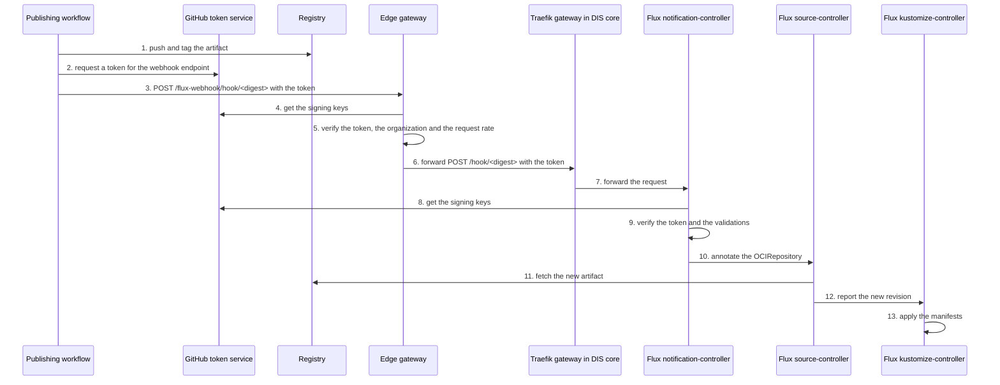

- Feature Name: on_demand_flux_reconcile
- Title: On-demand Flux reconcile for product artifacts
- Start Date: 2026-10-12
- RFC PR: [altinn/altinn-platform#4180](https://github.com/altinn/altinn-platform/pull/4180)
- Github Issue: N/A; implementation issues follow RFC acceptance
- Product/Category: CI/CD
- State: **REVIEW**

# Summary
[summary]: #summary

A publishing workflow can ask Flux to fetch a new product artifact immediately. The workflow sends an authenticated reconcile request to the DIS edge gateway of the environment. The edge gateway verifies the token, limits the request rate and forwards the request to the DIS core cluster. A Flux `Receiver` in the product namespace verifies the token again and starts the reconcile. The reconcile request contains no deployment data, and Flux continues to pull the artifact from the registry. Polling stays as the fallback.

# Motivation
[motivation]: #motivation

Flux finds a new artifact only when the `OCIRepository` polls the registry. Each product sets its poll interval. Dialogporten uses 10 minutes.

After a publishing workflow completes, the cluster waits for the next poll. The table shows the wait for Dialogporten.

| Value | Wait |
|---|---|
| Minimum | 0 minutes |
| Average | 5 minutes |
| Maximum | 10 minutes |

This wait has two effects:

- Each deployment takes longer than necessary.
- A test that runs after a deployment must wait for the maximum time, or it tests the previous release.

A shorter poll interval decreases the wait, but it does not remove the wait. It also adds registry requests for each product in each cluster.

The expected outcome is that Flux starts to fetch the artifact some seconds after the publishing workflow pushes it. No continuous integration (CI) system gets access to the Kubernetes API, and no CI system connects directly to a DIS core cluster.

# Guide-level explanation
[guide-level-explanation]: #guide-level-explanation

## Concepts

| Concept | Meaning |
|---|---|
| Publishing workflow | The GitHub Actions workflow that pushes the Flux Open Container Initiative (OCI) artifact of a product to the registry. |
| Reconcile request | An HTTPS `POST` request that asks Flux to reconcile specified resources immediately. |
| `Receiver` | The Flux resource that accepts a reconcile request. It names the resources that Flux reconciles. |
| Edge gateway | The Envoy Gateway in the DIS edge cluster of an environment. It is the public entry point for the Altinn APIs. [RFC 0015](0015-envoy-gateway-api-edge.md) describes it. |
| Webhook endpoint | The address on the edge gateway where a workflow sends a reconcile request. |
| Cluster route | The route on the gateway of a DIS core cluster to the Flux notification-controller. The edge gateway forwards each reconcile request to it. |

The webhook endpoint of an environment is `https://<platform host name>/flux-webhook`.

| Environment | Platform host name |
|---|---|
| `at22` | `platform.at22.altinn.cloud` |
| `at23` | `platform.at23.altinn.cloud` |
| `at24` | `platform.at24.altinn.cloud` |
| `yt01` | `platform.yt01.altinn.cloud` |
| `tt02` | `platform.tt02.altinn.no` |
| `prod` | `platform.altinn.no` |

## Use the feature

A product team does two steps.

1. Add a `Receiver` to the product syncroot, next to the `OCIRepository` of the product.
2. Call the `trigger-reconcile` action after the step that pushes the artifact.

This is the `Receiver` for a product with the name `example`:

```yaml
apiVersion: notification.toolkit.fluxcd.io/v1
kind: Receiver
metadata:
  name: example-manifests
  namespace: product-example
spec:
  type: generic-oidc
  oidcProviders:
    - issuerURL: https://token.actions.githubusercontent.com
      audience: https://platform.at23.altinn.cloud/flux-webhook
      validations:
        - expression: claims.repository_owner_id == '<organization id>' && claims.repository_id == '<repository id>'
          message: token is not issued to the publishing repository
        - expression: claims.ref == 'refs/heads/main'
          message: token is not issued for the main branch
  resources:
    - apiVersion: source.toolkit.fluxcd.io/v1
      kind: OCIRepository
      name: example-manifests
```

This is the step in the publishing workflow:

```yaml
- name: Trigger Flux reconcile
  continue-on-error: true
  uses: Altinn/altinn-platform/actions/flux/trigger-reconcile@<commit>
  with:
    url: https://platform.at23.altinn.cloud/flux-webhook
    receiver_name: example-manifests
    receiver_namespace: product-example
```

The job must have the permission `id-token: write`.

## Rules for product teams

- The reconcile request is an optimization. Polling continues, and the next poll fetches the artifact if the reconcile request fails.
- Set `continue-on-error: true` on the step. A failed reconcile request must not stop a deployment.
- Send the reconcile request only to the webhook endpoint of the environment that the workflow publishes.
- Use the webhook endpoint as the audience in the `Receiver`. The action uses the same value as the audience of the token.
- Name only the `OCIRepository` in the `Receiver`. Flux reconciles the `Kustomization` when the `OCIRepository` reports a new revision.
- Use the numeric repository id and organization id in the validations. A different repository can get a name again after a rename or a transfer.
- Publish from a GitHub organization that the edge gateway admits. Ask the platform team to add a new organization.
- The reconcile request does not report the deployment result.

## Error messages

The action reports the response of the webhook endpoint.

| Response | Source | Meaning | Correction |
|---|---|---|---|
| `200` | Flux | Flux accepted the reconcile request. | None. |
| `400` | Flux | Flux rejected the token. | Compare the audience and the validations of the `Receiver` with the workflow. |
| `401` | Edge gateway | The token is missing, not valid or expired, or it has a different audience. | Compare the address and the audience with the webhook endpoint of the environment. |
| `403` | Edge gateway | The edge gateway does not admit the GitHub organization of the repository. | Ask the platform team to add the organization. |
| `404` | Flux | No `Receiver` has this name and namespace. | Examine the name, the namespace and the address. |
| `429` | Edge gateway | The request rate is more than the limit. | None. The action tries again, and the next poll fetches the artifact. |
| `503` | Flux | The `Receiver` is suspended or not ready. | Examine the status of the `Receiver`. |

# Reference-level explanation
[reference-level-explanation]: #reference-level-explanation

## Components

| Component | Owner | Location | Function |
|---|---|---|---|
| Edge route | Platform team | `dis-way/gitops-manifests`, package `flux-webhook-receiver`, layer `edge` | Exposes the webhook endpoint on the edge gateway. Verifies the token, limits the request rate and forwards the request to the cluster route. |
| Cluster route | Platform team | `dis-way/gitops-manifests`, package `flux-webhook-receiver`, layer `multitenancy` | Exposes the notification-controller through the Traefik gateway of a DIS core cluster. |
| Edge configuration | Platform team | `dis-way/core`, `flux/clusters/dis-edge-<environment>-aks` | Deploys the edge layer to an edge cluster. |
| Cluster configuration | Platform team | `dis-way/core`, the Terraform configuration of each DIS core cluster | Deploys the multitenancy layer to a DIS core cluster. |
| `trigger-reconcile` action | Platform team | `Altinn/altinn-platform`, `actions/flux/trigger-reconcile` | Gets the token and sends the reconcile request. |
| `Receiver` | Product team | Product syncroot | Verifies the caller and names the resources. |
| Workflow step | Product team | Publishing workflow | Calls the action after the push. |

## Sequence



## Authentication

Two components verify each token: the edge gateway and the notification-controller.

### Edge gateway

A `SecurityPolicy` on the edge route does these checks for each reconcile request:

1. It reads the token from the `Authorization: Bearer` header.
2. It verifies the signature with the keys from `https://token.actions.githubusercontent.com/.well-known/jwks`.
3. It verifies the issuer, the expiry time and the audience of the token.
4. It admits the request only if the `repository_owner_id` claim is in the list of admitted organizations.

The edge gateway forwards the token to the cluster route without a change.

```yaml
apiVersion: gateway.envoyproxy.io/v1alpha1
kind: SecurityPolicy
metadata:
  name: flux-webhook-github-oidc
  namespace: flux-webhook
spec:
  targetRefs:
    - group: gateway.networking.k8s.io
      kind: HTTPRoute
      name: flux-webhook
  jwt:
    providers:
      - name: github-actions
        issuer: https://token.actions.githubusercontent.com
        audiences:
          - https://platform.at23.altinn.cloud/flux-webhook
        remoteJWKS:
          uri: https://token.actions.githubusercontent.com/.well-known/jwks
  authorization:
    defaultAction: Deny
    rules:
      - name: admitted-organizations
        action: Allow
        principal:
          jwt:
            provider: github-actions
            claims:
              - name: repository_owner_id
                values: ["5949420"]
```

### Notification-controller

The `Receiver` has the type `generic-oidc`. This type is available from Flux 2.9. The notification-controller does these checks for each reconcile request:

1. It reads the token from the `Authorization: Bearer` header.
2. It finds the provider whose `issuerURL` is the same as the `iss` claim of the token.
3. It verifies the signature, the expiry time and the audience of the token.
4. It evaluates each Common Expression Language (CEL) expression in `validations` against the claims of the token.

### Token

GitHub issues an OpenID Connect (OIDC) token to each workflow in each repository. A correct signature does not identify the product. The edge gateway examines only the organization. The validations of the `Receiver` must identify the publishing repository and the branch.

The audience is the webhook endpoint of the environment. A token for one environment is not valid in a different environment.

Flux calculates the path of the `Receiver` as `/hook/<sha256(name + namespace)>`. The path is not a secret. The token gives the authentication.

The product does not store a secret in the cluster, and the workflow does not store a secret in GitHub.

## Authorization

A caller can send a valid reconcile request only from the publishing repository and the `main` branch. The same repository and branch can push the artifact to the registry. The feature does not add a new group of trusted callers.

A reconcile request sets the annotation `reconcile.fluxcd.io/requestedAt` on the resources that the `Receiver` names. It cannot select an artifact, a tag or a digest. It cannot change a manifest. The worst result of an incorrect reconcile request is one more poll of the registry.

The multi-tenancy setting of the Flux extension prevents references to a different namespace. A `Receiver` can name only resources in its namespace. A product cannot reconcile the resources of a different product.

The workflow connects only to the edge gateway. All Altinn API clients use the same entry point. The workflow does not connect to the Kubernetes API, and it does not connect directly to a DIS core cluster.

## Edge route

The layer `edge` of the package `flux-webhook-receiver` contains the edge route and its policies.

| Property | Value |
|---|---|
| Gateway | `eg` in the namespace `envoy-gateway-system` |
| Listener | `https` |
| Host name | The platform host name of the environment |
| Path | Prefix `/flux-webhook/hook` |
| Rewrite | Host name `flux-webhook.<DEFAULT_GATEWAY_HOSTNAME>` of the DIS core cluster, and path prefix `/hook` |
| Target | A `Backend` with the host name of the cluster route and port 443 |
| Transport Layer Security (TLS) to the target | A `BackendTLSPolicy` verifies the certificate with the system certificate authorities. |
| Namespace | `flux-webhook`, with the annotation `<platform host name>/edge-allowed-paths: "/flux-webhook"` |

The Dialogporten route on `dis-edge-at23` uses the same `Backend`, `BackendTLSPolicy` and `HTTPRoute` resources to reach a DIS core cluster.

The edge route guard admits the route only if the annotation of the namespace allows the path.

A `BackendTrafficPolicy` on the edge route sets a global rate limit:

- The rate limit service of the edge cluster keeps the counters in Valkey.
- The policy must set `mergeType`. Without `mergeType`, the route policy replaces the gateway policy, and the route loses the limits and timeouts of the gateway.
- Envoy verifies the token and the organization before it applies the rate limit. A request without a valid token does not use the limit.
- The rate limiter fails open. If Valkey is not available, the edge gateway forwards each request that has a valid token.

## Cluster route

The layer `multitenancy` of the package `flux-webhook-receiver` contains one `HTTPRoute` in the namespace `flux-system`.

| Property | Value |
|---|---|
| Gateway | `traefik-gateway` in the namespace `traefik` |
| Listener | `https-wildcard` only |
| Host name | `flux-webhook.<DEFAULT_GATEWAY_HOSTNAME>` |
| Path | Prefix `/hook` |
| Target | Service `webhook-receiver`, port 80 |

The route must not change the path. The notification-controller finds the `Receiver` from the exact path of the request.

The wildcard record in the cluster zone gives the host name. The wildcard certificate of the gateway gives the TLS certificate. The route needs no new record and no new certificate.

The source ranges of the Traefik load balancer apply to the route.

| Cluster | Load balancer admits | Edge gateway can reach the cluster route | Runner can reach the cluster route directly |
|---|---|---|---|
| `at22`, `at23`, `at24`, `yt01`, `tt02` | All sources | Yes | Yes |
| `prod` | Cloudflare, altinn-uptime and the DIS edge cluster | Yes | No |

In the test and staging environments, a caller can send a request to the cluster route without the edge gateway. The checks of the edge gateway do not apply to that request. The notification-controller continues to verify the token.

## Prerequisites

- The DIS core cluster runs the `microsoft.flux` extension 1.26.1 or later. This version contains Flux 2.9.
- The notification-controller can connect to `https://token.actions.githubusercontent.com`. It gets the provider configuration and the signing keys from that address.
- The edge gateway can connect to `https://token.actions.githubusercontent.com`. It gets the signing keys from that address.
- The edge gateway serves the platform host name of the environment.
- The load balancer of the DIS core cluster admits the edge cluster.

## Environment selection

A product publishes its artifact with one tag for each environment. The publishing workflow sends the reconcile request to the webhook endpoint of that environment.

Dialogporten publishes one tag for all environments at this time. [Dialogporten manifests PR #86](https://github.com/Altinn/dialogporten-manifests/pull/86) changes this to one tag for each environment. Until then, the Dialogporten workflow sends the reconcile request only to the environment whose image tags changed. The other clusters fetch the artifact at their next poll and find no change for their environment.

## Corner cases

| Case | Result |
|---|---|
| The `Receiver` does not exist yet. | Flux returns `404`. The next poll fetches the artifact. |
| The cluster runs a Flux version before 2.9. | The API server rejects the `Receiver`. The syncroot `Kustomization` fails until the product removes the `Receiver`. |
| The token is missing, expired or not valid. | The edge gateway returns `401`. The request does not reach the DIS core cluster. |
| The repository is in an organization that the edge gateway does not admit. | The edge gateway returns `403`. The request does not reach the DIS core cluster. |
| Workflows send more requests than the limit. | The edge gateway returns `429`. The next poll fetches the artifact. |
| Valkey is not available. | The rate limiter fails open. The edge gateway and the notification-controller continue to verify each token. |
| The edge gateway cannot get the signing keys from GitHub. | The edge gateway rejects the request. The next poll fetches the artifact. |
| The edge gateway is not available. | The action reports an error. The next poll fetches the artifact. |
| Two publishing workflows send a reconcile request at the same time. | Flux reconciles the `OCIRepository` one time or two times. The result is the same. |
| The reconcile request arrives before the registry has the new tag. | Flux finds no new revision. The next poll fetches the artifact. The step order in the workflow prevents this case. |
| A person captures a token and sends it again. | The token expires after some minutes. A second reconcile request causes one more poll. |
| The `OCIRepository` is suspended. | Flux does not reconcile it. |
| The notification-controller is not available. | The edge gateway returns an error. The source-controller and the kustomize-controller continue to operate. |

## Pilot

Dialogporten in `at23` is the pilot. The pilot needs these changes:

- The action `actions/flux/trigger-reconcile` in this repository: [altinn-platform#4181](https://github.com/Altinn/altinn-platform/pull/4181). The action must also explain the responses `401`, `403` and `429`.
- The layer `multitenancy` of the package `flux-webhook-receiver`: [gitops-manifests#2005](https://github.com/dis-way/gitops-manifests/pull/2005). The layer `edge` does not exist yet.
- The Flux configuration for `dis-core-at23` in `dis-way/core`: [core#396](https://github.com/dis-way/core/pull/396).
- The Flux configuration for `dis-edge-at23` in `dis-way/core`. This change does not exist yet. [core#387](https://github.com/dis-way/core/pull/387) deploys the edge route guard to `dis-edge-at23`.
- The `Receiver` and the workflow step in `Altinn/dialogporten-manifests`: [dialogporten-manifests#89](https://github.com/Altinn/dialogporten-manifests/pull/89). The audience and the address must change to the webhook endpoint on the edge gateway.

# Drawbacks
[drawbacks]: #drawbacks

- The webhook endpoint is on the public platform host name. Through the edge gateway, it connects to a Flux controller in each DIS core cluster.
- Each reconcile request crosses two gateways. More components can fail, and each component can return an error.
- In the test and staging environments, a caller can reach the cluster route without the edge gateway. There, the notification-controller must verify each request, also the requests without a valid token.
- The edge gateway and each `Receiver` must use the same audience.
- The platform team must keep the list of admitted GitHub organizations.
- The feature needs a minimum version of the `microsoft.flux` extension. Azure controls when a cluster gets a new version.
- The edge gateway and the notification-controller need a connection to GitHub to verify a token.
- Each product must add a `Receiver` and a workflow step.
- A failed reconcile request is easy to miss, because the deployment continues.

# Rationale and alternatives
[rationale-and-alternatives]: #rationale-and-alternatives

## Why this design

- The cluster continues to pull. The workflow gets no access to the Kubernetes API and no credentials for the cluster.
- The workflow connects only to the edge gateway, which is the public entry point for the Altinn APIs.
- The edge gateway rejects a request without a valid token before the request reaches a DIS core cluster.
- The edge gateway can limit the request rate. The Traefik gateway in DIS core cannot do this at this time, because the multi-tenant Traefik configuration disables the Traefik `Middleware` resources.
- The production DIS core cluster admits the edge cluster. Thus the design works in production with no change to the load balancer.
- The design uses standard Flux and Envoy Gateway functions. The platform does not operate a new service.
- The design uses no shared secret. Thus there is no secret to store, to rotate or to leak.
- A product team adds and controls its `Receiver`. The platform team does one change for each DIS core cluster and one change for each edge cluster.

## Alternatives

| Alternative | Why not |
|---|---|
| A route directly to the DIS core gateway, without the edge gateway | The production load balancer does not admit the runners. The Traefik gateway cannot limit the request rate. The notification-controller gets all requests from the internet. |
| A shorter poll interval | It decreases the wait and does not remove it. It needs no new component, and a product can use it together with this feature. |
| A `Receiver` of the type `generic-hmac` | It needs a shared secret in the cluster and in GitHub. It works with Flux versions before 2.9. |
| A registry webhook to a `Receiver` of the type `acr` | The `Receiver` does not verify a signature. Each product and each cluster needs one webhook in the shared registry, and the registry has a webhook quota. |
| `az aks command invoke` from the workflow | The workflow gets a path to the Kubernetes API. Microsoft states that the command is not for automated access. Each call starts a pod in the cluster. |
| A network connection from the runners to the API server | The runners get direct access to the Kubernetes API. This is opposite to the pull model in RFC 0001. |
| A reconcile function in DIS Console | The platform team must build and operate a function that Flux already has. |
| A `Receiver` of the type `github` with a repository webhook | GitHub sends the push event before the workflow publishes the artifact. |

## If we do not do this

Each deployment continues to wait for the poll interval.

# Prior art
[prior-art]: #prior-art

- [Flux Receivers](https://fluxcd.io/flux/components/notification/receivers/) describes the `Receiver` types and the `generic-oidc` type.
- [`flux trigger receiver`](https://fluxcd.io/flux/cmd/flux_trigger_receiver/) is the Flux command that sends the same request. The action does not use it, because the shared publishing actions install an earlier Flux version.
- [RFC 0001](0001-pull-based-cd.md) sets the pull model. This RFC keeps that model.
- [RFC 0015](0015-envoy-gateway-api-edge.md) makes Envoy Gateway in the DIS edge cluster the public API edge for Altinn. This RFC adds one route to that edge.
- The Dialogporten route on `dis-edge-at23` forwards requests from the edge gateway to a DIS core cluster. The edge route uses the same resources.
- [RFC 0010](https://github.com/Altinn/altinn-platform/pull/3220) proposes to send Flux events to GitHub. That direction is from the cluster to GitHub. This RFC is the opposite direction.
- The syncroot publishing identity uses GitHub OIDC tokens to push to the registry. This RFC uses the same token source and the same repository and branch conditions.

# Unresolved questions
[unresolved-questions]: #unresolved-questions

Before the team accepts this RFC:

- Which address must the webhook endpoint use: the path `/flux-webhook` on the platform host name, or a separate host name? A separate host name needs a `ListenerSet`, a DNS record and a certificate.
- Which rate limit must the edge route use? Must it be one limit for the environment, or one limit for each repository?
- Which GitHub organizations must the edge gateway admit?
- Must the cluster route admit only the edge cluster in all environments? At this time, only the production load balancer limits the sources.
- Must the platform deploy the cluster route to all multi-tenant clusters from `dis_aks_resources_multitenancy`, or to each cluster on request?
- Must a policy reject a `Receiver` of the type `generic`? That type does no authentication, and the cluster route exposes all `Receiver` resources in the cluster.

Before the feature is stable:

- Do all DIS core clusters run the `microsoft.flux` extension 1.26.1 or later? The implementation must examine each cluster before a product adds a `Receiver`.
- Can the notification-controller and the edge gateway connect to the GitHub token service in all environments?
- Can the applier service account of a product namespace create a `Receiver`?
- Where must the action be after [the action migration](https://github.com/Altinn/altinn-platform/pull/3926): in this repository or in `dis-way/actions`?

Out of scope:

- The deployment result.
- Reconcile requests for platform artifacts.

# Future possibilities
[future-possibilities]: #future-possibilities

- **Report the deployment result to the workflow.** This is the next step. A wait step after the reconcile request can report the result of the deployment. The reconcile request removes the poll interval from the time to that result.
- Send Flux events to GitHub, as RFC 0010 proposes.
- Add the `Receiver` to the default syncroot, so each new product gets it.
- Use reconcile requests for the platform packages in `dis-way/gitops-manifests`.
- Increase the poll interval of a product after its reconcile requests are reliable. This decreases the number of registry requests.
