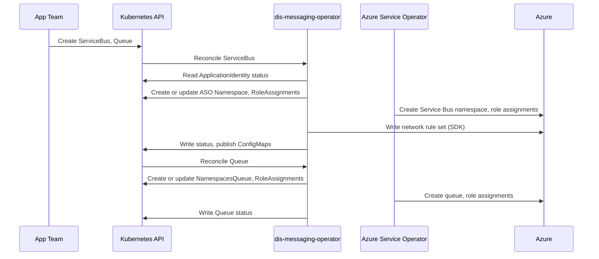

- Feature Name: self_service_messaging
- Title: Self-service messaging
- Start Date: 2026-10-07
- RFC PR: [altinn/altinn-platform#0000](https://github.com/altinn/altinn-platform/pull/0000)
- Github Issue: [altinn/altinn-platform#2545](https://github.com/Altinn/altinn-platform/issues/2545)
- Product/Category: Container Runtime
- State: **REVIEW** (possible states are: **REVIEW**, **ACCEPTED** and **REJECTED**)

# Summary
[summary]: #summary

This RFC adds a new operator: `dis-messaging-operator`. The operator gives app teams a self-service Azure Service Bus.

A team creates a `ServiceBus` custom resource (CR) in its team namespace. The operator creates a Service Bus namespace in Azure. The team adds `Queue` and `Topic` resources next to it. The team grants a role to a DIS application identity. The app authenticates with Entra ID, so there is no connection string or key to store or rotate.

# Motivation
[motivation]: #motivation

Several apps use Service Bus. Today the platform team provisions it with Terraform:

- The Altinn Notifications Service Bus namespace is defined in the legacy platform configuration, one per environment, with one queue and the role assignments.
- The cluster configuration can create a private endpoint to a Service Bus namespace that a product owns in its own subscription. No environment uses it.
- Every new queue, topic or consumer is a pull request to a platform repository.
- The settings predate the DIS defaults for authentication and network access.
- A team gets no status in the cluster. It reads pipeline logs.

The epic [#2545](https://github.com/Altinn/altinn-platform/issues/2545) asks for a Service Bus "with as few knobs and dials as possible", with access granted to an `ApplicationIdentity`.

We want the same model as for databases, key vaults and caches: the team declares a CR next to its app, the operator applies safe defaults, and the team reads status and connection values from the cluster.

# Guide-level explanation
[guide-level-explanation]: #guide-level-explanation

## An app that manages its own entities

Many .NET messaging libraries create their queues and topics at start-up. Such an app needs only the `owner` role:

```yaml
apiVersion: messaging.dis.altinn.cloud/v1alpha1
kind: ServiceBus
metadata:
  name: my-app
  namespace: product-myproduct
spec:
  access:
    principals:
      - role: owner
        identityRef:
          name: my-app
```

The operator then:

1. Waits until the `ApplicationIdentity` `my-app` is ready.
2. Creates a Standard tier Service Bus namespace in the DIS resource group of the cluster. SAS is off. TLS 1.2 is the minimum.
3. Sets the firewall. Only the cluster egress addresses and trusted Azure services can connect.
4. Grants `Azure Service Bus Data Owner` on the Service Bus namespace to the identity.
5. Writes `status.endpoint` and the `Ready` condition.
6. Publishes the ConfigMap `my-app-dis-messaging` with the keys `endpoint` and `namespace`.

The app reads the ConfigMap and connects with its workload identity. One `ServiceBus` is one Service Bus namespace. A team can share it between its apps, or create more than one.

## A queue with a declared consumer and an external producer

This example mirrors the Altinn Notifications flow today. Azure Event Grid is the event routing service in Azure. Other Azure services publish events to it, and it pushes them to a destination such as a Service Bus queue. Here it delivers e-mail reports to a queue:

```yaml
apiVersion: messaging.dis.altinn.cloud/v1alpha1
kind: ServiceBus
metadata:
  name: notifications
spec:
  tier: premium
---
apiVersion: messaging.dis.altinn.cloud/v1alpha1
kind: Queue
metadata:
  name: email-delivery-reports
spec:
  serviceBus:
    name: notifications
  name: altinn.notifications.email.deliveryreports
  access:
    principals:
      - role: receiver
        identityRef:
          name: notifications-worker
      - role: sender
        servicePrincipal:
          name: email-event-grid-topic
          principalId: 11111111-2222-3333-4444-555555555555
```

The team grants access per queue. The Event Grid topic has no `ApplicationIdentity`, so the team grants it by principal ID, from its own Terraform output. The team then points its Event Grid subscription at `status.resourceId` of the `Queue`. The operator does not manage Event Grid. Trusted services need the Premium tier, so an Azure service can deliver only to a Premium namespace.

## A topic with subscriptions

```yaml
apiVersion: messaging.dis.altinn.cloud/v1alpha1
kind: Topic
metadata:
  name: party-events
spec:
  serviceBus:
    name: my-app
  access:
    principals:
      - role: sender
        identityRef:
          name: my-app
  subscriptions:
    - name: updated-only
      rules:
        - name: updated
          sqlFilter: "eventType = 'PartyUpdated'"
      access:
        principals:
          - role: receiver
            identityRef:
              name: sync-worker
```

A subscription belongs to one topic, so the team declares it inside the `Topic`.

# Reference-level explanation
[reference-level-explanation]: #reference-level-explanation

## CRD contract

All kinds are namespaced, in the group `messaging.dis.altinn.cloud/v1alpha1`. Validation is CEL in the CRD and conditions in the reconciler. There is no admission webhook.

### ServiceBus

Spec:

- `tier` (optional): `standard | premium`. Default `standard`. Immutable.
- `capacity` (optional): messaging units, `1 | 2 | 4 | 8 | 16`. Default `1`. Premium only.
- `access.principals[]` (optional): grants on the Service Bus namespace.
- `deletionPolicy` (optional): `Retain | Delete`. Default `Retain`.
- `tags` (optional): extra Azure tags. Platform tags win.

Status: `azureName`, `resourceId`, `endpoint` (`<azureName>.servicebus.windows.net`), `conditions[]` (`Ready`, `NamespaceReady`, `NetworkReady`, `AccessReady`), `observedGeneration`.

### Queue

Spec:

- `serviceBus.name` (required): a `ServiceBus` in the same team namespace.
- `name` (optional): the Azure entity name. Default `metadata.name`. Immutable. Azure allows dots and slashes here.
- `lockDuration`, `maxDeliveryCount`, `defaultMessageTimeToLive`, `maxSizeInMegabytes`, `deadLetteringOnMessageExpiration` (optional): Azure defaults apply.
- `requiresSession`, `requiresDuplicateDetection` (optional): default `false`. Immutable.
- `access.principals[]` (optional): grants on the queue.
- `deletionPolicy` (optional): `Retain | Delete`. Default `Retain`.

Status: `name`, `resourceId`, `conditions[]` (`Ready`, `QueueReady`, `AccessReady`), `observedGeneration`.

### Topic

Spec:

- `serviceBus.name`, `name`, `defaultMessageTimeToLive`, `maxSizeInMegabytes`, `requiresDuplicateDetection`, `deletionPolicy`: as for `Queue`.
- `access.principals[]` (optional): grants on the topic. Roles `sender` and `owner` only.
- `subscriptions[]` (optional). Each has `name` (required), the queue settings above, `deadLetteringOnFilterEvaluationExceptions`, `forwardTo`, `rules[]` and `access.principals[]` with roles `receiver` and `owner` only.
- A rule has `name` and exactly one of `sqlFilter` or `correlationFilter`. No rules means the Azure default rule.

Status: `name`, `resourceId`, `subscriptions[]`, `conditions[]` (`Ready`, `TopicReady`, `SubscriptionsReady`, `AccessReady`), `observedGeneration`.

The spec starts small on purpose. We can add fields later. We cannot remove a field without a new API version, per the [Kubernetes deprecation policy](https://kubernetes.io/docs/reference/deprecation-policy/).

## Platform defaults

The operator sets these values on every Service Bus namespace. A team cannot change them.

| Setting | Value | Note |
|---|---|---|
| `disableLocalAuth` | `true` | Entra ID is the only authentication. |
| `minimumTlsVersion` | `1.2` | |
| `publicNetworkAccess` | `Enabled` | See Networking. |
| firewall `defaultAction` | `Deny` | |
| firewall `ipRules` | cluster egress prefixes and the VPN exit node | From configuration. IPv4 only. |
| firewall `trustedServiceAccessEnabled` | `true` | Premium only. Standard has no trusted services. |
| `premiumMessagingPartitions` | `1` | Premium only. |
| tags | `dis-common/platformtags` | [RFC 0007](https://github.com/Altinn/altinn-platform/blob/main/rfcs/0007-finops-resource-tags.md). |

## Access control

Each principal has a `role` and exactly one source, as in [RFC 0013](https://github.com/Altinn/altinn-platform/blob/main/rfcs/0013-multitenant-dis-databases.md):

- `identityRef.name`: an `ApplicationIdentity` in the same team namespace. The operator resolves it with `dis-common/identityref`. A missing or not-ready identity sets `AccessReady=False` with reason `IdentityNotReady`. The operator requeues.
- `group{name, principalId}`: an Entra group.
- `servicePrincipal{name, principalId}`: any other principal, such as an Azure service or an app in another cluster.

| Role | Azure role | Role definition ID |
|---|---|---|
| `sender` | Azure Service Bus Data Sender | `69a216fc-b8fb-44d8-bc22-1f3c2cd27a39` |
| `receiver` | Azure Service Bus Data Receiver | `4f6d3b9b-027b-4f4c-9142-0e5a2a2247e0` |
| `owner` | Azure Service Bus Data Owner | `090c5cfd-751d-490a-894a-3ce6f1109419` |

The scope is the resource that holds the principal. `owner` on a Service Bus namespace lets an app create and delete its own entities.

The operator creates one Azure Service Operator (ASO) `RoleAssignment` per principal and scope. The name is a UUIDv5 of `namespace/owner/principalId/role`, as in `dis-vault`. The operator removes a role assignment when the principal leaves the spec. It does not touch other role assignments.

## ASO resources

Facts at the time of writing (2026-10-07): the fleet runs ASO 2.20.0. The group `servicebus.azure.com`, version `v1api20240101`, has `Namespace`, `NamespacesQueue`, `NamespacesTopic`, `NamespacesTopicsSubscription`, `NamespacesTopicsSubscriptionsRule` and two authorization rule kinds. It has no kind for the network rule set.

| DIS kind | ASO kinds |
|---|---|
| `ServiceBus` | `Namespace`, `RoleAssignment` per principal |
| `Queue` | `NamespacesQueue`, `RoleAssignment` per principal |
| `Topic` | `NamespacesTopic`, `NamespacesTopicsSubscription`, `NamespacesTopicsSubscriptionsRule`, `RoleAssignment` per principal |

The operator creates the ASO resources in the team namespace with a controller owner reference. The `Namespace` owner is the DIS resource group. The operator never creates authorization rules, because they are SAS rules.

## Networking

Facts at the time of writing: only the Premium tier supports private endpoints and virtual network rules. All tiers support an IP firewall through the Azure Resource Manager (ARM) API.

In v1 every Service Bus namespace uses the public endpoint with the firewall from Platform defaults. Entra ID is the authentication boundary. The firewall is defence in depth.

ASO has no kind for the network rule set. The operator writes it with the Azure SDK for Go under its own workload identity. This is its only direct Azure call. When ASO adds the kind, the operator moves to it.

The rule set cannot live in Terraform. It is a child resource of the Service Bus namespace, and the namespace exists only after a team applies a `ServiceBus` CR. In `dis-pgsql-operator` the static part is a VNet with subnets that exist before any server, and the operator only reads them. Service Bus has no such object. The only network control is this child resource, so the operator must write it. The values stay static: the egress prefixes come from the AKS module, and the operator copies them onto each namespace.

The cluster configuration owns the egress prefixes and passes them to the operator, as it passes `DISVAULT_AKS_SUBNET_IDS`. The list also holds the egress address of the VPN exit node, so developers reach a namespace through the VPN, as they reach databases and key vaults. Service Bus takes IPv4 rules only, so the exit node is allowed by its public address, not by its subnet. Azure ignores `defaultAction: Deny` with an empty rule list, so the operator refuses to start without a prefix.

The clusters are dual-stack, and the firewall takes IPv4 rules only. This is not a problem. Service Bus endpoints have no IPv6 address at the time of writing, so a pod reaches them through the IPv4 prefix. Microsoft states that [Azure PaaS services are reached through their IPv4 endpoints](https://learn.microsoft.com/en-us/azure/virtual-network/ip-services/ipv6-overview#scope).

Azure services such as Event Grid [deliver over the public network](https://learn.microsoft.com/en-us/azure/event-grid/managed-service-identity#private-endpoints), and only the Premium tier lets [trusted services bypass the firewall](https://learn.microsoft.com/en-us/azure/service-bus-messaging/service-bus-ip-filtering#ip-firewall-rules). An Azure service can therefore deliver only to a Premium namespace. A team that needs this runs that namespace on Premium. An allow list of Event Grid addresses is not an option: the ranges change, and a namespace takes at most 128 rules. The firewall has no opt-out.

Private endpoints for Premium namespaces are a second phase. They need subnet join rights for ASO, a private DNS zone per cluster, and `publicNetworkAccess: Disabled`. The trusted services bypass must stay on, because Event Grid [cannot deliver through a private endpoint](https://learn.microsoft.com/en-us/azure/event-grid/managed-service-identity#private-endpoints).

## Connection details

The operator publishes one ConfigMap per `ServiceBus`:

- Name: `<servicebus>-dis-messaging`, hash-suffixed above 63 characters.
- Keys: `endpoint`, `namespace`.
- Labels: `messaging.dis.altinn.cloud/servicebus`, `messaging.dis.altinn.cloud/component=connection`.

The values are the same for every principal, so there is no ConfigMap per principal as in `dis-pgsql-operator`. The entity name is in `status.name`. There is no Secret.

## Reconciliation flow



A `Queue` or `Topic` waits with reason `ServiceBusNotReady` until its `ServiceBus` is ready. The operator watches `ServiceBus` and `ApplicationIdentity`. Each reconcile re-applies the full ASO spec. `Ready` aggregates the other conditions, as in `dis-vault`.

## Naming

Service Bus namespace names are global, 6 to 50 characters. The operator uses the `dis-vault` scheme: `<team namespace>-<name>-<env>`, sanitized and truncated, plus a hash suffix. A taken name sets `NamespaceReady=False` with reason `NamespaceNameConflict`.

Entity names are explicit, default `metadata.name`. Two resources with the same entity name on one `ServiceBus` give a `Conflict` validation error on the second.

## Deletion

`deletionPolicy` defaults to `Retain` on all kinds. With `Retain` the operator sets `serviceoperator.azure.com/reconcile-policy: detach-on-delete` on the ASO resource. The Azure resource and its messages stay. This is the [RFC 0013](https://github.com/Altinn/altinn-platform/blob/main/rfcs/0013-multitenant-dis-databases.md) rule.

With `Delete`, Azure deletes the resource. Service Bus has no soft delete. Messages are lost.

## Limits

The operator keeps a `ResourceQuota` named `dis-messaging` in every namespace with the `product-` prefix. The quota uses [object counts](https://kubernetes.io/docs/concepts/policy/resource-quotas/#object-count-quota) for the three kinds. The API server enforces the counts at admission. There is no webhook.

A quota cannot see the tier. The reconciler limits Premium namespaces instead: a `ServiceBus` above the limit gets `Ready=False` with reason `LimitExceeded`, and no Azure resource.

| Variable | Default |
|---|---|
| `DISMSG_MAX_SERVICEBUS_PER_NAMESPACE` | `2` |
| `DISMSG_MAX_PREMIUM_PER_NAMESPACE` | `1` |
| `DISMSG_MAX_QUEUES_PER_NAMESPACE` | `50` |
| `DISMSG_MAX_TOPICS_PER_NAMESPACE` | `20` |

## Operator's configuration

Environment variables with the prefix `DISMSG_`, validated at start-up, as in `dis-vault-operator`:

| Variable | Meaning |
|---|---|
| `DISMSG_AZURE_SUBSCRIPTION_ID` | Subscription of the DIS resource group |
| `DISMSG_AZURE_TENANT_ID` | Entra tenant |
| `DISMSG_RESOURCE_GROUP` | DIS resource group |
| `DISMSG_LOCATION` | Azure location |
| `DISMSG_ENV` | Environment ID, part of the Azure name |
| `DISMSG_CLUSTER_EGRESS_PREFIXES` | Comma-separated IPv4 prefixes of the cluster |
| `DISMSG_VPN_EXIT_NODE_PREFIXES` | Optional. Comma-separated IPv4 prefixes of the VPN exit node |
| `DISMSG_WORKLOAD_IDENTITY_CLIENT_ID` | Identity for the network rule set call |
| `DISMSG_BASE_TAGS` | JSON object of platform tags |
| `DISMSG_MAX_*` | Limits per team namespace. See Limits. |

## Terraform changes

The Terraform modules keep the permissions and the cluster facts. The operator owns the Service Bus resources.

| Repository | Change |
|---|---|
| `terraform-azurerm-dis-modules`, ASO modules | Add `servicebus.azure.com/*` to `aso_crd_pattern`. Add `Microsoft.ServiceBus/namespaces/*` read, write and delete actions to the custom role. Add the three data role IDs to `aso_delegatable_role_definition_ids`. |
| `terraform-azurerm-dis-modules`, new module | A managed identity for the operator with `Microsoft.ServiceBus/namespaces/networkRuleSets/*` on the DIS resource group. Same shape as `dis_pgsql_multitenancy`. |
| `terraform-azurerm-dis-modules`, `dis_aks_resources_multitenancy` | A Flux configuration with the `DISMSG_*` substitutions. |
| `gitops-manifests` | A platform-system package, per [RFC 0012](https://github.com/Altinn/altinn-platform/blob/main/rfcs/0012-platform-system-flux-syncroot.md). |
| Cluster configuration | Register the `Microsoft.ServiceBus` provider. Remove the private endpoint variable in the second phase. |
| Legacy platform configuration | No change. It retires with the legacy clusters. |

The ASO identity holds the `Role Based Access Control Administrator` role on the DIS resource group, with an attribute-based access control (ABAC) condition. The condition lists the role definition IDs that ASO may assign. Today the list holds only `Reader`. This RFC adds the three Service Bus data roles. ASO can then grant those roles, and nothing else, on resources in the DIS resource group.

## Migration

The existing Service Bus namespaces live in other subscriptions. The operator cannot adopt them. A product that moves to DIS creates a new `ServiceBus` and switches its apps. Service Bus has no data migration, so the team drains the old queues first.

## Tiers

List prices for Norway East in NOK, read from [Azure Service Bus pricing](https://azure.microsoft.com/en-us/pricing/details/service-bus/) on 2026-10-12. Limits are from [Service Bus quotas](https://learn.microsoft.com/en-us/azure/service-bus-messaging/service-bus-quotas).

| Tier | Price | Limits |
|---|---|---|
| Standard | 95 NOK per month, plus operations above 13 million per month | 1000 operations per second, 256 KB messages, no private endpoint |
| Premium | 8.83 NOK per messaging unit per hour, about 6 450 NOK per month | Dedicated capacity, 100 MB messages, private endpoint possible |

A team that hits the Standard limit, as in [#3195](https://github.com/Altinn/altinn-platform/issues/3195), sets `tier: premium`. Platform tags attribute the cost to the product.

# Drawbacks
[drawbacks]: #drawbacks

- The platform gets one more operator to run and update.
- The Standard tier uses the public endpoint. Some teams expect a private endpoint.
- The network rule set is a direct SDK call outside ASO, with its own identity.
- `Retain` leaves Azure resources behind. The platform needs a cleanup process.

# Rationale and alternatives
[rationale-and-alternatives]: #rationale-and-alternatives

1. **Keep provisioning with Terraform in the platform repositories.** Rejected: every change is a platform pull request, and the team gets no status.
2. **Give teams the ASO `servicebus.azure.com` kinds.** Rejected: the ASO defaults keep SAS on and the firewall open, and the ASO API becomes the tenant contract.
3. **Call the Azure SDK for everything, as `dis-apim-operator` does.** Rejected: ASO gives drift repair and status for free.
4. **One platform-owned Premium namespace per environment.** This is the [RFC 0013](https://github.com/Altinn/altinn-platform/blob/main/rfcs/0013-multitenant-dis-databases.md) shared tier. Rejected for v1: a fixed cost of about 6 450 NOK per month and environment, throttling shared between tenants, and cross-subscription networking. A team that wants to share creates one `ServiceBus` and grants each app.
5. **Only the `owner` mode, no `Queue` and `Topic` kinds.** Rejected as the only mode: an Azure service needs an existing queue and a grant before it can deliver.
6. **A broker in the cluster.** Rejected: the apps use Service Bus client libraries, and the platform would own a stateful broker.

Impact of not doing this: Service Bus stays provisioned by hand in several repositories, and products that need it cannot move to DIS without platform work per environment.

# Prior art
[prior-art]: #prior-art

- [RFC 0009 - self_service_key_vault](https://github.com/Altinn/altinn-platform/blob/main/rfcs/0009-self-service-key-vault.md): one resource per CR, hashed Azure names, role assignments owned by the resource.
- [RFC 0013 - multitenant_dis_databases](https://github.com/Altinn/altinn-platform/blob/main/rfcs/0013-multitenant-dis-databases.md): the principal model, explicit entity names, `Retain` by default, the ConfigMap contract.
- [RFC 0014 - self_service_cache](https://github.com/Altinn/altinn-platform/blob/main/rfcs/0014-self-service-cache.md): a small spec and platform defaults.
- The legacy Altinn Notifications setup: data roles per consumer and a queue that Event Grid delivers to.

# Unresolved questions
[unresolved-questions]: #unresolved-questions

- The limit values per team namespace. The defaults in Limits are a starting point.
- Cleanup of retained resources.
- Diagnostic settings and metrics for teams.
- The upstream ASO request for a network rule set kind, so the SDK path can go away.

# Future possibilities
[future-possibilities]: #future-possibilities

- Private endpoints for Premium namespaces.
- Azure Event Hubs in the same group. The operator is named `dis-messaging-operator` for this reason.
- Fields that v1alpha1 leaves out: partitions, auto-delete, forwarding on queues, geo-replication, customer-managed keys.
- `DisApp` binding through the ConfigMap labels, as [RFC 0013](https://github.com/Altinn/altinn-platform/blob/main/rfcs/0013-multitenant-dis-databases.md) describes.
- An Event Grid subscription kind, so a product keeps the whole delivery chain in Git. Today the subscription lives in the product's own Terraform configuration.
- An allow list of extra prefixes on a `ServiceBus`, for a consumer in another cluster.
- A firewall opt-out for a Standard namespace that must receive from an Azure service. The namespace then relies on Entra ID alone.
- A Kyverno policy that audits the tier per environment.
