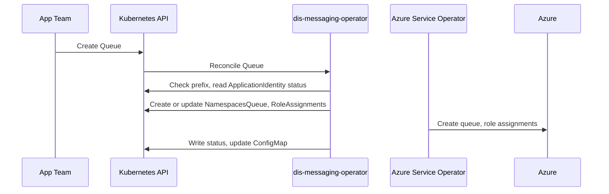

- Feature Name: self_service_messaging
- Title: Self-service messaging
- Start Date: 2026-10-07
- RFC PR: [altinn/altinn-platform#4182](https://github.com/Altinn/altinn-platform/pull/4182)
- Github Issue: [altinn/altinn-platform#2545](https://github.com/Altinn/altinn-platform/issues/2545)
- Product/Category: Container Runtime
- State: **REVIEW** (possible states are: **REVIEW**, **ACCEPTED** and **REJECTED**)

# Summary
[summary]: #summary

This RFC adds a new operator: `dis-messaging-operator`. It gives app teams self-service queues on Azure Service Bus.

The platform runs one Service Bus namespace per cluster. Terraform creates it. A team declares `Queue` resources in its product namespace. The operator creates the queues in the shared namespace and grants the team's DIS application identities the sender or receiver role on them. The app authenticates with Entra ID, so there is no connection string or key to store or rotate.

The platform owns the namespace and decides who may use it. The team owns its queues.

# Motivation
[motivation]: #motivation

Several apps use Service Bus. Today three teams provision their namespaces with three tools and three sets of conventions:

- Every new queue or consumer is a pull request to an infrastructure repository.
- The apps that share a namespace hold the owner role on all of it. Each app can delete the queues of the other apps.
- Eight Premium namespaces run at one messaging unit each, most of them nearly idle.
- A team gets no status in the cluster. It reads pipeline logs.

The epic [#2545](https://github.com/Altinn/altinn-platform/issues/2545) asks for a Service Bus "with as few knobs and dials as possible", with access granted to a DIS application identity.

We want the same model as for databases, key vaults and caches: the team declares a resource next to its app, the operator applies safe defaults, and the team reads status and connection values from the cluster.

# Guide-level explanation
[guide-level-explanation]: #guide-level-explanation

## A queue between two apps

A team declares a queue in its product namespace. One app sends, one app consumes:

```yaml
apiVersion: messaging.dis.altinn.cloud/v1alpha1
kind: Queue
metadata:
  name: orders
  namespace: product-myproduct
spec:
  name: myproduct.orders
  access:
    principals:
      - role: sender
        identityRef:
          name: my-api
      - role: consumer
        identityRef:
          name: my-worker
```

The operator then:

1. Checks that `spec.name` starts with the product prefix, `myproduct.`.
2. Creates the queue in the shared Service Bus namespace of the cluster.
3. Grants `my-api` the Azure role Service Bus Data Sender on the queue, and `my-worker` the roles Data Sender and Data Receiver. A consumer needs both, because retries re-send a scheduled copy to the same queue.
4. Writes `status.name` and the `Ready` condition.
5. Adds the queue to the ConfigMap `dis-messaging` in the product namespace.

The apps read the host name and the queue name from the ConfigMap and connect with their workload identity.

## A queue that an Azure service delivers to

Azure Event Grid delivers events over the public network with its own managed identity. The team grants that identity by principal ID, because it has no `ApplicationIdentity`:

```yaml
apiVersion: messaging.dis.altinn.cloud/v1alpha1
kind: Queue
metadata:
  name: delivery-reports
  namespace: product-myproduct
spec:
  name: myproduct.delivery.reports
  requiresDuplicateDetection: true
  access:
    principals:
      - role: sender
        servicePrincipal:
          name: email-event-grid-topic
          principalId: 11111111-2222-3333-4444-555555555555
      - role: consumer
        identityRef:
          name: my-api
```

The team then points its Event Grid subscription at `status.resourceId`. The shared namespace runs the Premium tier, so trusted Azure services pass the firewall.

## An app that creates its own queues today

Many .NET messaging libraries create their queues when the app starts. Such an app holds the owner role on the whole namespace. In a shared namespace that role lets the app delete the queues of other products, so the operator does not grant it. The team declares its queues in Git instead, and the app runs with the sender and receiver roles.

For Wolverine, the library the Core apps use, this is a small change. Here is the worst case among those apps, as a neutral example. `dis-example-app` has three components with three identities, nine queues, and one external producer.

The shared configuration code changes in one method. It connects with workload identity when a namespace host is given, never creates queues, never creates Wolverine's system queues, and purges only on an explicit setting:

```csharp
var bus = string.IsNullOrEmpty(settings.ServiceBusNamespace)
    ? opts.UseAzureServiceBus(settings.ServiceBusConnectionString)
    : opts.UseAzureServiceBus(settings.ServiceBusNamespace, new DefaultAzureCredential());

bus.SystemQueuesAreEnabled(false);

if (settings.PurgeOnStartup)
{
    bus.AutoPurgeOnStartup();
}
```

The connection string branch stays for the emulator in local development and tests. The `AutoProvision()` call is gone. The queue names in the settings file do not change, because they already carry the product prefix.

Each component gets the host name from the ConfigMap:

```yaml
env:
  - name: WolverineSettings__ServiceBusNamespace
    valueFrom:
      configMapKeyRef:
        name: dis-messaging
        key: endpoint
```

The team declares the nine queues. Two of them in full:

```yaml
apiVersion: messaging.dis.altinn.cloud/v1alpha1
kind: Queue
metadata:
  name: jobs-a
  namespace: product-example
spec:
  name: example.jobs.a
  access:
    principals:
      - role: sender
        identityRef:
          name: example-api
      - role: consumer
        identityRef:
          name: example-worker
---
apiVersion: messaging.dis.altinn.cloud/v1alpha1
kind: Queue
metadata:
  name: reports-a
  namespace: product-example
spec:
  name: example.reports.a
  access:
    principals:
      - role: sender
        servicePrincipal:
          name: reports-event-grid-topic
          principalId: 11111111-2222-3333-4444-555555555555
      - role: consumer
        identityRef:
          name: example-api
```

The other seven follow the same pattern:

| Queue | Sender | Consumer |
|---|---|---|
| `example.jobs.b` | example-api | example-worker |
| `example.jobs.c` | example-api | example-dispatcher |
| `example.jobs.a.status` | example-worker | example-worker |
| `example.jobs.a.result` | example-worker | example-api |
| `example.jobs.a.ratelimit` | example-worker | example-api |
| `example.jobs.c.result` | example-dispatcher | example-api |
| `example.reports.c` | example-dispatcher | example-api |

In total: one method, two settings, one environment variable per component, and nine declarations of about 14 lines each. The declarations mirror the list of queue names the team already keeps in its settings file.

# Reference-level explanation
[reference-level-explanation]: #reference-level-explanation

## The boundary

The Service Bus namespace is the line between the platform and the teams:

- The platform owns the namespace: tier, capacity, firewall, private endpoint, authentication, diagnostics, tags and cost. It decides who may use it, and with what roles.
- The team owns its queues: names, settings and lifetime, declared in Git.

Azure sets this line. A role can be limited to one queue. The right to create a queue cannot be limited to less than the whole namespace, because the queue does not exist yet. So an app that creates its own queues needs the owner role on the namespace, and the owner role on a shared namespace removes the isolation between products. In the first version the operator creates the queues and refuses the owner role. See Roles.

## CRD contract

One kind, `Queue`, namespaced, in the group `messaging.dis.altinn.cloud/v1alpha1`. Validation is CEL in the CRD and conditions in the reconciler. There is no admission webhook.

Spec:

- `name` (required): the Azure queue name. Immutable. It must start with the product prefix. Azure allows dots and slashes here.
- `lockDuration`, `maxDeliveryCount`, `defaultMessageTimeToLive`, `maxSizeInMegabytes`, `deadLetteringOnMessageExpiration` (optional): Azure defaults apply. Durations are ISO 8601.
- `requiresSession`, `requiresDuplicateDetection` (optional): default `false`. Immutable, because Azure fixes them at creation.
- `access.principals[]` (optional): grants on the queue. See Roles.
- `deletionPolicy` (optional): `Retain | Delete`. Default `Retain`.

Status: `name`, `resourceId`, `conditions[]` (`Ready`, `QueueReady`, `AccessReady`), `observedGeneration`.

The spec starts small on purpose. We can add fields later. We cannot remove a field without a new API version, per the [Kubernetes deprecation policy](https://kubernetes.io/docs/reference/deprecation-policy/).

## Roles

Each principal has a `role` and exactly one source, as in the `dis-pgsql-operator` `Database` API:

- `identityRef.name`: an `ApplicationIdentity` in the same product namespace. The operator resolves it with `dis-common/identityref`. A missing or not-ready identity sets `AccessReady=False` with reason `IdentityNotReady`, and the operator requeues.
- `group{name, principalId}`: an Entra group.
- `servicePrincipal{name, principalId}`: any other principal, such as an Azure service or an app in another cluster.

| Role | Azure roles on the queue |
|---|---|
| `sender` | Azure Service Bus Data Sender |
| `receiver` | Azure Service Bus Data Receiver |
| `consumer` | Data Sender and Data Receiver |
| `owner` | Not granted in the first version |

`consumer` exists because every listener needs both roles: Wolverine and MassTransit re-send a scheduled copy to the same queue when a handler fails.

`owner` is in the API so that the platform can allow it later for a namespace that runs the trusted model. In the first version the reconciler sets `AccessReady=False` with reason `RoleNotAllowed`, and the Azure ABAC condition on the ASO identity does not contain the owner role. See Terraform changes.

The operator creates one Azure Service Operator (ASO) `RoleAssignment` per principal and role. The Azure name is a UUIDv5 of `namespace/queue/principalId/role`, as in `dis-vault`. The operator sets `principalType` to `ServicePrincipal` for identities and service principals, and `Group` for groups. It removes a role assignment when the principal leaves the spec. It does not touch other role assignments.

## Naming

Every queue name starts with the product prefix. The default prefix is the product name followed by a dot, for example `myproduct.` for the namespace `product-myproduct`. The platform can set another prefix for a product namespace with the annotation `messaging.dis.altinn.cloud/prefix`. A name without the prefix sets `Ready=False` with reason `InvalidName`.

The prefix gives every queue an owner that a human or an agent reads from the name, and it prevents collisions between products in the shared namespace.

Two `Queue` resources with the same `spec.name` give a `Conflict` condition on the newer one. The reconciler lists the `Queue` resources in the cluster that share the name and lets the oldest one win. The operator does not take over an ASO resource it does not own.

## The platform namespace

Terraform creates one Service Bus namespace per cluster, with these settings:

| Setting | Value | Note |
|---|---|---|
| Tier | Premium in production-like environments, Standard in test | The Standard tier shares 1000 operations per second across all products |
| Capacity | 1 messaging unit, autoscale to 2 | Azure scales online. Terraform ignores the capacity field after creation, as the shared modules do for other Azure-managed fields |
| `disableLocalAuth` | `true` | Entra ID is the only authentication |
| `minimumTlsVersion` | `1.2` | |
| Firewall | Default action Deny. Cluster egress prefixes and the VPN exit node allowed. Trusted services allowed | Developers reach the namespace through the VPN, as they reach databases and key vaults |
| Diagnostic settings | Management operations and errors to Log Analytics | See Audit |
| Delete lock | On | The namespace cannot be deleted by accident |
| Tags | Platform tags per [RFC 0007](https://github.com/Altinn/altinn-platform/blob/main/rfcs/0007-finops-resource-tags.md) | |

The namespace resource ID reaches the operator as configuration. The operator never creates, changes or deletes a namespace.

A private endpoint for the namespace is a second phase. It needs subnet join rights for ASO and a private DNS zone per cluster. Event Grid [cannot deliver through a private endpoint](https://learn.microsoft.com/en-us/azure/event-grid/managed-service-identity#private-endpoints), so the trusted services bypass must stay on.

## ASO resources

Facts at the time of writing (2026-10-13): the fleet runs ASO 2.20.0. The group `servicebus.azure.com`, version `v1api20240101`, has the kind `NamespacesQueue`.

| DIS resource | ASO resources |
|---|---|
| `Queue` | `NamespacesQueue`, owned by the namespace through `owner.armId`; one `RoleAssignment` per principal and role, with the queue as scope |

The operator creates the ASO resources in the product namespace with a controller owner reference.

## Connection details

The operator keeps one ConfigMap named `dis-messaging` in every product namespace that has a `Queue`:

- Key `endpoint`: the host name of the shared namespace, `<name>.servicebus.windows.net`.
- One key per `Queue`, `queue.<metadata.name>`, with the Azure queue name.
- Labels: `messaging.dis.altinn.cloud/component=connection`.

There is no Secret. The app authenticates with its workload identity.

## Reconciliation flow



The operator watches `Queue` and `ApplicationIdentity`. Each reconcile re-applies the full ASO spec. `Ready` aggregates the other conditions, as in `dis-vault`.

## Deletion

`deletionPolicy` defaults to `Retain`. The operator sets `serviceoperator.azure.com/reconcile-policy: detach-on-delete` on the ASO resource, so the queue and its messages stay in Azure when the `Queue` is deleted. This is the [RFC 0013](https://github.com/Altinn/altinn-platform/blob/main/rfcs/0013-multitenant-dis-databases.md) rule.

With `Delete`, Azure deletes the queue and its messages at once.

## Limits

The operator keeps a `ResourceQuota` named `dis-messaging` in every product namespace. The quota uses an [object count](https://kubernetes.io/docs/concepts/policy/resource-quotas/#quota-on-object-count) for `Queue`. The API server enforces it at admission, and the team sees a rejection in its Flux Kustomization status. The default is 50 per product namespace, from configuration.

## Operating the shared namespace

The isolation between products holds because no app holds the owner role. These measures cover the rest:

- **Inventory.** The operator lists the queues in the namespace at an interval, with the Reader role, and reports every queue that matches no product prefix. That list is the cleanup backlog, and it catches a queue created outside Git.
- **Audit.** The diagnostic logs record every management operation on the namespace with the principal's object ID. The operator reads them from Log Analytics, translates the object ID to the `ApplicationIdentity` name, and publishes each operation as a Kubernetes event in the product namespace of the acting identity.
- **Capacity.** The operator reports the current messaging units and the namespace utilisation in its metrics, so a team sees when its load caused the second unit.
- **Purge rule.** A Wolverine app that purges its queues on start-up must bind that to an explicit setting, never to the environment name. A Kyverno audit policy flags a pod in a product namespace that runs with `ASPNETCORE_ENVIRONMENT=Development`.

dis-console can show the inventory, the audit trail and the capacity per cluster, and can serve the same data to agents.

## Operator's configuration

Environment variables with the prefix `DISMSG_`, validated at start-up, as in `dis-vault-operator`:

| Variable | Meaning |
|---|---|
| `DISMSG_AZURE_SUBSCRIPTION_ID` | Subscription of the namespace |
| `DISMSG_AZURE_TENANT_ID` | Entra tenant |
| `DISMSG_NAMESPACE_RESOURCE_ID` | Resource ID of the shared namespace |
| `DISMSG_ENV` | Environment ID |
| `DISMSG_BASE_TAGS` | JSON object of platform tags |
| `DISMSG_MAX_QUEUES_PER_NAMESPACE` | Quota per product namespace |
| `DISMSG_LOG_ANALYTICS_WORKSPACE_ID` | Workspace with the diagnostic logs |

## Terraform changes

| Repository | Change |
|---|---|
| `terraform-azurerm-dis-modules`, new module | The Service Bus namespace with the settings in The platform namespace, and the Reader role for the operator identity |
| `terraform-azurerm-dis-modules`, ASO modules | Add `servicebus.azure.com/*` to `aso_crd_pattern`. Add the read, write and delete actions for namespace queues to the custom role. Add the Data Sender and Data Receiver role IDs to `aso_delegatable_role_definition_ids` |
| `terraform-azurerm-dis-modules`, `dis_aks_resources_multitenancy` | A Flux configuration with the `DISMSG_*` substitutions |
| `gitops-manifests` | A platform-system package, per [RFC 0012](https://github.com/Altinn/altinn-platform/blob/main/rfcs/0012-platform-system-flux-syncroot.md) |
| Cluster configuration | Register the `Microsoft.ServiceBus` provider |

The ASO identity holds the `Role Based Access Control Administrator` role on the DIS resource group, with an attribute-based access control (ABAC) condition that lists the role definition IDs it may assign. Today the list holds only `Reader`. This RFC adds Data Sender and Data Receiver. The Data Owner role is not on the list, so Azure refuses an owner grant even if the operator asks for one.

## Migration

The four Core apps run on Wolverine and need the change shown in the guide: one method, the switch from a connection string to workload identity, and the declared queues. Their queue names already carry a product prefix. This RFC assumes that the Core apps share one product namespace, as they share one Kubernetes namespace today.

The register and Dialogporten apps run on MassTransit. MassTransit reads every queue through the Service Bus management API on every start, and it creates queues and topics on its own. It needs the owner role on the namespace. Both teams keep the namespaces they run today. The owner role on a shared namespace is the extension described in Future possibilities.

## Cost

List prices for Norway East in NOK, read from [Azure Service Bus pricing](https://azure.microsoft.com/en-us/pricing/details/service-bus/) on 2026-10-13. One Premium messaging unit costs 8.83 NOK per hour, about 6 450 NOK per month.

| Model | Premium namespaces in three production-like environments | Cost per year |
|---|---|---|
| One namespace per product, as today | 9 | about 696 000 NOK |
| One shared namespace per environment | 3 | about 232 000 NOK |

Test environments run the Standard tier at about 95 NOK per month per namespace.

# Drawbacks
[drawbacks]: #drawbacks

- The platform gets one more operator to run and update.
- Teams that let their library create queues must declare them in Git instead. For MassTransit apps that is not possible without the owner role, so they stay outside the shared namespace.
- One namespace per cluster shares capacity between products. The platform must watch it and scale it.
- `Retain` leaves queues behind. The inventory shows them, and the platform needs a cleanup process.

# Rationale and alternatives
[rationale-and-alternatives]: #rationale-and-alternatives

1. **One Service Bus namespace per team, created by the operator.** The first draft of this RFC. Rejected for the first version: about 464 000 NOK per year more for the same apps, and the operator would need to write the firewall through the SDK, because ASO has no kind for it.
2. **A shared namespace where every app holds the owner role.** Works for all six apps as they are, including MassTransit. Rejected as the default: each app can delete the queues of every other product, and the isolation rests on trust and rules alone. It stays available as an extension.
3. **Give teams the ASO `servicebus.azure.com` kinds.** Rejected: the ASO API becomes the tenant contract, and the ASO defaults keep SAS on.
4. **No operator: Terraform plus a grant field on `ApplicationIdentity`.** Enough for a trusted namespace. Rejected: the declared queues, the prefix check, the inventory and the audit trail need a reconciler.
5. **A broker in the cluster.** Rejected: the apps use Service Bus client libraries, and the platform would own a stateful broker.

Impact of not doing this: three teams keep three ways to run Service Bus, the Core apps keep owner rights on a namespace they share, and products that need Service Bus cannot move to DIS without platform work per environment.

# Prior art
[prior-art]: #prior-art

- [RFC 0009 - self_service_key_vault](https://github.com/Altinn/altinn-platform/blob/main/rfcs/0009-self-service-key-vault.md): role assignments owned by the resource, operator configuration by environment.
- [RFC 0013 - multitenant_dis_databases](https://github.com/Altinn/altinn-platform/blob/main/rfcs/0013-multitenant-dis-databases.md): the shared tier, explicit entity names, `Retain` by default, the ConfigMap contract.
- [RFC 0014 - self_service_cache](https://github.com/Altinn/altinn-platform/blob/main/rfcs/0014-self-service-cache.md): a small spec and platform defaults.
- The RabbitMQ messaging topology operator: queue, exchange and permission kinds in front of a shared broker, with `retain` as a deletion option. RabbitMQ can limit the create right to a name pattern. Service Bus cannot. That is why the operator creates the queues here.

# Unresolved questions
[unresolved-questions]: #unresolved-questions

- The product namespace layout for the Core apps. This RFC assumes one.
- The quota value per product namespace.
- Cleanup of retained queues.
- The second phase with a private endpoint, and how the VPN exit node reaches it.
- Whether a `Topic` kind is needed before a team asks for one.

# Future possibilities
[future-possibilities]: #future-possibilities

- **The owner role on a namespace.** Enabling `owner` in the reconciler and adding the Data Owner role to the ABAC list turns a namespace into the trusted model, where apps create their own entities. This is the path for MassTransit apps that want the shared namespace. It needs no change to the `Queue` API.
- A `Topic` kind with subscriptions and rules.
- A Service Bus namespace per product for a team that needs isolation of capacity or cost, as a second namespace in the same operator configuration.
- A private endpoint for the namespace.
- An agent interface in dis-console over the inventory and the audit trail.
