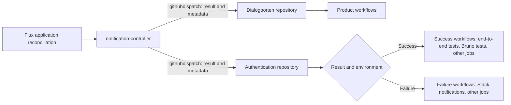

- Feature Name: flux_workflow_notifications
- Title: Trigger GitHub workflows from Flux reconciliation results
- Start Date: 2026-10-15
- RFC PR: [altinn/altinn-platform#4214](https://github.com/Altinn/altinn-platform/pull/4214)
- Github Issue: N/A; implementation issues follow RFC acceptance.
- Product/Category: CI/CD
- State: **REVIEW**

# Summary
[summary]: #summary

Flux sends reconciliation events directly to product repositories through its notification-controller and the `githubdispatch` provider. After a deployment succeeds or a reconciliation attempt fails, product-owned GitHub workflows run the required follow-up jobs. Examples include Slack notifications, end-to-end tests and Bruno tests. Each event identifies the product, environment, cluster, resource and available release information. This completes the reverse direction of the accepted [RFC 0017](https://github.com/Altinn/altinn-platform/blob/main/rfcs/0017-on-demand-flux-reconcile.md). The design requires a verified Flux fix before rollout, because the inspected notification-controller filters out the final success event. Delivery is best effort, and workflows must tolerate missing, repeated and late events.

# Motivation
[motivation]: #motivation

A publishing workflow finishes before Flux finishes the application rollout. Product teams need the deployment result before they run follow-up jobs. A fixed delay can start tests against the previous release. A long delay also wastes time after a fast rollout.

RFC 0017 lets GitHub request a reconcile after it publishes an artifact. That request does not report the result. This RFC sends the result from Flux to GitHub, including reconciles that start through polling or manual requests.

Example use cases are:

- Send a Slack message when a deployment fails, with the environment, revision and failure details.
- Run end-to-end tests when a deployment succeeds.
- Run Bruno tests or other application checks when a deployment succeeds.
- Run any other product-owned GitHub workflow jobs selected by the deployment result and environment.

These examples do not limit the supported workflow jobs. Dialogporten, Authentication and other products choose the jobs in their own repositories. Adding a new follow-up job does not require a change to the platform event integration.

The expected outcome is a workflow that starts soon after Flux reports the result. GitHub queue time and runner availability still affect the start time. A workflow receives the result without access to the Kubernetes application programming interface (API).

# Guide-level explanation
[guide-level-explanation]: #guide-level-explanation

## Concepts

| Concept | Meaning |
|---|---|
| Application Kustomization | The Flux resource that applies the application and checks its required workloads. |
| Subscription | An `Alert` and its `Provider`, which connect named Flux resources to one GitHub repository. |
| Dispatch | A GitHub `repository_dispatch` event that can start workflows in the receiving repository. |
| Reconciliation result | A successful reconciliation, a failed reconciliation attempt, or a waiting state. |
| Artifact revision | The revision of the manifest artifact that Flux reconciles. For an Open Container Initiative (OCI) artifact, it includes the digest. |
| Application commit | The full Git commit identifier for the application code. It can differ from the manifest commit. |

## How it works



Each arrow to GitHub represents a separate subscription. A product event goes only to the repository configured by that subscription.

For example, Authentication version `1.0.0` finishes reconciliation in staging at 13:05. GitHub receives the event and starts the configured staging jobs when a runner is available. These jobs can run end-to-end tests, Bruno tests and other tasks. Jobs for the test environment do not run. If the deployment fails, a failure workflow can send a Slack message with the failure details.

The platform sends one event to the repository. The product owns the workflow selection, job logic, test tools and notification destinations inside that repository. The platform does not select a workflow filename or a Git branch.

The event starts a new workflow run. It does not resume the workflow that requested reconciliation. Correlation uses the artifact revision, because the RFC 0017 request contains no deployment data. There is no one-to-one mapping between reconcile requests and result events.

The RFC 0017 route, Receiver and workflow step are optional for this feature. Polling also produces reconciliation results. The [RFC 0017 implementation tracker](https://github.com/Altinn/altinn-platform/issues/4237) covers the inbound path separately. An inbound request failure does not prove a deployment failure, because polling can still deploy the artifact.

## Configure a product

1. Select the application Kustomization that represents the rollout.
2. Configure health checks for its required workloads.
3. Register the destination repository and its GitHub App credentials with the platform team.
4. Add the Provider and Alert to the product syncroot.
5. Add the receiving workflow to the destination repository's default branch.
6. Validate both success and failure events before enabling the follow-up jobs.

The examples use illustrative Authentication resource names and cluster names. They are not verified deployment configuration.

This subscription receives application events and source errors:

```yaml
apiVersion: notification.toolkit.fluxcd.io/v1beta3
kind: Provider
metadata:
  name: application-github
  namespace: product-authentication
spec:
  type: githubdispatch
  address: https://github.com/Altinn/altinn-authentication
  secretRef:
    name: application-github-app
---
apiVersion: notification.toolkit.fluxcd.io/v1beta3
kind: Alert
metadata:
  name: application-reconciliation
  namespace: product-authentication
spec:
  providerRef:
    name: application-github
  eventSeverity: info
  eventSources:
    - kind: Kustomization
      name: authentication-app
  eventMetadata:
    schema_version: "1"
    product: authentication
    environment: staging
    cluster: staging-cluster
    repository: Altinn/altinn-authentication
---
apiVersion: notification.toolkit.fluxcd.io/v1beta3
kind: Alert
metadata:
  name: application-source-errors
  namespace: product-authentication
spec:
  providerRef:
    name: application-github
  eventSeverity: error
  eventSources:
    - kind: OCIRepository
      name: authentication-app
  eventMetadata:
    schema_version: "1"
    product: authentication
    environment: staging
    cluster: staging-cluster
    repository: Altinn/altinn-authentication
```

`eventSeverity: info` includes errors. Do not add another error Alert for the same Kustomization and Provider. That creates overlapping subscriptions. The source Alert covers failures before the Kustomization can fetch an artifact.

Use exact resource names. The subscription must not select every resource in the namespace. Keep the Provider, its Secret, the Alerts and their event sources in the same product namespace. Cross-namespace access is not necessary.

## Define application readiness

Set `spec.wait: true` or explicit `spec.healthChecks` on the application Kustomization. Set a timeout that covers the expected rollout duration.

This fragment checks a required Deployment:

```yaml
apiVersion: kustomize.toolkit.fluxcd.io/v1
kind: Kustomization
metadata:
  name: authentication-app
  namespace: product-authentication
spec:
  # Keep the existing sourceRef, path, interval and other application settings.
  healthChecks:
    - apiVersion: apps/v1
      kind: Deployment
      name: authentication
      namespace: product-authentication
  timeout: 5m
```

The product must include every workload required for a completed application rollout. A parent Kustomization that creates child Kustomizations is not sufficient unless its health checks cover those children. A downloaded OCI artifact does not prove application readiness. End-to-end tests and Bruno tests run as follow-up jobs, separate from Flux health checks.

## Receive the event in GitHub

The native Provider derives `event_type` from the resource: `{Kind}/{Name}.{Namespace}`. It puts the Flux event in `client_payload`. It does not support a custom event name such as `deployment-succeeded`.

The following workflow shows result and environment routing. It assumes two product-owned reusable workflows:

| Workflow | Inputs | Example jobs |
|---|---|---|
| `deployment-succeeded.yml` | `environment`, `expected_revision` | End-to-end tests, Bruno tests and other tasks after success. |
| `deployment-failed.yml` | `environment`, `flux_event` | A Slack notification with the failure details, or other tasks after failure. |

These filenames are examples. Each product supplies its workflows, job configuration and required credentials. Jobs that test the running application verify its release before testing. The cluster names and App sender identifier must match the subscription.

```yaml
name: Application reconciled
on:
  repository_dispatch:
    types:
      - Kustomization/authentication-app.product-authentication
      - OCIRepository/authentication-app.product-authentication

permissions:
  contents: read

jobs:
  classify:
    runs-on: ubuntu-latest
    outputs:
      outcome: ${{ steps.event.outputs.outcome }}
      environment: ${{ steps.event.outputs.environment }}
      revision: ${{ steps.event.outputs.revision }}
    steps:
      - id: event
        uses: actions/github-script@3a2844b7e9c422d3c10d287c895573f7108da1b3 # v9
        env:
          EXPECTED_SENDER_ID: ${{ vars.FLUX_DISPATCH_BOT_ID }}
        with:
          script: |
            const e = context.payload.client_payload;
            const m = e?.metadata ?? {};
            const o = e?.involvedObject ?? {};
            const clusters = {staging: 'staging-cluster', test: 'test-cluster'};
            const controllers = {
              Kustomization: 'kustomize-controller',
              OCIRepository: 'source-controller'
            };
            const valid = process.env.EXPECTED_SENDER_ID &&
              String(context.payload.sender?.id) === process.env.EXPECTED_SENDER_ID &&
              m.schema_version === '1' && m.product === 'authentication' &&
              m.repository === 'Altinn/altinn-authentication' &&
              Object.hasOwn(clusters, m.environment) &&
              m.cluster === clusters[m.environment] &&
              o.name === 'authentication-app' && o.namespace === 'product-authentication' &&
              Object.hasOwn(controllers, o.kind) &&
              e.reportingController === controllers[o.kind] &&
              context.payload.action === `${o.kind}/${o.name}.${o.namespace}`;
            if (!valid) throw new Error('Unrecognized Flux event');
            const success = o.kind === 'Kustomization' &&
              e.reason === 'ReconciliationSucceeded' && e.severity === 'info';
            const outcome = e.severity === 'error' ? 'failed' : success ? 'succeeded' : 'ignored';
            if (success && !/^.+@sha256:[a-f0-9]{64}$/.test(m.revision ?? '')) {
              throw new Error('Missing OCI artifact revision');
            }
            core.setOutput('outcome', outcome);
            core.setOutput('environment', m.environment);
            core.setOutput('revision', m.revision ?? '');

  success-staging:
    needs: classify
    if: needs.classify.outputs.outcome == 'succeeded' && needs.classify.outputs.environment == 'staging'
    uses: ./.github/workflows/deployment-succeeded.yml
    with:
      environment: staging
      expected_revision: ${{ needs.classify.outputs.revision }}

  success-test:
    needs: classify
    if: needs.classify.outputs.outcome == 'succeeded' && needs.classify.outputs.environment == 'test'
    uses: ./.github/workflows/deployment-succeeded.yml
    with:
      environment: test
      expected_revision: ${{ needs.classify.outputs.revision }}

  failure:
    needs: classify
    if: needs.classify.outputs.outcome == 'failed'
    uses: ./.github/workflows/deployment-failed.yml
    with:
      environment: ${{ needs.classify.outputs.environment }}
      flux_event: ${{ toJSON(github.event.client_payload) }}
```

The receiving workflow must exist on the default branch. `github.sha` identifies that branch's commit, not the deployed application commit. A checkout at the deployed application commit requires a separate, validated application commit value.

Pass payload values through action inputs or environment variables. Do not insert event messages directly into shell commands. Use fixed environment mappings before selecting credentials or test targets.

# Reference-level explanation
[reference-level-explanation]: #reference-level-explanation

## Flux compatibility prerequisite

The source review covers these upstream versions on 2026-10-28. This RFC does not verify the versions in running DIS clusters.

| Notification-controller | Kustomize-controller | Result |
|---|---|---|
| [v1.9.4](https://github.com/fluxcd/notification-controller/blob/v1.9.4/internal/server/event_handlers.go) | [v1.9.6](https://github.com/fluxcd/kustomize-controller/blob/v1.9.6/internal/controller/kustomization_controller.go) | The final success event is filtered before `githubdispatch`. |
| [v1.10.0](https://github.com/fluxcd/notification-controller/blob/v1.10.0/internal/server/event_handlers.go) | [v1.10.1](https://github.com/fluxcd/kustomize-controller/blob/v1.10.1/internal/controller/kustomization_controller.go) | The same limitation remains. |

The inspected code has a compatibility problem:

1. The Kustomization controller marks its final success event as a commit-status update.
2. The notification-controller forwards that event only to commit-status providers and generic webhook providers.
3. `githubdispatch` belongs to neither group, so the controller drops the final success event.

The `DisableCommitStatusEvent` feature gate removes that success event. It does not make the event available to `githubdispatch`.

The implementation must obtain an upstream fix that forwards final success events to `githubdispatch`. It must consume that fix through the supported Flux distribution. Do not change the shared controllers manually or disable tenant isolation to work around this requirement.

[Microsoft's release notes](https://learn.microsoft.com/en-us/azure/azure-arc/kubernetes/flux-gitops-release-notes) list extension `1.26.2` with notification-controller `v1.9.4-3` and kustomize-controller `v1.9.6-3`. The RFC 0017 upgrade for `generic-oidc` does not establish that success dispatch works. Coordinate extension upgrades with [the existing upgrade tracker](https://github.com/Altinn/altinn-platform/issues/4241). It records regional availability and Terraform replacement risks. Verify the extension plan before changing a version.

[Upstream notification-controller 1.10.0](https://github.com/fluxcd/notification-controller/blob/v1.10.0/CHANGELOG.md) promotes Alert and Provider to API version `v1`. It still serves `v1beta3`. The examples retain `v1beta3` for the documented Azure baseline. The pilot must select an API version supported by its verified distribution.

Rollout stays blocked until the deployed controller versions pass the success, failure and recovery checks below. Failure delivery alone does not satisfy this prerequisite. A message about applied resources or passed intermediate health checks cannot replace the final result.

The [provider classification](https://github.com/fluxcd/notification-controller/blob/v1.10.0/internal/server/provider_commit_status.go) still excludes `githubdispatch` from the groups that receive commit-status updates.

## Event classification

| Event | Consumer result | Action |
|---|---|---|
| Application Kustomization, `ReconciliationSucceeded`, severity `info` | `succeeded` | Run the product's success jobs for the configured environment. |
| Application Kustomization, severity `error` | `failed` | Run the product's failure jobs with the failed attempt and its reason. |
| Selected OCIRepository, severity `error` | `failed` | Run the product's failure jobs for a source failure. The attempted artifact can be unknown. |
| `DependencyNotReady` with severity `info` | `ignored` | Flux is waiting. Do not report successful deployment. |
| Progress, resource changes or source success | `ignored` | Do not start deployment result jobs. |
| An unknown schema, sender, resource or environment | Invalid | Reject the event and report the configuration error. |

Failures can include `HealthCheckFailed`, `BuildFailed` and `ReconciliationFailed`. Consumers preserve the actual reason instead of requiring a fixed failure list. A failure describes one attempt. Flux can retry the same revision and later report success.

Missing sources, suspended resources and controller outages do not necessarily produce a failure event. Some waiting conditions only update resource status. Existing readiness monitoring must cover these cases. This feature does not assign a terminal outcome to every published release.

## Metadata contract

The contract keeps the native Flux payload and adds object annotations or Alert metadata. Notification-controller removes the `event.toolkit.fluxcd.io/` prefix from annotation keys. It also removes the involved controller's group prefix from controller metadata keys.

For example, consumers read `client_payload.metadata.revision`, not `client_payload.metadata['kustomize.toolkit.fluxcd.io/revision']`.

| Field | Producer | Meaning |
|---|---|---|
| `metadata.schema_version` | Alert | Contract version, initially the string `1`. |
| `metadata.product` | Alert | Product identifier. |
| `metadata.environment` | Alert | Product environment, such as `staging` or `test`. |
| `metadata.cluster` | Alert | Cluster identifier. It distinguishes equal environment names across clusters. |
| `metadata.repository` | Alert | Destination repository in `owner/name` format. It must match the Provider address. |
| `metadata.revision` | Flux controller | Artifact revision for this event, when available. |
| `metadata.originRevision` | Flux controller | Source revision recorded in the OCI artifact, when available. |
| `metadata.app_version` | Product release metadata | Optional application version for display. |
| `metadata.app_commit` | Product release metadata | Optional full application commit identifier. |
| `metadata.release_revision` | Product release metadata | Artifact revision to which the application version and commit belong. |
| `involvedObject` | Flux controller | Resource kind, name, namespace and identifier. |
| `reason`, `severity`, `timestamp` | Flux controller | Result classification and event time. |
| `message` | Flux controller | Diagnostic text. It is not a machine-readable result code. |

The Provider address selects the repository. Metadata cannot redirect an event. Environment names select product workflows; they do not change the destination repository.

Alert metadata overrides object annotations with the same key. Controller metadata has the highest precedence. Reserve the contract keys for their documented producers. Do not set `revision` or `originRevision` through product annotations or Alert metadata.

The following fragment adds optional release information to the watched Kustomization:

```yaml
metadata:
  annotations:
    event.toolkit.fluxcd.io/app_version: "1.0.0"
    event.toolkit.fluxcd.io/app_commit: "1111111111111111111111111111111111111111"
    event.toolkit.fluxcd.io/release_revision: "staging@sha256:aaaaaaaaaaaaaaaaaaaaaaaaaaaaaaaaaaaaaaaaaaaaaaaaaaaaaaaaaaaaaaaa"
```

The product publisher records these values before requesting the reconcile. The values describe one immutable manifest artifact. They must exist on the watched Flux object, not only on an application Deployment or an Alert.

An annotation can still describe the previous release when a new artifact fails before application. A consumer uses `app_version` and `app_commit` only when `release_revision` exactly matches the controller-provided `revision`. Otherwise, it treats those fields as unavailable. The publisher can instead provide a trusted mapping from artifact revision to application version and commit.

The [publishing action](../actions/flux/build-push-image/action.yaml) records the publishing repository's revision through `flux push artifact --revision`. With separate application and manifest repositories, `originRevision` normally identifies the manifest commit. Do not treat an OCI digest as a Git commit or assume that the manifest commit identifies application code.

This representative success payload omits optional native Flux fields:

```json
{
  "event_type": "Kustomization/authentication-app.product-authentication",
  "client_payload": {
    "involvedObject": {
      "apiVersion": "kustomize.toolkit.fluxcd.io/v1",
      "kind": "Kustomization",
      "name": "authentication-app",
      "namespace": "product-authentication"
    },
    "severity": "info",
    "reason": "ReconciliationSucceeded",
    "message": "Reconciliation finished",
    "reportingController": "kustomize-controller",
    "timestamp": "2026-10-15T13:05:00Z",
    "metadata": {
      "schema_version": "1",
      "product": "authentication",
      "environment": "staging",
      "cluster": "staging-cluster",
      "repository": "Altinn/altinn-authentication",
      "revision": "staging@sha256:aaaaaaaaaaaaaaaaaaaaaaaaaaaaaaaaaaaaaaaaaaaaaaaaaaaaaaaaaaaaaaaa",
      "originRevision": "main/2222222222222222222222222222222222222222",
      "app_version": "1.0.0",
      "app_commit": "1111111111111111111111111111111111111111",
      "release_revision": "staging@sha256:aaaaaaaaaaaaaaaaaaaaaaaaaaaaaaaaaaaaaaaaaaaaaaaaaaaaaaaaaaaaaaaa"
    }
  }
}
```

The contract version describes the added metadata and consumer rules. It does not replace Flux's event schema. Consumers must accept additional fields and reject unsupported contract versions.

GitHub limits `event_type` to 100 characters and `client_payload` to ten top-level properties. Its API also limits the payload size to less than 64 kilobytes. Validate resource names and representative payloads before onboarding. Keep annotations small and exclude secrets from all event metadata.

## Authentication and tenant isolation

Use GitHub App authentication. The App requires repository `Contents: write` to create a repository dispatch. `Actions: write` is not the permission for this endpoint.

For the initial design, each product has a dedicated App installed only on its approved destination repositories. Its permissions must not include another product's repositories. A shared App private key must not enter a product namespace. Different installation identifiers do not restrict what that shared private key can access.

The platform provisions the App and supplies its private key through a verified secret management mechanism for the product namespace. [RFC 0017's pilot configuration](https://github.com/Altinn/altinn-platform/blob/main/rfcs/0017-on-demand-flux-reconcile.md#pilot) records that DIS core clusters have no `dis-system-store`. Do not assume that store exists or put private keys in `postBuild.substitute`. The namespace-local Secret contains `githubAppID`, `githubAppInstallationID` and `githubAppPrivateKey`. Flux uses those credentials to obtain installation tokens. Do not commit the Secret values to Git.

The product namespace is the credential trust boundary. Its administrators can access credentials for that product's approved repositories. Repository administrators must accept that scope during onboarding. The platform owns credential rotation and revocation.

Keep cross-namespace restrictions enabled. Verify that the product applier can reconcile Providers and Alerts, and that the selected mechanism can provision the Secret. RFC 0017's admission policy restricts Receiver resources. It does not grant permissions for Providers or Alerts. The outbound subscription needs no Receiver.

Permit notification-controller outbound HTTPS access to `api.github.com` and required name resolution. This path needs no public cluster endpoint, edge gateway route or GitHub-to-cluster connection.

### Internal event endpoint

Network policy must restrict the notification-controller's internal event endpoint to the Flux controllers that emit events. Otherwise, an application pod can submit a forged event. The GitHub App sender check cannot detect events forged through the authorized controller.

The notification-controller has separate ports for these functions:

| Port | Function | Required access |
|---|---|---|
| 9090 | Internal Flux events | The authorized Flux controllers. |
| 9292 | RFC 0017 inbound reconcile requests | Traefik, under the RFC 0017 webhook policy. |
| 8080 | Metrics | The required monitoring sources. |
| 9440 | Health probes | The required probe paths. |

The [27 October prerequisite checks](https://github.com/Altinn/altinn-platform/issues/4240#issuecomment-6448060592) confirm these ports in `dis-core-at23`. They identify two policy conflicts. RFC 0017's merged package admits all sources to port 9090. The extension's `allow-webhooks` policy also admits all namespaces to port 9292.

[Kubernetes combines the permissions of matching network policies](https://kubernetes.io/docs/concepts/services-networking/network-policies/#the-two-sorts-of-pod-isolation). Adding a restrictive policy does not override a broad allowance. The implementation must remove or constrain every conflicting allowance through supported configuration. It must coordinate these changes with [RFC 0017's package work](https://github.com/Altinn/altinn-platform/issues/4243).

Verify event isolation with the inbound feature enabled and disabled. Repeat the checks after extension upgrades and policy reconciliation. Keep authorized controller events, the RFC 0017 webhook path, metrics and health probes working.

## Delivery, repeated events and ordering

The native Provider does not provide a durable event queue, an event replay API or exactly-once delivery. Notification-controller acknowledges inbound events separately from the asynchronous GitHub request. A successful GitHub response confirms dispatch acceptance, not workflow completion.

| Situation | Required behavior |
|---|---|
| The same revision reconciles again | The receiving workflow tolerates repeated execution. |
| A failure is followed by success for the same revision | Both results remain eligible for processing. |
| A new release replaces an older event before tests start | The test workflow detects the revision mismatch and skips the stale test. |
| An event arrives out of order | It does not overwrite a newer deployment result without current-state verification. |
| GitHub is unavailable or rejects the dispatch | Flux continues reconciling. The platform reports delivery errors. |
| The controller restarts during delivery | An event can be lost. Existing monitoring and manual tests remain available. |
| A failure has no artifact revision | Report the resource and reason. Do not invent a revision or reuse the previous successful revision. |

Flux event rate limiting reduces some repeated notifications. It is not deployment deduplication. GitHub concurrency groups also do not suppress events after a previous run completes. RFC 0017's edge rate limits apply only to inbound reconcile requests. They do not limit outbound dispatches or workflow runs.

Each product defines how its jobs handle repeated events. Notifications can suppress repeated Slack messages, and tests must leave the environment safe for another run. Workflows that perform non-repeatable actions need durable deduplication before onboarding.

For such consumers, a deduplication key includes the cluster, resource identity, artifact revision, outcome and consumer. Failure and success must use different keys. Missing revisions must not collapse unrelated failures into one key.

Notification jobs can report historical results with the event time and revision. Jobs that act on the current environment must verify that the event still applies. Test jobs must verify the running release before and after their tests. They can use an application version endpoint and a trusted artifact-to-release mapping. A mismatch makes the result stale; it must not certify another release. Exact validation across concurrent deployments requires product-level deployment serialization or a separate deployment tracking design.

No delivery promise depends on a particular retry count. The implementation must measure the supported controller's behavior during GitHub failures. This RFC defines the event trigger and its contract. Products define the downstream job logic in GitHub, including tests, notifications and other actions.

## Ownership and rollout

| Owner | Responsibility |
|---|---|
| Platform team | Obtain and validate the Flux fix. Coordinate shared network policies with RFC 0017 and configure outbound connectivity. |
| Platform team | Provision repository-scoped Apps, credentials, rotation and delivery monitoring. |
| Product team | Select application health checks, event sources and environment mappings. |
| Product team | Publish release metadata and maintain receiving workflows. |
| Product team | Verify the running release and handle repeated or stale events. |

Add the subscription examples to the product onboarding documentation after the pilot. Keep controller configuration and shared policy changes in their existing infrastructure repositories. No new platform service is part of this RFC.

The rollout sequence is:

1. Verify the Flux fix in the supported distribution.
2. Verify product permissions, secret provisioning, namespace isolation, combined network policies and outbound connectivity.
3. Pilot Authentication in one non-production environment with a workflow that only records events.
4. Enable the product's success and failure jobs after the event contract passes validation.
5. Add the second environment and Dialogporten.
6. Expand to other products after the platform and product teams review the pilot.

Suspend the Alerts to stop dispatches during rollback. Application reconciliation continues. Revoke the App credentials if access must stop immediately.

Monitor `NotificationDispatchFailed` events, controller errors, credential failures and event rate limiting. Keep resource readiness alerts independent from GitHub delivery. Products monitor their follow-up jobs and report their results through their existing mechanisms.

## Implementation validation

These are rollout acceptance checks, not checks completed by this documentation change.

| Check | Required result |
|---|---|
| Reconcile a healthy application on the deployed Flux versions | GitHub receives the final `ReconciliationSucceeded` event with its artifact revision. |
| Keep old replicas healthy while the replacement fails | Required health checks fail. No success jobs start for the failed rollout. |
| Cause a build error and a health-check timeout | The failure workflow receives the actual reason and available revision. |
| Configure a Slack notification for failure | A failed deployment starts the notification job with the correct environment and failure details. |
| Configure end-to-end tests, Bruno tests and another success job | A successful deployment starts all configured jobs. The platform configuration does not depend on their tools. |
| Recover the same revision after failure | The success event remains eligible for the success jobs. |
| Fail the OCI source before an artifact exists | The source failure remains useful without a revision. |
| Publish distinct staging and test releases | Only the corresponding environment's follow-up jobs run. |
| Repeat a reconciliation and restart notification-controller | Consumers tolerate repeated or missing events. |
| Publish two releases while a workflow waits for a runner | The older event cannot certify the newer release. |
| Send a payload with stale application annotations | The consumer rejects the application version and commit mapping. |
| Remove App access or simulate GitHub rejection | Delivery monitoring detects failure. Application reconciliation continues. |
| Submit an event from an application pod | Network policy blocks access to the internal event endpoint. |
| Enable and disable the RFC 0017 feature, then reconcile the extension policies | Event isolation remains effective. Authorized events, metrics and health probes continue. |
| Exercise the RFC 0017 webhook path after shared policy changes | Traefik reaches port 9292. A direct connection from a product pod remains blocked. |
| Reconcile a subscription through the product applier | Providers, Alerts and the credential Secret reconcile without additional cross-namespace permissions. |
| Let polling deploy an artifact without a reconcile request | The result starts the configured jobs without a Receiver or an inbound workflow step. |
| Reference another namespace or another product's repository | Tenant restrictions or GitHub App permissions reject the operation. |
| Test maximum resource names and representative error messages | The dispatch stays within GitHub limits. |

# Drawbacks
[drawbacks]: #drawbacks

- Rollout depends on an upstream Flux fix and its availability in the supported distribution.
- Native events expose Flux resource names and reasons to product workflows.
- Best-effort delivery cannot replace a durable deployment history or guarantee a result for every release.
- Repeated reconciliations can create additional workflow runs, notification noise and job costs.
- A dedicated GitHub App per product adds credential administration.
- GitHub requires `Contents: write`, which grants more access than dispatch alone needs.
- Incorrect health checks or stale release metadata can produce misleading test results.

# Rationale and alternatives
[rationale-and-alternatives]: #rationale-and-alternatives

The direct path follows the proposed architecture and uses the existing notification-controller. Product repositories keep control of all jobs that follow a deployment result. An upstream compatibility fix is preferable to a new platform service for this initial scope.

| Alternative | Assessment |
|---|---|
| A custom dispatch service | Can normalize events, keep delivery state and hold shared credentials. It adds a service and an operational contract. |
| A generic Flux Provider that calls GitHub directly | Its body is a Flux event. GitHub requires an `event_type` and `client_payload` envelope. Authentication and body adaptation remain necessary. |
| GitHub `workflow_dispatch` | Selects a workflow and ref, but the native Flux Provider uses `repository_dispatch`. It needs an adapter. |
| Flux's `github` commit-status Provider | Updates commit status. A manifest commit can belong to a different repository from the application workflow. |
| Central Providers and Alerts with a shared App key | Keeps the key outside product namespaces, but needs cross-namespace event selection and an explicit authorization design. |
| Repository-scoped installation tokens in product namespaces | Avoids multiple App registrations, but requires a platform token renewal mechanism. The shared App private key must remain protected. |
| Durable deployment tracking and polling | Supports exact attempts and reliable completion. It is a larger contract than triggering follow-up workflows. |
| Fixed waits or scheduled tests | Needs no new event integration, but delays tests and does not establish which release they test. |

Without this feature, products continue to wait, poll or start follow-up jobs independently of reconciliation results.

# Prior art
[prior-art]: #prior-art

- The accepted [RFC 0017](https://github.com/Altinn/altinn-platform/blob/main/rfcs/0017-on-demand-flux-reconcile.md) covers the opposite direction: GitHub asks Flux to reconcile after publication. [Issue #4237](https://github.com/Altinn/altinn-platform/issues/4237) tracks its implementation.
- [RFC 0010](https://github.com/Altinn/altinn-platform/pull/3220) and [its implementation proposal](https://github.com/Altinn/altinn-platform/pull/3925) used a custom dispatch service. Both pull requests are closed without merge.
- [RFC 0016](https://github.com/Altinn/altinn-platform/pull/4144) proposed durable deployment tracking through DIS Console. That pull request is also closed without merge.
- [Flux's GitHub dispatch documentation](https://fluxcd.io/flux/components/notification/providers/#github-dispatch) describes the native repository event and authentication.
- [Flux Alert metadata](https://fluxcd.io/flux/components/notification/alerts/#event-metadata-from-object-annotations) describes annotation handling and metadata precedence.
- [Flux Kustomization health checks](https://fluxcd.io/flux/components/kustomize/kustomizations/#health-checks) define the readiness boundary used by this RFC.
- [GitHub dispatch triggers](https://docs.github.com/en/actions/reference/workflows-and-actions/events-that-trigger-workflows#repository_dispatch) describe default-branch behavior and event limits.
- [GitHub's dispatch API](https://docs.github.com/en/rest/repos/repos#create-a-repository-dispatch-event) specifies the required repository permission and request body.

# Unresolved questions
[unresolved-questions]: #unresolved-questions

Before the team accepts this RFC:

- Does best-effort delivery meet the requirements of the pilot's notifications, tests and other follow-up jobs?
- Does the platform accept dedicated product Apps, or must it provide repository-scoped token renewal before onboarding?
- Which Authentication resource and environment form the first pilot?

Before rollout:

- Which upstream release fixes final success dispatch, and when does the supported Azure Flux distribution include it?
- Do the deployed controllers preserve the documented payload and classification rules after the fix?
- Which supported policy configuration closes the documented port 9090 and 9292 gaps without extension reconciliation restoring a broad allowance?
- Do all pilot namespaces enforce event isolation with the RFC 0017 feature enabled and disabled?
- Which secret management mechanism provisions product App credentials, and do product appliers have the required Provider and Alert permissions?
- Which product mechanism maps an artifact revision to the application version currently serving requests?
- What workflow volume, delivery error threshold and stale-event policy does the pilot require?

Out of scope:

- Exactly-once processing, durable replay and a deployment history API.
- Implementing or standardizing product-owned workflow jobs.
- A guarantee that every intermediate published artifact reaches the cluster.
- Completing the publishing workflow from the asynchronous result.

# Future possibilities
[future-possibilities]: #future-possibilities

- Provide a shared workflow for event validation and result classification.
- Generate subscriptions from approved product configuration.
- Add HelmRelease events with a separately verified readiness and metadata contract.
- Add durable delivery and replay if product requirements exceed the native Provider's guarantees.
- Connect events to a future deployment tracking API without changing the GitHub-to-Flux reconcile request.
