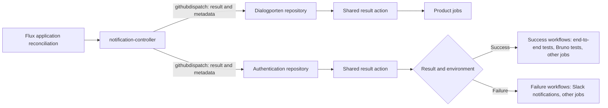

- Feature Name: flux_workflow_notifications
- Title: Trigger GitHub workflows from Flux reconciliation results
- Start Date: 2026-10-15
- RFC PR: [altinn/altinn-platform#4214](https://github.com/Altinn/altinn-platform/pull/4214)
- Github Issue: N/A; implementation issues follow RFC acceptance.
- Product/Category: CI/CD
- State: **REVIEW**

# Summary
[summary]: #summary

Flux sends reconciliation events directly to product repositories through its notification-controller and the `githubdispatch` provider. A shared GitHub action validates each event and returns its result and deployment metadata. After a deployment succeeds or a reconciliation attempt fails, product-owned GitHub workflows run the required follow-up jobs. Examples include Slack notifications, end-to-end tests and Bruno tests. Each event identifies the product, environment, cluster, resource and available release information. This completes the reverse direction of the accepted [RFC 0017](https://github.com/Altinn/altinn-platform/blob/main/rfcs/0017-on-demand-flux-reconcile.md). The design requires a verified Flux fix before rollout, because the inspected notification-controller filters out the final success event. Delivery is best effort, and workflows must tolerate missing, repeated and late events.

# Motivation
[motivation]: #motivation

A publishing workflow finishes before Flux finishes the application rollout. Product teams need the deployment result before they run follow-up jobs. A fixed delay can start tests against the previous release. A long delay also wastes time after a fast rollout.

RFC 0017 lets GitHub request a reconcile after it publishes an artifact. That request does not report the result. This RFC sends the result from Flux to GitHub, including reconciles that start through polling or manual requests.

Example use cases are:

- Send a Slack message when a deployment fails, with the environment, revision and failure details.
- Run end-to-end tests when a deployment succeeds.
- Run Bruno tests or other application checks when a deployment succeeds.
- Run any other product-owned GitHub workflow jobs selected by the deployment result and environment.

These examples do not limit the supported workflow jobs. Dialogporten, Authentication and other products choose the jobs in their own repositories. Adding a new follow-up job does not require a change to the platform event integration.

The expected outcome is a workflow that starts soon after Flux reports the result. GitHub queue time and runner availability still affect the start time. A workflow receives the result without access to the Kubernetes application programming interface (API).

# Guide-level explanation
[guide-level-explanation]: #guide-level-explanation

## Concepts

| Concept | Meaning |
|---|---|
| Application Kustomization | The Flux resource that applies the application and checks its required workloads. |
| Subscription | An `Alert` and its `Provider`, which connect named Flux resources to one GitHub repository. |
| Dispatch | A GitHub `repository_dispatch` event that can start workflows in the receiving repository. |
| Reconciliation result | A successful reconciliation, a failed reconciliation attempt, or a waiting state. |
| Artifact revision | The revision of the manifest artifact that Flux reconciles. For an Open Container Initiative (OCI) artifact, it includes the digest. |
| Application commit | The full Git commit identifier for the application code. It can differ from the manifest commit. |

## How it works



Each arrow to GitHub represents a separate subscription. A product event goes only to the repository configured by that subscription.

For example, Authentication version `1.0.0` finishes reconciliation in staging at 13:05. GitHub receives the event and starts the configured staging jobs when a runner is available. These jobs can run end-to-end tests, Bruno tests and other tasks. Jobs for the test environment do not run. If the deployment fails, a failure workflow can send a Slack message with the failure details.

The platform sends one event to the repository. The product owns the workflow selection, job logic, test tools and notification destinations inside that repository. The platform does not select a workflow filename or a Git branch.

The event starts a new workflow run. It does not resume the workflow that requested reconciliation. Correlation uses the artifact revision, because the RFC 0017 request contains no deployment data. There is no one-to-one mapping between reconcile requests and result events.

The RFC 0017 route, Receiver and workflow step are optional for this feature. Polling also produces reconciliation results. The [RFC 0017 implementation tracker](https://github.com/Altinn/altinn-platform/issues/4237) covers the inbound path separately. An inbound request failure does not prove a deployment failure, because polling can still deploy the artifact.

The two directions use separate shared actions:

| Action | Workflow | Result |
|---|---|---|
| Existing `actions/flux/trigger-reconcile` | The publishing workflow, after it pushes and tags the artifact. | Confirms acceptance of the reconcile request. |
| Proposed `actions/flux/read-reconciliation-result` | The receiving workflow, triggered by `repository_dispatch`. | Validates the event and returns `succeeded`, `failed` or `ignored`. |

Both actions belong in `Altinn/altinn-platform`. The [trigger-reconcile README](https://github.com/Altinn/altinn-platform/blob/main/actions/flux/trigger-reconcile/README.md) lists enabled inbound endpoints at `https://ops.<environment>.dis.altinn.cloud/flux-webhook`. An enabled inbound endpoint does not establish that outbound notifications are ready.

## Configure a product

1. Select the application Kustomization that represents the rollout.
2. Configure health checks for its required workloads.
3. Register the destination repository with the platform team for the shared GitHub App.
4. Add the Provider and Alert to the product syncroot.
5. Add the receiving workflow and shared action configuration to the destination repository's default branch.
6. Validate both success and failure events before enabling the follow-up jobs.

The examples use illustrative Authentication resource names and cluster names. They are not verified deployment configuration. The initial pilot uses Dialogporten in `at23`, as specified under [Ownership and rollout](#ownership-and-rollout).

This subscription receives application events and source errors:

```yaml
apiVersion: notification.toolkit.fluxcd.io/v1beta3
kind: Provider
metadata:
  name: application-github
  namespace: product-authentication
spec:
  type: githubdispatch
  address: https://github.com/Altinn/altinn-authentication
  secretRef:
    name: application-github-token
---
apiVersion: notification.toolkit.fluxcd.io/v1beta3
kind: Alert
metadata:
  name: application-reconciliation
  namespace: product-authentication
spec:
  providerRef:
    name: application-github
  eventSeverity: info
  eventSources:
    - kind: Kustomization
      name: authentication-app
  eventMetadata:
    schema_version: "1"
    product: authentication
    environment: staging
    cluster: staging-cluster
    repository: Altinn/altinn-authentication
---
apiVersion: notification.toolkit.fluxcd.io/v1beta3
kind: Alert
metadata:
  name: application-source-errors
  namespace: product-authentication
spec:
  providerRef:
    name: application-github
  eventSeverity: error
  eventSources:
    - kind: OCIRepository
      name: authentication-app
  eventMetadata:
    schema_version: "1"
    product: authentication
    environment: staging
    cluster: staging-cluster
    repository: Altinn/altinn-authentication
```

`eventSeverity: info` includes errors. Do not add another error Alert for the same Kustomization and Provider. That creates overlapping subscriptions. The source Alert covers failures before the Kustomization can fetch an artifact.

Use exact resource names. The subscription must not select every resource in the namespace. Keep the Provider, its token Secret, the Alerts and their event sources in the same product namespace. The platform supplies the Secret's `token` value through the renewal process described below. The product syncroot does not manage that generated value. Flux subscriptions need no cross-namespace access.

## Define application readiness

Set `spec.wait: true` or explicit `spec.healthChecks` on the application Kustomization. Set a timeout that covers the expected rollout duration.

This fragment checks a required Deployment:

```yaml
apiVersion: kustomize.toolkit.fluxcd.io/v1
kind: Kustomization
metadata:
  name: authentication-app
  namespace: product-authentication
spec:
  # Keep the existing sourceRef, path, interval and other application settings.
  healthChecks:
    - apiVersion: apps/v1
      kind: Deployment
      name: authentication
      namespace: product-authentication
  timeout: 5m
```

The product must include every workload required for a completed application rollout. A parent Kustomization that creates child Kustomizations is not sufficient unless its health checks cover those children. A downloaded OCI artifact does not prove application readiness. End-to-end tests and Bruno tests run as follow-up jobs, separate from Flux health checks.

## Receive the event in GitHub

The native Provider derives `event_type` from the resource: `{Kind}/{Name}.{Namespace}`. It puts the Flux event in `client_payload`. It does not support a custom event name such as `deployment-succeeded`.

The shared `read-reconciliation-result` action handles event validation and classification. Products use its outputs in regular jobs or reusable workflows. They do not need to copy the classification code.

The action requires implementation before a product can use the following example. Replace `<commit>` with a reviewed full commit identifier when the action is available. The workflow assumes two product-owned reusable workflows:

| Workflow | Inputs | Example jobs |
|---|---|---|
| `deployment-succeeded.yml` | `environment`, `expected_revision` | End-to-end tests, Bruno tests and other tasks after success. |
| `deployment-failed.yml` | `environment`, `flux_event` | A Slack notification with the failure details, or other tasks after failure. |

These filenames are examples. Each product supplies its workflows, job configuration and required credentials. Jobs that test the running application verify its release before testing. The cluster names and App sender identifier must match the subscription.

```yaml
name: Application reconciled
on:
  repository_dispatch:
    types:
      - Kustomization/authentication-app.product-authentication
      - OCIRepository/authentication-app.product-authentication

permissions:
  contents: read

jobs:
  classify:
    runs-on: ubuntu-latest
    permissions: {}
    outputs:
      outcome: ${{ steps.event.outputs.outcome }}
      environment: ${{ steps.event.outputs.environment }}
      revision: ${{ steps.event.outputs.revision }}
      event_json: ${{ steps.event.outputs.event_json }}
    steps:
      - id: event
        uses: Altinn/altinn-platform/actions/flux/read-reconciliation-result@<commit>
        with:
          expected_sender_id: ${{ vars.FLUX_DISPATCH_BOT_ID }}
          product: authentication
          subscriptions: |
            [
              {
                "environment": "staging",
                "cluster": "staging-cluster",
                "namespace": "product-authentication",
                "kustomization": "authentication-app",
                "oci_repository": "authentication-app"
              },
              {
                "environment": "test",
                "cluster": "test-cluster",
                "namespace": "product-authentication",
                "kustomization": "authentication-app",
                "oci_repository": "authentication-app"
              }
            ]

  success-staging:
    needs: classify
    if: needs.classify.outputs.outcome == 'succeeded' && needs.classify.outputs.environment == 'staging'
    uses: ./.github/workflows/deployment-succeeded.yml
    with:
      environment: staging
      expected_revision: ${{ needs.classify.outputs.revision }}

  success-test:
    needs: classify
    if: needs.classify.outputs.outcome == 'succeeded' && needs.classify.outputs.environment == 'test'
    uses: ./.github/workflows/deployment-succeeded.yml
    with:
      environment: test
      expected_revision: ${{ needs.classify.outputs.revision }}

  failure:
    needs: classify
    if: needs.classify.outputs.outcome == 'failed'
    uses: ./.github/workflows/deployment-failed.yml
    with:
      environment: ${{ needs.classify.outputs.environment }}
      flux_event: ${{ needs.classify.outputs.event_json }}
```

The receiving workflow must exist on the default branch. `github.sha` identifies that branch's commit, not the deployed application commit. A checkout at the deployed application commit requires a separate, validated application commit value.

Pass payload values through action inputs or environment variables. Do not insert event messages directly into shell commands. Use fixed environment mappings before selecting credentials or test targets.

# Reference-level explanation
[reference-level-explanation]: #reference-level-explanation

## Shared action contract

The platform maintains `actions/flux/read-reconciliation-result` with its README and tests. The action reads the GitHub event from `GITHUB_EVENT_PATH`. It requires the event type `repository_dispatch` and validates the envelope before processing `client_payload`. It needs no repository checkout, GitHub API call, cluster credentials or `id-token: write` permission.

All inputs are required. Products set them through trusted workflow configuration or repository variables, not from the incoming event.

| Input | Meaning |
|---|---|
| `expected_sender_id` | Numeric GitHub bot identifier of the approved dispatch App. An empty value is an error. |
| `product` | Expected `metadata.product` value. |
| `subscriptions` | JSON array of permitted environment, cluster, namespace and resource combinations. Wildcards are not permitted. |

Each subscription requires `environment`, `cluster`, `namespace` and `kustomization`. The optional `oci_repository` selects source failure events. The action matches all fields against one subscription. It does not combine an environment from one entry with a resource from another.

The action checks the sender, contract version, field types, product and destination repository. The event repository and `metadata.repository` must match `GITHUB_REPOSITORY`. It verifies the involved object, reporting controller and resource-derived dispatch type. Kustomization events require `kustomize-controller`; OCIRepository events require `source-controller`.

The action applies the [event classification](#event-classification) and [metadata contract](#metadata-contract) below. Success requires a controller-provided OCI revision with a SHA-256 digest. A source failure can have no revision. Optional application metadata requires a valid mapping to the event's revision.

| Output | Meaning |
|---|---|
| `outcome` | `succeeded`, `failed` or `ignored`. |
| `environment` | Validated product environment. |
| `cluster` | Validated cluster identifier. |
| `revision` | Artifact revision, or an empty string when unavailable. |
| `app_version` | Application version, or an empty string when the release mapping is unavailable or invalid. |
| `app_commit` | Full application commit identifier, or an empty string when the release mapping is unavailable or invalid. |
| `event_json` | Validated Flux event encoded as JSON, including the resource, reason, severity, timestamp and diagnostic message. |

The action removes unbound or invalid `app_version`, `app_commit` and `release_revision` fields from `event_json`. It preserves other supported fields and additional Flux fields. It uses safe output encoding, including for multiline messages. Consumers treat these outputs as data.

A deployment failure produces `outcome: failed` while the action step succeeds. This lets the product run its failure jobs. Valid progress events produce `outcome: ignored`. Invalid events or configuration fail the action before it publishes outputs.

Do not set `continue-on-error: true` on this action. Keep follow-up jobs dependent on successful validation and the corresponding outcome. The inbound action's error policy does not apply to event validation.

The action classifies one delivered event. It does not wait for a deployment, retry dispatch delivery, suppress duplicate jobs or query the running application. Product jobs retain the release checks and repeated-event handling described below.

The action README records the supported contract versions and validated environments. Products pin a reviewed action commit. Incompatible changes require an explicit contract migration. The inbound endpoint status table does not enable this action's subscriptions.

## Flux compatibility prerequisite

The source review covers these upstream versions on 2026-11-03. This RFC does not independently verify the versions in running DIS clusters.

| Notification-controller | Kustomize-controller | Result |
|---|---|---|
| [v1.9.4](https://github.com/fluxcd/notification-controller/blob/v1.9.4/internal/server/event_handlers.go) | [v1.9.6](https://github.com/fluxcd/kustomize-controller/blob/v1.9.6/internal/controller/kustomization_controller.go) | The final success event is filtered before `githubdispatch`. |
| [v1.10.0](https://github.com/fluxcd/notification-controller/blob/v1.10.0/internal/server/event_handlers.go) | [v1.10.1](https://github.com/fluxcd/kustomize-controller/blob/v1.10.1/internal/controller/kustomization_controller.go) | The same limitation remains. |

The inspected code has a compatibility problem:

1. The Kustomization controller marks its final success event as a commit-status update.
2. The notification-controller forwards that event only to commit-status providers and generic webhook providers.
3. `githubdispatch` belongs to neither group, so the controller drops the final success event.

The `DisableCommitStatusEvent` feature gate removes that success event. It does not make the event available to `githubdispatch`.

The implementation must obtain an upstream fix that forwards final success events to `githubdispatch`. It must consume that fix through the supported Flux distribution. Do not change the shared controllers manually or disable tenant isolation to work around this requirement.

[Microsoft's release notes](https://learn.microsoft.com/en-us/azure/azure-arc/kubernetes/flux-gitops-release-notes) list extension `1.26.2` with notification-controller `v1.9.4-3` and kustomize-controller `v1.9.6-3`. The `1.26.4` notes list security updates. The RFC 0017 upgrade for `generic-oidc` does not establish that success dispatch works.

The [upgrade tracker](https://github.com/Altinn/altinn-platform/issues/4241) reports Flux 2.9.6 in `at23`, `at22`, `yt01` and `tt02`. Follow its automatic-upgrade guidance. Verify the running controllers with `flux version` and check the extension's provisioning state. Azure's `currentVersion` can report a version that failed to install. Each outbound pilot still needs the verified fix and result checks.

[Upstream notification-controller 1.10.0](https://github.com/fluxcd/notification-controller/blob/v1.10.0/CHANGELOG.md) promotes Alert and Provider to API version `v1`. It still serves `v1beta3`. The examples retain `v1beta3` for the documented Azure baseline. The pilot must select an API version supported by its verified distribution.

Rollout stays blocked until the deployed controller versions pass the success, failure and recovery checks below. Failure delivery alone does not satisfy this prerequisite. A message about applied resources or passed intermediate health checks cannot replace the final result.

The [provider classification](https://github.com/fluxcd/notification-controller/blob/v1.10.0/internal/server/provider_commit_status.go) still excludes `githubdispatch` from the groups that receive commit-status updates.

## Event classification

| Event | Consumer result | Action |
|---|---|---|
| Application Kustomization, `ReconciliationSucceeded`, severity `info` | `succeeded` | Run the product's success jobs for the configured environment. |
| Application Kustomization, severity `error` | `failed` | Run the product's failure jobs with the failed attempt and its reason. |
| Selected OCIRepository, severity `error` | `failed` | Run the product's failure jobs for a source failure. The attempted artifact can be unknown. |
| `DependencyNotReady` with severity `info` | `ignored` | Flux is waiting. Do not report successful deployment. |
| Progress, resource changes or source success | `ignored` | Do not start deployment result jobs. |
| An unknown schema, sender, resource or environment | Invalid | Reject the event and report the configuration error. |

Failures can include `HealthCheckFailed`, `BuildFailed` and `ReconciliationFailed`. Consumers preserve the actual reason instead of requiring a fixed failure list. A failure describes one attempt. Flux can retry the same revision and later report success.

Missing sources, suspended resources and controller outages do not necessarily produce a failure event. Some waiting conditions only update resource status. Existing readiness monitoring must cover these cases. This feature does not assign a terminal outcome to every published release.

## Metadata contract

The contract keeps the native Flux payload and adds object annotations or Alert metadata. Notification-controller removes the `event.toolkit.fluxcd.io/` prefix from annotation keys. It also removes the involved controller's group prefix from controller metadata keys.

For example, consumers read `client_payload.metadata.revision`, not `client_payload.metadata['kustomize.toolkit.fluxcd.io/revision']`.

| Field | Producer | Meaning |
|---|---|---|
| `metadata.schema_version` | Alert | Contract version, initially the string `1`. |
| `metadata.product` | Alert | Product identifier. |
| `metadata.environment` | Alert | Product environment, such as `staging` or `test`. |
| `metadata.cluster` | Alert | Cluster identifier. It distinguishes equal environment names across clusters. |
| `metadata.repository` | Alert | Destination repository in `owner/name` format. It must match the Provider address. |
| `metadata.revision` | Flux controller | Artifact revision for this event, when available. |
| `metadata.originRevision` | Flux controller | Source revision recorded in the OCI artifact, when available. |
| `metadata.app_version` | Product release metadata | Optional application version for display. |
| `metadata.app_commit` | Product release metadata | Optional full application commit identifier. |
| `metadata.release_revision` | Product release metadata | Artifact revision to which the application version and commit belong. |
| `involvedObject` | Flux controller | Resource kind, name, namespace and identifier. |
| `reason`, `severity`, `timestamp` | Flux controller | Result classification and event time. |
| `message` | Flux controller | Diagnostic text. It is not a machine-readable result code. |

The Provider address selects the repository. Metadata cannot redirect an event. Environment names select product workflows; they do not change the destination repository.

Alert metadata overrides object annotations with the same key. Controller metadata has the highest precedence. Reserve the contract keys for their documented producers. Do not set `revision` or `originRevision` through product annotations or Alert metadata.

The following fragment adds optional release information to the watched Kustomization:

```yaml
metadata:
  annotations:
    event.toolkit.fluxcd.io/app_version: "1.0.0"
    event.toolkit.fluxcd.io/app_commit: "1111111111111111111111111111111111111111"
    event.toolkit.fluxcd.io/release_revision: "staging@sha256:aaaaaaaaaaaaaaaaaaaaaaaaaaaaaaaaaaaaaaaaaaaaaaaaaaaaaaaaaaaaaaaa"
```

The product publisher records these values before requesting the reconcile. The values describe one immutable manifest artifact. They must exist on the watched Flux object, not only on an application Deployment or an Alert.

An annotation can still describe the previous release when a new artifact fails before application. A consumer uses `app_version` and `app_commit` only when `release_revision` exactly matches the controller-provided `revision`. Otherwise, it treats those fields as unavailable. The publisher can instead provide a trusted mapping from artifact revision to application version and commit.

The [publishing action](../actions/flux/build-push-image/action.yaml) records the publishing repository's revision through `flux push artifact --revision`. With separate application and manifest repositories, `originRevision` normally identifies the manifest commit. Do not treat an OCI digest as a Git commit or assume that the manifest commit identifies application code.

This representative success payload omits optional native Flux fields:

```json
{
  "event_type": "Kustomization/authentication-app.product-authentication",
  "client_payload": {
    "involvedObject": {
      "apiVersion": "kustomize.toolkit.fluxcd.io/v1",
      "kind": "Kustomization",
      "name": "authentication-app",
      "namespace": "product-authentication"
    },
    "severity": "info",
    "reason": "ReconciliationSucceeded",
    "message": "Reconciliation finished",
    "reportingController": "kustomize-controller",
    "timestamp": "2026-10-15T13:05:00Z",
    "metadata": {
      "schema_version": "1",
      "product": "authentication",
      "environment": "staging",
      "cluster": "staging-cluster",
      "repository": "Altinn/altinn-authentication",
      "revision": "staging@sha256:aaaaaaaaaaaaaaaaaaaaaaaaaaaaaaaaaaaaaaaaaaaaaaaaaaaaaaaaaaaaaaaa",
      "originRevision": "main/2222222222222222222222222222222222222222",
      "app_version": "1.0.0",
      "app_commit": "1111111111111111111111111111111111111111",
      "release_revision": "staging@sha256:aaaaaaaaaaaaaaaaaaaaaaaaaaaaaaaaaaaaaaaaaaaaaaaaaaaaaaaaaaaaaaaa"
    }
  }
}
```

The contract version describes the added metadata and consumer rules. It does not replace Flux's event schema. Consumers must accept additional fields and reject unsupported contract versions.

GitHub limits `event_type` to 100 characters and `client_payload` to ten top-level properties. Its API also limits the payload size to less than 64 kilobytes. Validate resource names and representative payloads before onboarding. Keep annotations small and exclude secrets from all event metadata.

## Authentication and tenant isolation

Use one shared platform GitHub App. A GitHub App is the machine identity that authenticates dispatch requests. It is separate from the deployed product application. The App requires repository `Contents: write` to create a repository dispatch. `Actions: write` is not the permission for this endpoint.

Install the shared App only on approved destination repositories. Keep its private key in a platform-controlled namespace. Each product namespace receives an installation token restricted to its approved destination repository. The shared App private key must not enter a product namespace. Different installation identifiers do not restrict what that private key can access.

Flux can obtain installation tokens itself when its Provider Secret contains `githubAppID`, `githubAppInstallationID` and `githubAppPrivateKey`. This design supplies only the `token` key to each product's Provider. [Flux uses a supplied token directly](https://github.com/fluxcd/notification-controller/blob/v1.10.0/internal/notifier/github_helpers.go); it cannot renew that token without the App credentials. [GitHub installation tokens](https://docs.github.com/en/apps/creating-github-apps/authenticating-with-a-github-app/generating-an-installation-access-token-for-a-github-app) expire after one hour. The platform must replace them before expiry.

The product namespace is the token trust boundary. Its administrators can access the token for that product's approved repository. Repository administrators must accept that scope during onboarding. The platform owns the App, private key rotation, token renewal and revocation. The App sender identifier is shared across products; consumers must also validate the repository and subscription.

### Token generation and renewal

Use External Secrets Operator (ESO) for token generation and distribution. This requires platform configuration of existing components, not a custom token service. ESO provides a [GitHub token generator](https://external-secrets.io/latest/api/generator/github/) and [Kubernetes Secret distribution](https://external-secrets.io/latest/provider/kubernetes/#pushsecret).

The proposed configuration uses this sequence:

1. Provision the App private key in `platform-system` through the platform's verified secret management mechanism.
2. Configure a platform-owned `GithubAccessToken` generator for each approved destination repository.
3. Set explicit `repositories` and `permissions` fields. For Dialogporten, use `repositories: [dialogporten]` and `contents: write`.
4. Configure an `ExternalSecret` in `platform-system` to generate the repository token every 30 minutes.
5. Configure a `PushSecret` in `platform-system` to copy the token to the approved product Secret every minute.
6. Let the product Provider read that local Secret for dispatch requests.

Each PushSecret uses a platform-owned Kubernetes SecretStore with an explicit destination namespace and restricted service account permissions. The platform approves each repository, namespace and Secret mapping. Products cannot change the generator, its permissions or that mapping. Generation failures retain the existing token; distribution failures must not replace it with an empty value. Monitor generation and distribution failures before the current token expires.

The generator reads its private key from the namespace where generation runs. A [ClusterGenerator](https://external-secrets.io/latest/api/generator/cluster/#limitations) does not remove that namespace requirement. Keep generation in `platform-system`. Distribute only the resulting token. Do not commit credentials. Do not put private keys in `postBuild.substitute`.

The inspected [ESO package](https://github.com/dis-way/gitops-manifests/blob/main/oci/external-secrets-operator/base/helmrelease.yaml) declares chart version `2.13.0`. Its [multitenancy secret layer](https://github.com/dis-way/gitops-manifests/blob/main/oci/external-secrets-operator/README.md) now defines `dis-system-store` in `platform-system`. These manifests do not establish that the pilot cluster has those resources. Verify the deployed version, generator support, private key access and restricted token distribution before rollout.

Keep Flux cross-namespace restrictions enabled. [Flux blocks cross-namespace event selection](https://fluxcd.io/flux/components/notification/alerts/#disable-cross-namespace-selectors) with `--no-cross-namespace-refs=true`. Central Alerts therefore cannot replace product subscriptions while that restriction remains enabled. Verify that the product applier can reconcile Providers and Alerts. Verify token provisioning separately through the platform configuration. RFC 0017's admission policy restricts Receiver resources. It does not grant permissions for Providers or Alerts. The outbound subscription needs no Receiver.

Permit notification-controller and the token generator outbound HTTPS access to `api.github.com` and required name resolution. This path needs no public cluster endpoint, edge gateway route or GitHub-to-cluster connection.

### Internal event endpoint

The internal event endpoint must accept only trusted platform workloads in `flux-system`. Product namespaces must not reach it. The platform controls which workloads run in `flux-system`. Otherwise, an application pod can submit a forged event. The GitHub App sender check cannot detect events forged through the authorized controller.

The notification-controller has separate ports for these functions:

| Port | Function | Required access |
|---|---|---|
| 9090 | Internal Flux events | Trusted platform workloads in `flux-system`. Product pods cannot connect. |
| 9292 | RFC 0017 inbound reconcile requests | Traefik and direct cluster connections. The Receiver validates every token. |
| 8080 | Metrics | The required monitoring sources. |
| 9440 | Health probes | The required probe paths. |

The [RFC 0017 network policy section](https://github.com/Altinn/altinn-platform/blob/main/rfcs/0017-on-demand-flux-reconcile.md#network-policy) records the current design. Package version 1.1.1 removes `flux-webhook-from-traefik` through [gitops-manifests#2272](https://github.com/dis-way/gitops-manifests/pull/2272). This removes its broad allowance on port 9090. The extension admits only `flux-system` to that port.

The extension's `allow-webhooks` policy still admits all namespaces to port 9292. RFC 0017 accepts that path because the Receiver verifies the token. Closing that path is not a prerequisite for outbound notifications. The acceptance does not apply to the internal event endpoint on port 9090.

[Kubernetes combines the permissions of matching network policies](https://kubernetes.io/docs/concepts/services-networking/network-policies/#the-two-sorts-of-pod-isolation). Adding a restrictive policy does not override a broad allowance. Verify the deployed package and all policies that select the notification-controller. Use the extension's namespace isolation when the acceptance checks pass. Do not restore the removed allowance on port 9090.

Verify event isolation with the inbound feature enabled and disabled. Repeat the checks after extension upgrades and policy reconciliation. Keep authorized controller events, the RFC 0017 webhook path, metrics and health probes working.

## Delivery, repeated events and ordering

The native Provider does not guarantee at-least-once delivery. The success event compatibility fix does not establish this guarantee. The Provider supplies no durable event queue or event replay API. The inspected [notification-controller handler](https://github.com/fluxcd/notification-controller/blob/v1.10.0/internal/server/event_handlers.go) acknowledges an inbound event while its GitHub request runs asynchronously. If the request fails, the controller reports an error without retaining a durable delivery record. A controller restart can also lose an unfinished request. A later reconciliation can emit a new result, but it does not replay the missing result. A successful GitHub response confirms dispatch acceptance, not workflow completion.

| Situation | Required behavior |
|---|---|
| The same revision reconciles again | The receiving workflow tolerates repeated execution. |
| A failure is followed by success for the same revision | Both results remain eligible for processing. |
| A new release replaces an older event before tests start | The test workflow detects the revision mismatch and skips the stale test. |
| An event arrives out of order | It does not overwrite a newer deployment result without current-state verification. |
| GitHub is unavailable or rejects the dispatch | Flux continues reconciling. The platform reports delivery errors. |
| The controller restarts during delivery | An event can be lost. Existing monitoring and manual tests remain available. |
| A failure has no artifact revision | Report the resource and reason. Do not invent a revision or reuse the previous successful revision. |

Flux event rate limiting reduces some repeated notifications. It is not deployment deduplication. GitHub concurrency groups also do not suppress events after a previous run completes. RFC 0017's edge rate limits apply only to inbound reconcile requests. They do not limit outbound dispatches or workflow runs.

Each product defines how its jobs handle repeated events. Notifications can suppress repeated Slack messages, and tests must leave the environment safe for another run. Workflows that perform non-repeatable actions need durable deduplication before onboarding.

For such consumers, a deduplication key includes the cluster, resource identity, artifact revision, outcome and consumer. Failure and success must use different keys. Missing revisions must not collapse unrelated failures into one key.

Notification jobs can report historical results with the event time and revision. Jobs that act on the current environment must verify that the event still applies. Test jobs must verify the running release before and after their tests. They can use an application version endpoint and a trusted artifact-to-release mapping. A mismatch makes the result stale; it must not certify another release. Exact validation across concurrent deployments requires product-level deployment serialization or a separate deployment tracking design.

No delivery promise depends on a particular retry count. The implementation must measure the supported controller's behavior during GitHub failures. This RFC defines the event trigger and its contract. Products define the downstream job logic in GitHub, including tests, notifications and other actions.

### What at-least-once delivery requires

At-least-once delivery requires each deployment result to remain recoverable until GitHub accepts it. It permits repeated deliveries. This needs more than an HTTP retry setting:

1. Commit each result and its pending delivery record together in durable storage at the producer.
2. Retry pending deliveries until GitHub acknowledges acceptance, including after process restarts.
3. Retain failed deliveries during outages or credential errors. Resume them after recovery.
4. Give each result a stable identifier. Make its consumers tolerate repeated delivery.

This follows the [transactional outbox pattern](https://learn.microsoft.com/en-us/azure/architecture/databases/guide/transactional-out-box-cosmos). Delivery depends on eventual recovery of GitHub, credentials and the delivery worker. Workflow completion needs separate tracking if that guarantee is also required.

A durable receiver only protects events after it stores them. Adding a queue after Flux does not recover events lost before they reach that queue. Polling current Flux status can also miss intermediate failure and recovery results.

An upstream durable delivery implementation could preserve the direct path. A platform dispatcher with durable result capture changes the architecture and requires a separate design. Neither mechanism exists in this proposal. If every result must reach GitHub, the native design alone does not meet that requirement.

## Ownership and rollout

| Owner | Responsibility |
|---|---|
| Platform team | Obtain and validate the Flux fix. Coordinate shared network policies with RFC 0017 and configure outbound connectivity. |
| Platform team | Manage the shared App, private key rotation, repository token generation, distribution and monitoring. |
| Platform team | Implement, test and maintain the shared result action, its contract and onboarding documentation. |
| Product team | Select application health checks, event sources and environment mappings. |
| Product team | Publish release metadata, configure the shared action and maintain receiving workflows. |
| Product team | Verify the running release and handle repeated or stale events. |

Keep the shared action and its README beside `trigger-reconcile` in this repository. Add the subscription examples to the product onboarding documentation after the pilot. Keep controller configuration and shared policy changes in their existing infrastructure repositories. No new platform service is part of this RFC.

### Dialogporten pilot

The first pilot uses Dialogporten in `at23`. The proposed destination is `Altinn/dialogporten`, where product workflows select the follow-up jobs.

| Setting | Pilot value |
|---|---|
| Product | `dialogporten` |
| Environment | `at23` |
| Cluster | `dis-core-at23-aks` |
| Namespace | `product-dialogporten` |
| Application Kustomization | `dialogporten-apps` |
| OCIRepository | `dialogporten-manifests` |
| Application path | `./environments/at23` |
| Destination repository | `Altinn/dialogporten` |

The [Dialogporten syncroot](https://github.com/Altinn/dialogporten-manifests/blob/main/flux/syncroot/at23/kustomization.yaml) and [RFC 0017 onboarding issue](https://github.com/Altinn/altinn-platform/issues/4249) establish the existing `at23` integration. The outbound pilot still needs its own Provider, Alerts, credentials and receiving workflow.

The [application Kustomization](https://github.com/Altinn/dialogporten-manifests/blob/main/flux/syncroot/base/dialogporten-flux-kustomization.yaml) has no `wait` or `healthChecks` configuration in the source inspected on 2026-11-03. Before enabling success jobs, the product must configure and validate health checks for every required workload. Applying manifests alone does not establish rollout completion.

The [OCIRepository](https://github.com/Altinn/dialogporten-manifests/blob/main/flux/syncroot/base/dialogporten-oci-repository.yaml) follows the `main` tag. Its artifact revision therefore uses `main@sha256:<digest>`, while the subscription environment remains `at23`. The environment does not determine the artifact tag. Confirm these values against the deployed resources before enabling the subscription.

### Rollout sequence

The rollout sequence is:

1. Implement the shared action, its documented contract and event fixture tests.
2. Verify the Flux fix in the supported distribution.
3. Verify token generation, renewal, distribution, product permissions, namespace isolation, combined network policies and outbound connectivity.
4. Pilot Dialogporten in `at23` with the shared action, initially recording validated results only.
5. Enable the product's success and failure jobs after the event contract passes validation.
6. Add a second environment and Authentication with the same action.
7. Expand to other products after the platform and product teams review the pilot.

Suspend the affected Alerts to stop dispatches during rollback. Application reconciliation continues. For offboarding, stop token distribution. Remove the repository from the shared App installation. Do not revoke the shared App for a routine product rollback.

Monitor `NotificationDispatchFailed` events, controller errors, credential failures and event rate limiting. Keep resource readiness alerts independent from GitHub delivery. Products monitor their follow-up jobs and report their results through their existing mechanisms.

## Implementation validation

These are rollout acceptance checks, not checks completed by this documentation change.

The action implementation must include automated fixture tests for its contract:

| Check | Required result |
|---|---|
| Missing inputs, malformed subscriptions or an unsupported GitHub event | The action fails before publishing outputs. |
| Unknown sender, schema, repository, controller or resource | The action rejects the event. |
| Valid fields taken from different subscription entries | The action rejects the combination. |
| Success without a valid OCI revision | The action rejects the event. |
| Deployment failure, including a source failure without a revision | The action step succeeds with `outcome: failed`. Failure jobs remain eligible. |
| Valid progress or waiting event | The action returns `ignored`. No result jobs run. |
| Missing or stale application release mapping | Application version and commit outputs are empty. The event output omits the unbound release fields. |
| Multiline messages and workflow command syntax in event fields | Output encoding preserves data without executing commands or creating additional outputs. |

The deployed integration must pass these checks:

| Check | Required result |
|---|---|
| Reconcile a healthy application on the deployed Flux versions | GitHub receives the final `ReconciliationSucceeded` event with its artifact revision. |
| Keep old replicas healthy while the replacement fails | Required health checks fail. No success jobs start for the failed rollout. |
| Cause a build error and a health-check timeout | The failure workflow receives the actual reason and available revision. |
| Configure a Slack notification for failure | A failed deployment starts the notification job with the correct environment and failure details. |
| Configure end-to-end tests, Bruno tests and another success job | A successful deployment starts all configured jobs. The platform configuration does not depend on their tools. |
| Recover the same revision after failure | The success event remains eligible for the success jobs. |
| Fail the OCI source before an artifact exists | The source failure remains useful without a revision. |
| Publish distinct staging and test releases | Only the corresponding environment's follow-up jobs run. |
| Repeat a reconciliation and restart notification-controller | Consumers tolerate repeated or missing events. |
| Publish two releases while a workflow waits for a runner | The older event cannot certify the newer release. |
| Send a payload with stale application annotations | The consumer rejects the application version and commit mapping. |
| Remove App access or simulate GitHub rejection | Delivery monitoring detects failure. Application reconciliation continues. |
| Submit an event from an application pod | Network policy blocks access to the internal event endpoint. |
| Enable and disable the RFC 0017 feature, then reconcile the extension policies | Event isolation remains effective. Authorized events, metrics and health probes continue. |
| Exercise the RFC 0017 webhook path after shared policy changes | Valid requests work. The Receiver rejects invalid tokens on direct connections. |
| Reconcile a subscription through the product applier | Providers and Alerts reconcile without additional cross-namespace permissions. Platform configuration supplies the token Secret. |
| Renew and distribute tokens across two expiry periods | Dispatch continues with replacement tokens without restarting notification-controller. |
| Interrupt token generation or distribution | Monitoring reports the failure before expiry. Existing tokens remain available until they expire. |
| Use a product token for another product's repository | GitHub rejects access, even when both repositories use the shared App. |
| Attempt to change token generation or distribution from a product namespace | Authorization rejects access to the private key, generator and destination mapping. |
| Let polling deploy an artifact without a reconcile request | The result starts the configured jobs without a Receiver or an inbound workflow step. |
| Reference another namespace or another product's repository | Tenant restrictions or GitHub App permissions reject the operation. |
| Test maximum resource names and representative error messages | The dispatch stays within GitHub limits. |

# Drawbacks
[drawbacks]: #drawbacks

- Rollout depends on an upstream Flux fix and its availability in the supported distribution.
- Native events expose Flux resource names and reasons to product workflows.
- Best-effort delivery cannot replace a durable deployment history or guarantee a result for every release.
- Repeated reconciliations can create additional workflow runs, notification noise and job costs.
- The shared GitHub App requires automatic token renewal and distribution for each destination repository.
- A shared App credential failure can affect several products.
- GitHub requires `Contents: write`, which grants more access than dispatch alone needs.
- The shared action needs maintenance, and products must update their pinned commits for fixes or contract changes.
- Incorrect health checks or stale release metadata can produce misleading test results.

# Rationale and alternatives
[rationale-and-alternatives]: #rationale-and-alternatives

The direct path follows the proposed architecture and uses the existing notification-controller. Product repositories keep control of all jobs that follow a deployment result. The shared action gives products one maintained implementation of event validation and classification. An upstream compatibility fix is preferable to a new platform service for this initial scope.

| Alternative | Assessment |
|---|---|
| Inline validation in every product workflow | Duplicates the event contract and its fixes. The shared action keeps validation consistent while products select their jobs. |
| A custom dispatch service | Can normalize events, keep delivery state and hold shared credentials. At-least-once delivery also requires durable result capture. |
| A generic Flux Provider that calls GitHub directly | Its body is a Flux event. GitHub requires an `event_type` and `client_payload` envelope. Authentication and body adaptation remain necessary. |
| GitHub `workflow_dispatch` | Selects a workflow and ref, but the native Flux Provider uses `repository_dispatch`. It needs an adapter. |
| Flux's `github` commit-status Provider | Updates commit status. A manifest commit can belong to a different repository from the application workflow. |
| Central Providers and Alerts with a shared App key | Flux handles tokens, but the required namespace restriction blocks these Alerts from selecting product events. |
| Dedicated product GitHub Apps | Flux can manage tokens directly with a product-specific private key. This adds App registrations and separate key administration. |
| A custom token renewal service | Can supply restricted tokens, but duplicates capabilities available through ESO. |
| Durable deployment tracking and polling | Supports exact attempts and reliable completion. It is a larger contract than triggering follow-up workflows. |
| Fixed waits or scheduled tests | Needs no new event integration, but delays tests and does not establish which release they test. |

Without this feature, products continue to wait, poll or start follow-up jobs independently of reconciliation results.

# Prior art
[prior-art]: #prior-art

- The accepted [RFC 0017](https://github.com/Altinn/altinn-platform/blob/main/rfcs/0017-on-demand-flux-reconcile.md) covers the opposite direction: GitHub asks Flux to reconcile after publication. [Issue #4237](https://github.com/Altinn/altinn-platform/issues/4237) tracks its implementation.
- [RFC 0010](https://github.com/Altinn/altinn-platform/pull/3220) and [its implementation proposal](https://github.com/Altinn/altinn-platform/pull/3925) used a custom dispatch service. Both pull requests are closed without merge.
- [RFC 0016](https://github.com/Altinn/altinn-platform/pull/4144) proposed durable deployment tracking through DIS Console. That pull request is also closed without merge.
- [Flux's GitHub dispatch documentation](https://fluxcd.io/flux/components/notification/providers/#github-dispatch) describes the native repository event and authentication.
- [Flux Alert metadata](https://fluxcd.io/flux/components/notification/alerts/#event-metadata-from-object-annotations) describes annotation handling and metadata precedence.
- [Flux Kustomization health checks](https://fluxcd.io/flux/components/kustomize/kustomizations/#health-checks) define the readiness boundary used by this RFC.
- [GitHub dispatch triggers](https://docs.github.com/en/actions/reference/workflows-and-actions/events-that-trigger-workflows#repository_dispatch) describe default-branch behavior and event limits.
- [GitHub's dispatch API](https://docs.github.com/en/rest/repos/repos#create-a-repository-dispatch-event) specifies the required repository permission and request body.

# Unresolved questions
[unresolved-questions]: #unresolved-questions

Before the team accepts this RFC:

- Can the Dialogporten pilot tolerate a missing notification or test run after a GitHub outage or controller restart?
- If every result must reach GitHub, which durable capture and delivery design replaces the native delivery assumption?

Before rollout:

- Which upstream release fixes final success dispatch, and when does the supported Azure Flux distribution include it?
- Do the deployed controllers preserve the documented payload and classification rules after the fix?
- Do all pilot clusters remove the old broad allowance on port 9090 and restrict `flux-system` workloads to trusted platform components?
- Do all pilot namespaces enforce event isolation with the RFC 0017 feature enabled and disabled?
- Which shared App registration and installation does the platform use?
- Does the pilot's ESO installation support the proposed generator and restricted token distribution?
- Does the private key provisioning path work in `platform-system`, and do product appliers have the required Provider and Alert permissions?
- Which product mechanism maps an artifact revision to the application version currently serving requests?
- What workflow volume, delivery error threshold and stale-event policy does the pilot require?

Out of scope:

- Exactly-once processing, durable replay and a deployment history API.
- Implementing or standardizing product-owned workflow jobs.
- A guarantee that every intermediate published artifact reaches the cluster.
- Completing the publishing workflow from the asynchronous result.

# Future possibilities
[future-possibilities]: #future-possibilities

- Generate subscriptions from approved product configuration.
- Add HelmRelease events with a separately verified readiness and metadata contract.
- Add durable delivery and replay if product requirements exceed the native Provider's guarantees.
- Connect events to a future deployment tracking API without changing the GitHub-to-Flux reconcile request.
