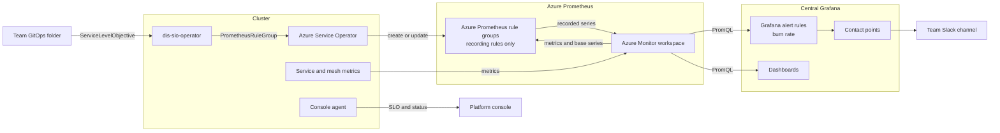

- Feature Name: self_service_slo
- Title: Self-service SLOs
- Start Date: 2026-11-26
- RFC PR: [altinn/altinn-platform#4517](https://github.com/Altinn/altinn-platform/pull/4517)
- Github Issue: [altinn/altinn-platform#4495](https://github.com/Altinn/altinn-platform/issues/4495)
- Product/Category: Observability
- State: **REVIEW** (possible states are: **REVIEW**, **ACCEPTED** and **REJECTED**)

# Summary
[summary]: #summary

This RFC adds a kind, `ServiceLevelObjective`, and an operator, `dis-slo-operator`. A team declares a Service Level Objective (SLO) next to its service, with its own Prometheus Query Language (PromQL) queries. The operator writes recording rules to Azure Monitor managed Prometheus. This RFC calls it Azure Prometheus. Alert rules in the central Grafana read the recorded series and send burn-rate alerts to the team. The platform owns the kind and the names of the recorded series. The platform can therefore change the rule maths, and no team changes a file.

# Motivation
[motivation]: #motivation

Teams have no shared way to state how reliable a service must be, or to get an alert when it is not.

- A team that wants an SLO must write recording rules and alert rules manually.
- Azure Prometheus evaluates rules only from Azure Prometheus rule groups. The open source SLO generators [Sloth](https://github.com/slok/sloth) and [Pyrra](https://github.com/prometheus-community/pyrra) write `PrometheusRule` objects, and Azure Prometheus does not read them.
- Burn-rate rules give false alerts for a service with few requests, or with busy days and quiet nights. See Low traffic.
- The platform needs SLOs for its own services too. See [#4300](https://github.com/Altinn/altinn-platform/issues/4300).

We want the same model as for databases, key vaults, caches and queues. The team declares a resource next to its service, and the operator applies safe defaults.

# Guide-level explanation
[guide-level-explanation]: #guide-level-explanation

An SLO uses these concepts:

| Concept | Meaning |
|---|---|
| Service Level Indicator (SLI) | The measured share of failed requests. The team gives it as PromQL. |
| Budget | The share of requests that may fail in the period. It is 100 % minus the objective. |
| Burn rate | The speed at which a service uses its budget. A burn rate of 1 uses the full budget in one period. |
| Page and ticket | A page is an alert that needs a person now. A ticket can wait for working hours. |

A team declares an SLO in its product namespace:

```yaml
apiVersion: slo.dis.altinn.cloud/v1alpha1
kind: ServiceLevelObjective
metadata:
  name: app-one-availability
  namespace: product-team-a
spec:
  service: app-one
  objective: "99.9"
  period: 30d
  sli:
    events:
      errorQuery: |
        sum(rate(http_requests_total{namespace="product-team-a", app="app-one", code=~"5.."}[{{.window}}]))
      totalQuery: |
        sum(rate(http_requests_total{namespace="product-team-a", app="app-one"}[{{.window}}]))
  alerting:
    minFailures: 10
    lowTrafficDamping: true
```

The operator checks the spec and writes the recording rules for this SLO to Azure Prometheus rule groups. The platform team writes the Grafana alert rules for SLOs once, and they cover every SLO. The team makes no change in a second repository. The team gets two pages and two tickets. A dashboard shows the budget that is left.

Three rules apply to the queries:

- Each query must return one series, which is a rate of requests per second. Put the placeholder `{{.window}}` in the position of the range.
- Take the SLI from the layer in front of the service where such metrics exist, for example the ingress. A service with no running pod counts no requests itself.
- Start counters at zero. `rate()` cannot see the first increment of a counter that starts with a value.

# Reference-level explanation
[reference-level-explanation]: #reference-level-explanation

Four points are decisions:

1. The platform owns the SLO kind and a normal operator for it, from the first version.
2. The only metrics backend is Azure Prometheus. The design has no Azure Monitor alerts, no action groups and no Azure Monitor native SLIs.
3. The interface is the kind and the names of the recorded series. Both belong to the platform.
4. The operator has its own rule maths. It does not embed another SLO tool.

All other points are proposals. Nothing in this RFC has run on Azure Prometheus.

## CRD contract

The CustomResourceDefinition (CRD) has one namespaced kind, `ServiceLevelObjective`, in the group `slo.dis.altinn.cloud/v1alpha1`. Validation is Common Expression Language (CEL) in the CRD and conditions from the reconciler. There is no admission webhook.

| Field | Required | Meaning |
|---|---|---|
| `service` | yes | The name of the service. It is a label on the recorded series, so it is immutable. |
| `objective` | yes | A percent as a string, for example `"99.9"`. |
| `period` | no | The first version accepts only `30d`. |
| `sli.events.errorQuery`, `sli.events.totalQuery` | one SLI form | PromQL for the rate of failed requests and for the rate of all requests. |
| `sli.raw.errorRatioQuery` | one SLI form | PromQL that returns an error ratio from 0 to 1, for an SLI that is not a request count. |
| `alerting.minFailures` | no | A page fires only if its long window has at least this number of failed requests. This check is the guard. |
| `alerting.lowTrafficDamping` | no | See Low traffic. The proposed default is `true`. |
| `deletionPolicy` | no | `Retain` or `Delete`. The default is `Retain`. |

A team sets exactly one SLI form. The operator fills in the placeholder `{{.window}}`. The first version fills in `5m` only. The placeholder lets the platform change which windows read raw data, with no change to an SLO.

The status has `conditions[]` (`Ready`, `RulesReady`), `ruleGroupIds[]` and `observedGeneration`. An invalid spec gives `Ready=False`. A rule group that Azure does not accept gives `RulesReady=False`, with the message from Azure.

## Data flow



## Recording rules

The operator writes 19 recording rules per SLO. Only the two base rules read raw data. Azure Prometheus evaluates them every minute.

| Series | Expression |
|---|---|
| `dis_slo:errors:rate5m` | `(<errorQuery>) or (<totalQuery>) * 0` |
| `dis_slo:total:rate5m` | `<totalQuery>` |
| `dis_slo:sli_error:ratio_rate5m` | `dis_slo:errors:rate5m / (dis_slo:total:rate5m > 0)` |
| `dis_slo:sli_error:ratio_rate<W>`, W = 30m, 1h, 2h, 6h, 1d, 3d, 30d | `sum_over_time(dis_slo:errors:rate5m[W]) / (sum_over_time(dis_slo:total:rate5m[W]) > 0)` |
| `dis_slo:total:rate30d` | `avg_over_time(dis_slo:total:rate5m[30d])` |
| `dis_slo:objective:ratio`, `dis_slo:error_budget:ratio`, `dis_slo:period:days`, `dis_slo:min_failures:count`, `dis_slo:low_traffic_damping:enabled` | The constants of the SLO |
| `dis_slo:current_burn_rate:ratio`, `dis_slo:period_burn_rate:ratio`, `dis_slo:error_budget_remaining:ratio` | Values for dashboards, from the ratios and the budget |

Each rule selects the series of its own SLO by its labels. Three properties of the rules are important:

- **No rule can give NaN (not a number).** The error rate is zero when the error query finds no series. Every ratio divides by a total that is greater than zero.
- **The budget counts requests.** The 30-day ratio gives the budget. It is the share of failed requests, as a [request-based SLO](https://docs.cloud.google.com/stackdriver/docs/solutions/slo-monitoring) defines it. A budget that is an average over time counts a quiet 5 minutes as much as a busy 5 minutes. A few failed requests at night can then use a large part of it.
- **No rule reads 30 days of raw data.** By our reading of the published cost formula, such a read is possible only up to about 173 series. The 30-day rule here reads two recorded series and costs about 17 of 3 000.

## Series names and labels

The names and the labels of the recorded series are part of the interface. The platform picks the prefix `dis_slo` once.

Do not rename a series or a label after the first SLO runs in production. The 30-day series comes from the recorded base series, so a renamed series loses up to 30 days of budget history.

| Label | Value |
|---|---|
| `cluster` | The cluster name, from the configuration of the operator |
| `env` | The environment, from the configuration of the operator |
| `namespace` | The namespace of the SLO |
| `team` | The product name of the team, from the namespace: `product-team-a` gives `team-a` |
| `service` | `spec.service` |
| `slo` | `metadata.name` |

## Azure Prometheus rule groups

Azure Prometheus evaluates rules only from [Azure Prometheus rule groups](https://learn.microsoft.com/en-us/azure/azure-monitor/metrics/prometheus-rule-groups). The [documented limits](https://learn.microsoft.com/en-us/azure/azure-monitor/fundamentals/service-limits#prometheus-metrics) are:

| Limit | Value |
|---|---|
| Rules per rule group | 20, fixed |
| Rule groups per workspace | 500. Azure can raise it on request. |
| Rule group interval | 1 minute to 24 hours |
| Query range | 32 days |
| Query cost of one recording rule query | 3 000 |
| Query hours for rules, per workspace, per 3 minutes | 2 000 000 |

The 19 rules fit one rule group. The open question is the limit on query hours, because the documents do not define how a rule query counts. If each range counts its own length, the three `[30d]` ranges of an SLO count 2 160 query hours per evaluation. All other rules together count about 211.

| | One rule group, 1 minute | Fast rule group 1 minute, slow rule group 5 minutes |
|---|---|---|
| Rule groups per SLO | 1 | 2 |
| SLOs per workspace at 500 rule groups | 500 | 250 |
| Query hours per SLO per 3 minutes | about 7 100 | about 1 900 on average, about 2 800 at most |
| SLOs per workspace at 2 000 000 query hours | about 280 | about 700 to 1 000 |

The last two rows are calculations from the documented limits, not measurements.

This RFC recommends two rule groups per SLO. The slow rule group holds the four rules that depend on a 30-day range. A 30-day value changes slowly, and no alert compares the 30-day ratio with a threshold. An alert rule that reads a slow series must use `last_over_time`, or an instant query can find no sample.

With the default limits, both options allow about the same number of SLOs, and Azure can raise both limits on request. The options differ in the effect of a full limit. A full rule group limit stops one new SLO, which then reports `RulesReady=False`. A full query hours limit throttles rule queries, and a throttled base rule causes a gap in a budget.

The operator creates each rule group as an Azure Service Operator (ASO) resource of the kind `PrometheusRuleGroup`, in `alertsmanagement.azure.com/v1api20230301`. The resource is in the namespace of the SLO, with a controller owner reference. The workspace, the cluster name and the environment reach the operator as environment variables with the prefix `DISSLO_`.

ASO must install the kind. The variable `aso_crd_pattern` in `terraform-azurerm-dis-modules` selects the kinds, and its default does not contain `alertsmanagement.azure.com/*`.

## Alerts

Alerts are Grafana alert rules, not Prometheus alert rules. Grafana runs each rule itself. At each interval, it sends the PromQL query of the rule to the Azure Monitor workspace and sends the result to a contact point. The rules are [grafana-operator](https://github.com/grafana/grafana-operator) resources in the repository `Altinn/altinn-dashboards-grafana`, in the same form as the alert rules that exist there.

| Who | Does what | How often |
|---|---|---|
| The team | Writes the `ServiceLevelObjective` | Once per SLO |
| The operator | Writes the recording rules, with the labels of the SLO | For each SLO, automatically |
| The platform team | Writes the Grafana alert rules for SLOs | Once per workspace data source |
| Open question | Adds a route from the `team` label to the contact point of the team | Once per team |

Each alert compares a short window and a long window with a threshold. The threshold is a burn-rate factor times the budget.

| Alert | Short window | Long window | Burn-rate factor | Budget used in the long window |
|---|---|---|---|---|
| Fast page | 5m | 1h | 14.4 | 2 % |
| Slow page | 30m | 6h | 6 | 5 % |
| Fast ticket | 2h | 1d | 3 | 10 % |
| Slow ticket | 6h | 3d | 1 | 10 % |

For example, an objective of 99.9 % gives a budget of 0.1 % of requests. The fast page then fires when more than 1.44 % of requests failed in the last hour and in the last 5 minutes. At that rate, the service uses its full budget in about 2 days. The long window shows that the problem is large. The short window shows that the problem continues now, so the alert stops soon after a repair.

A page also needs the guard: at least `minFailures` failed requests in the long window. A ticket has no guard, so a short outage on a small service still raises a ticket. For example, a service with 480 requests per day has a budget of 14 failed requests. An outage with 7 failed requests uses half of it, but does not reach a guard of 10.

### One rule for all SLOs

Every SLO writes the same series names, with its own labels. The operator writes this rule for the budget of the SLO in the example (the snippet shows only some fields):

```yaml
apiVersion: alertsmanagement.azure.com/v1api20230301
kind: PrometheusRuleGroup
metadata:
  name: app-one-availability-fast
  namespace: product-team-a
spec:
  interval: PT1M
  rules:
    - record: dis_slo:error_budget:ratio
      expression: vector(0.001)
      labels: {team: team-a, service: app-one, slo: app-one-availability}
```

The platform team writes one Grafana rule for each alert. The fast page:

```yaml
apiVersion: grafana.integreatly.org/v1beta1
kind: GrafanaAlertRuleGroup
metadata:
  name: slo-burn-rate
  namespace: grafana
spec:
  name: SLO burn rate
  folderRef: external-grafana-altinn-platform
  instanceSelector:
    matchLabels:
      dashboards: external-grafana
  interval: 1m
  rules:
    - uid: slo-fast-page
      title: SLO uses its budget too fast
      condition: C
      for: 1m
      noDataState: OK
      execErrState: Error
      labels: {Severity: page}
      data:
        - refId: A
          datasourceUid: <workspace data source>
          relativeTimeRange: {from: 600, to: 0}
          model:
            instant: true
            expr: |
              dis_slo:sli_error:ratio_rate5m > 14.4 * dis_slo:error_budget:ratio
              and dis_slo:sli_error:ratio_rate1h > 14.4 * dis_slo:error_budget:ratio
              and sum_over_time(dis_slo:errors:rate5m[1h]) * 60 >= dis_slo:min_failures:count
        - refId: C
          datasourceUid: __expr__
          model:
            type: threshold
            expression: A
            conditions:
              - evaluator: {type: gt, params: [0]}
```

The query has no label filter, so it reads the series of every SLO in the workspace. PromQL compares each SLO only with its own budget, because the labels of the two series match. The result holds one series for each SLO that is above its threshold. Grafana makes one alert instance for each series, with the labels of that SLO. The rule names no team and no service, so a new SLO needs no change in Grafana.

| | team-a, objective 99.9 % | team-b, objective 99 % |
|---|---|---|
| Error ratio, last hour | 3 % | 5 % |
| Threshold, 14.4 times the budget | 1.44 % | 14.4 % |
| Alert | Yes | No |

The third line of the query is the guard. It adds the error rates that Azure Prometheus recorded each minute in the last hour. Each rate is in requests per second, so the sum times 60 seconds is about the number of failed requests.

The query returns no series when no SLO is above its threshold, and a window with zero requests has no value. So "no data" is the normal state, and the rules set `noDataState: OK`. A failed query sets the rule to the error state.

A notification policy sends each alert to the contact point of its team, by the `team` label. Who writes the route of a team is an open question.

```yaml
apiVersion: grafana.integreatly.org/v1beta1
kind: GrafanaNotificationPolicy
metadata:
  name: notification-policy
  namespace: grafana
spec:
  instanceSelector:
    matchLabels:
      dashboards: external-grafana
  route:
    receiver: Altinn Platform Slack Alerts
    routes:
      - receiver: Team A Slack Alerts
        object_matchers: [["team", "=", "team-a"]]
```

The alternative is four Grafana rules for each SLO. For each SLO, a team then opens a second pull request in the Grafana repository. The other way is that the operator in each cluster writes into the central Grafana. This RFC recommends the generic rules. No test covers them, and a generic rule that reads `dis_slo:low_traffic_damping:enabled` does not exist yet.

## Low traffic

Burn-rate alerts are a known problem for a service with few requests. The [Google SRE Workbook](https://sre.google/workbook/alerting-on-slos/) gives an example: at 10 requests per hour, one failed request is a burn rate of 1 000 and uses 13.9 % of the 30-day budget. [Google Cloud](https://docs.cloud.google.com/stackdriver/docs/solutions/slo-monitoring/alerting-on-budget-burn-rate) warns that alerts are too sensitive in periods with low traffic. A service with busy days has the same problem at night.

| Problem | What this design does |
|---|---|
| One failed request in a quiet window gives a large error ratio. | The guard. [Grafana SLO](https://grafana.com/docs/grafana-cloud/observe-and-act/alert-and-measure-reliability/slo/best-practices/) has the same option, "minimum failures". A service that never reaches the number never raises a page. |
| With zero requests, an error ratio is 0 / 0, which is NaN ([slok/sloth#531](https://github.com/slok/sloth/issues/531)). A 30-day value that includes one NaN sample is NaN. | Every ratio divides by a total that is greater than zero. |
| An error counter that starts at the first failed request gives an error series that exists only in incidents. | The error rate is zero when the error query finds no series. Teams export their counters with the value 0 from the start, as the [Prometheus documentation](https://prometheus.io/docs/practices/instrumentation/#avoid-missing-metrics) advises. |

**Damping.** With `lowTrafficDamping: true`, an alert divides the errors of a window by the larger of two rates: the request rate in the window and the 30-day average request rate. Errors in a quiet period then count by their share of all traffic. Above the average, nothing changes. For a window W, each ratio in the alert condition becomes:

```promql
avg_over_time(dis_slo:errors:rate5m[W]) / ((avg_over_time(dis_slo:total:rate5m[W]) > dis_slo:total:rate30d) or dis_slo:total:rate30d)
```

Damping has a disadvantage. During a full outage in quiet hours, few requests fail compared with the 30-day traffic. Such an outage may raise no alert. This RFC proposes that damping is on by default, because an outage that affects no user uses almost no budget. No published source describes this form of damping.

**Very small services.** At 480 requests per day and 99.9 %, the budget is 14 failed requests in 30 days. With so few requests, an alert cannot separate a real problem from one bad request. Artificial traffic is the first fix in the Workbook, and Grafana SLO calls it the ideal fix. When a test client sends requests to the service, the SLI counts them, and the service has enough requests for a clear signal. Artificial traffic covers only the requests that the test client sends. Other fixes are one SLO over a group of services, a lower objective or a longer window. One SLO over a group can hide a full failure of one service in it.

**Requests that never arrive.** A service SLO cannot see a request that does not reach the service. This RFC proposes that the platform covers this case with its own SLOs at the edge, for each route. Artificial traffic also helps here, for the requests that it sends.

## Deletion

`deletionPolicy` defaults to `Retain`. The operator then sets `serviceoperator.azure.com/reconcile-policy: detach-on-delete` on the ASO resource, as in [RFC 0018](https://github.com/Altinn/altinn-platform/blob/main/rfcs/0018-self-service-messaging.md). The rule groups keep recording when a mistake deletes the SLO, and the budget has no gap. With `Delete`, Azure deletes the rule groups.

## Console

The console agent in each cluster already stores a snapshot of the platform kinds and their `Ready` conditions. The SLO kind uses the same mechanism.

# Drawbacks
[drawbacks]: #drawbacks

- The platform owns one more operator, and the rule maths in it.
- No part of the design has run on Azure Prometheus. The limits on query hours and query cost can make changes necessary.
- The alerts read recorded series. They react up to one rule interval later than a query on raw data.
- The guard delays a page on a small service. A service that never reaches the number never raises a page.
- With damping, a night outage raises no alert. It stays until the morning traffic arrives.
- An error query that matches no series gives an error rate of zero. Such an SLO shows a full budget.
- A rule group that stops working also gives "no data", so no alert fires. See Unresolved questions.
- With `Retain`, rule groups stay in Azure after a team deletes an SLO. They count against both limits until the platform removes them.

# Rationale and alternatives
[rationale-and-alternatives]: #rationale-and-alternatives

The kind and the series names belong to the platform. The platform therefore does not depend on one tool, and a team does not depend on the rule maths. This RFC rejects these alternatives:

1. **Embed Sloth as a library.** The library almost doubles the size of the operator binary, from 42 to 78 MB. Its series names are constants, so the operator must rewrite every rule. Its 30-day budget is an average over time, and its alerts are Prometheus alert rules. The operator must replace both. Its low-traffic plugin reads 30 days of raw data in seven rules per SLO. The maintainer who ported the plugin did not test it ([slok/sloth#674](https://github.com/slok/sloth/pull/674)).
2. **Pyrra.** It has no output for Azure Prometheus ([prometheus-community/pyrra#1185](https://github.com/prometheus-community/pyrra/issues/1185)). Its burn-rate rule group uses an interval of 30 seconds, which is below the documented minimum of 1 minute. It takes metric selectors, not free PromQL.
3. **Azure Monitor native SLIs.** They are a separate Azure resource type with a separate alert mechanism. Decision 2 excludes them.
4. **Alert rules in Azure Prometheus rule groups, with action groups**, as [#4300](https://github.com/Altinn/altinn-platform/issues/4300) describes. This mechanism does not depend on Grafana. Decision 2 excludes it, because the platform team manages alerts as code in the central Grafana.
5. **A minimum request count in the alert condition**, as [#4300](https://github.com/Altinn/altinn-platform/issues/4300) asks. A service that never reaches the count never alerts, also in a full outage. The guard counts failed requests, so such an outage raises a page. A Pyrra maintainer declined the same request ([prometheus-community/pyrra#1925](https://github.com/prometheus-community/pyrra/issues/1925)).
6. **Evaluation at query time in Grafana, with no recording rules.** Every alert query then reads raw data, and the budget needs a 30-day read of raw data.
7. **A rule evaluator of our own in each cluster.** It removes the limits of Azure Prometheus rule groups. The platform then operates a stateful component in each cluster.
8. **A controller that converts `PrometheusRule` objects**, the earlier plan in [#997](https://github.com/Altinn/altinn-platform/issues/997). The kind and the series names of another tool then become the interface.

If we do not do this, each team writes rules manually or has no SLO.

# Prior art
[prior-art]: #prior-art

- The [Google SRE Workbook, Alerting on SLOs](https://sre.google/workbook/alerting-on-slos/) describes the multi-window burn-rate method. This RFC uses its window pairs and factors.
- [Sloth](https://github.com/slok/sloth) and [Pyrra](https://github.com/prometheus-community/pyrra) generate `PrometheusRule` objects from an SLO kind. [OpenSLO](https://github.com/OpenSLO/OpenSLO) is a specification for SLOs as YAML.
- [Grafana SLO](https://grafana.com/docs/grafana-cloud/observe-and-act/alert-and-measure-reliability/slo/best-practices/) has a "minimum failures" option. It is the model for the guard.
- The platform team runs Pyrra on the k6 test cluster, with a Prometheus in the cluster ([#1169](https://github.com/Altinn/altinn-platform/pull/1169)). The issues [#995](https://github.com/Altinn/altinn-platform/issues/995), [#997](https://github.com/Altinn/altinn-platform/issues/997), [#1103](https://github.com/Altinn/altinn-platform/issues/1103) and [#1160](https://github.com/Altinn/altinn-platform/issues/1160) contain the earlier plans.
- [RFC 0014](https://github.com/Altinn/altinn-platform/blob/main/rfcs/0014-self-service-cache.md) and [RFC 0018](https://github.com/Altinn/altinn-platform/blob/main/rfcs/0018-self-service-messaging.md) use the same model: a small spec, platform defaults and a `Ready` condition.

# Unresolved questions
[unresolved-questions]: #unresolved-questions

- Nothing has run on Azure Prometheus. Does the query cost limit accept a 30-day rule? A test with one rule on a real workspace gives the answer.
- How does Azure Prometheus count query hours for a rule query? The answer decides between one and two rule groups per SLO.
- Which rights does the ASO identity need to write rule groups?
- How do clusters map to Azure Monitor workspaces? The answer sets how many SLOs share the limits.
- Do we use generic Grafana rules or rules per SLO? Who owns the notification policy and the route of each team?
- How does an alert show that the recording rules of an SLO stopped? One option is a metric `dis_slo_info` for each SLO object, from the operator. A generic ticket rule then fires for each SLO with no recorded total series: `dis_slo_info unless on(cluster, namespace, slo) dis_slo:total:rate5m`.
- What is the default of `minFailures`? No source gives a number. The examples in this RFC use 10.
- Is damping on by default? Must a full outage in quiet hours raise a page?
- Is `sli.raw` in the first version?
- Which metrics from the mesh or the ingress can serve as an SLI?
- All names are proposals: the kind, the group, the fields, the series and the labels. Pyrra uses the same kind name in another group.
- Latency SLOs and periods other than 30 days are out of scope.
- [#4300](https://github.com/Altinn/altinn-platform/issues/4300) asks for a service level agreement (SLA) report per calendar month. It also asks for an objective that counts only Monday to Friday, 07:00 to 20:00. This RFC does not design them.

# Future possibilities
[future-possibilities]: #future-possibilities

These extensions are possible:

- A latency SLI form, calendar-month periods, and an SLO that counts only set hours of the week.
- A statistical test in place of the fixed guard, so that the needed number of failed requests follows the request count.
- Budget values in the status of the SLO, and budget views in the platform console.
- An SLO that the platform creates by default for each service.
